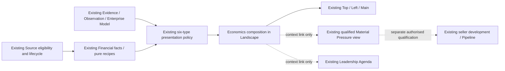

# Architecture / UX assessment and smallest next implementation

Design baseline: `03719d7573f087c65d9622719273aa4b89caf7d3`. This is an assessment and proposed presentation contract, not accepted runtime architecture or a new canonical Economics object.

## What Landscape already supports

| Existing capability / owner | Actual support | Reuse / bounded gap |
|---|---|---|
| `visual_streams.Context`, `resolve`, `url`, `stream_url` | Existing scope, perspective, selected subject, detail, agenda and Facts/Insight reading selection; finite routes and browser links | Keep the existing grammar. No new global Economics toggle, route family, country selector or authority-bearing URL |
| `visual_panels._top/_left/_frame/render` | Accepted VP-2 Top/Left/Main; original scene navigation; portrait collapse; role/resource-aware composition | Reuse shell and unmodified illustrations. A design option is not a new runtime mode |
| `lloyds_recovery.LANDSCAPE_COMPONENTS / landscape` | Funding, Lending & income, Profit & costs; conceptual bank mechanism, currently eligible dated context and related inspection/Inside links | **Incorporate this**, replacing its presentation with the accepted A visual rather than appending another Economics dashboard. Preserve old URLs and qualified subjects |
| `candidate_analytics.public_factual_projection/public_factual_html` (#699) | Finite read-only Source-owned mixed-unit Lloyds slice; every read rechecks source/rights/integrity. Shipping Source has unresolved §2 and null restriction assessment, so output is empty | Keep inactive. A new design cannot self-clear it or use its hidden values in calculated/Insight/ARIA outputs |
| `candidate_analytics.Measurement`, `FinancialPeriod`, `SourceReference`, `Derivation`, `calculate`, `Reconciliation`, `reconcile` | Typed issuer/perimeter/basis/state/unit/precision; instant vs duration; immutable revisions; annual percent-change; signed bridges; existing private run service | Reuse pure calculations and current authorised projections. No new store/engine, implicit annualisation, guessed allocations or formula evaluator |
| `financial_intelligence.analyst` | Existing scoped Financial Analyst, compatible charts, exact values, methods and private run authority. Current duration-chart grouping includes the exact period; two different annual durations do not pass the same-family check | Reuse its formatting/renderer owner. Paired annual bars need a narrow validated-comparison display extension, or remain separate displays. Do not weaken ordinary same-period checks, duplicate formulas or scan/create runs |
| `intelligence_presentation.Statement/NumericFactValue/eligible` | Six semantic types and separate source quality/authority/temporal semantics | Facts/Insight are reading modes over these types, not two canonical classes. Calculated inputs retain assumptions/estimates; targets remain targets |
| `easyjet_capabilities.fact`, `experience_composition.easyjet_root`, existing Aviation assessment | Verified, finite fleet/network disclosures and conceptual operational economics; AV-REVENUE/AV-PROFIT research exists, but current easyJet renderer does not project these financial measures | Primary evidence is adequate for this design. A later public financial slice needs existing Source-owner eligibility resolution plus a bounded Financial adapter; a document in Git is not a runtime source grant |
| `leadership_agenda.agenda/KEYS` | Bounded read-only agendas over existing source owners; no automatic durable issue creation | Related links consume actual eligible entries; do not clone ranking, create a second agenda or turn generic roles into named buyers |
| Existing Material Pressure and commercial/Pipeline owners | Separate qualification, employer/resource authority and human-controlled consequential actions | Economics supplies read-only context. A financial change is neither an automatically qualified pressure nor customer-confirmed need/opportunity |

The existing `detail=economics` subject/deep links and `detail=lending-income` composition are not interchangeable in every dispatcher branch. A later implementation must map the existing economics hotspot and retain historic Inside/Financial routes deliberately; do not silently reinterpret old private `analysis` URLs as public economic projections. No runtime route or mapping is changed here.

## Authority reconciliation

Accepted ADRs 001/002 preserve Observation and Enterprise Model ownership; 005 preserves inspectable lineage; 011 permits useful source-backed financial candidates without canonical promotion; 012 protects acceptance/import; 013 makes the Canvas a view and supports contextual lenses/progressive inspection; 014/024 govern bounded interpretation; **026** alone controls Material Pressure qualification. The Architecture Authority Registry explicitly records 014/024 as Accepted despite stale Draft fields in their document headers; their own Status sections also say Accepted. This metadata drift is documented, not repaired or used to expand authority.

ADR-023 and ADR-025 remain Proposed; ADR-027 remains Proposed. They are not acceptance authority for this design. The merged [FLORA Experience Contract](../../product/flora-experience/FLORA-Experience-Contract-v1.0.md) is owner-agreed product direction with explicit authority caveats: Landscape owns financial/business-model subjects; Inside owns operating capabilities; Facts-first and optional Insight are independent of perspective. It does not change the accepted canonical types or source lawfulness.

ADR-013/011's uncertainty requirements are preserved in source/method inspection and existing Owner/Research records, with material caveats next to the claim. The latest editorial direction omits unsupported/missing core claims instead of adding empty analytical slots. No records are deleted. The design does not amend an ADR or silently turn a Draft method into accepted architecture.

## Read-only presentation contract (proposed mapping, not a new schema owner)

- **Identity:** preserve existing research/canonical/resource distinctions; `AV-ENT-001` does not become a production ACL or new canonical easyJet legal identity. Group, company, division and capability never share inferred financial allocations.
- **Inputs:** existing current eligible Source/presentation objects; source/record revisions, issuer, perimeter, actual/target, period boundaries, basis, currency, scale, precision, semantic class, reasoning/dependencies and caveats. This list maps existing contracts; it is not an `EconomicsRegistry` proposal.
- **Calculations:** use existing Financial-owner recipes only. FY2024/FY2025 revenue growth uses adjacent full September years and the same presented source version. Do not misuse percent-change to compute a margin. No PBT−revenue cost residual, cross-perimeter NIM or cash inference.
- **Chart compatibility:** the existing pure recipe supports that annual comparison; `analyst.chart` currently does not combine different duration years in one family. The proposed zero-based paired annual display is a view extension over a Financial-owner-validated comparison, not evidence of current renderer support. It must retain the original issuer/basis/state/unit/period guards. Private `analyst.PATHS` and run-authorisation boundaries remain unchanged for a public easyJet slice.
- **Output:** a transient diagram/series, selected subject explanation, qualified contextual links and optional source/basis inspection. Links have no causal, permission or promotion semantics.
- **Privacy:** public facts never discover or depend on private Financial runs. An existing private-analysis link can appear only through the current verified `analyst.navigation`/run authority; no new run persistence or lookup service.
- **Withdrawal:** the Source owner suppresses dependent metrics, chart points, counts, accessible text, current print/export and Insight on every controlled read. Reuse existing controls; no copied payload cache. Previously delivered remote artifacts cannot be recalled.
- **Navigation:** preserve country, enterprise, period and compatible selected subject across Facts/Insight. A view change with an incompatible capability requires an explicit reset; never attach Group metrics to an implied capability return. Use current history/deep-link mechanisms, not a second router.

## Smallest subsequent implementation — A1, separately commissioned

1. Keep shell, assets, global tools, modes, routes, security and all data owners unchanged. Extend the existing Landscape economic component with the approved A figure and a small selected-stage explanation.
2. Reuse Funding/Lending & income/Profit & costs subjects and existing links. Resolve the old economics hotspot/deep-link aliases without losing the original Financial Analyst. One composition, not another independent financial screen.
3. Project only already eligible Source-owned facts through existing presentation/Financial contracts. For easyJet, check the exact public/minimal factual-use category and actual exceptions through the existing Source owner, then add a bounded financial adapter over the original source and typed measurements. The existing `public_factual_record` accessor is intentionally a fixed Lloyds/banking case; it is not an arbitrary-issuer reader. Reuse the generic method/integrity helpers and existing Aviation snapshot boundary for any separately authorised easyJet case, preserving the special Lloyds holds. Do not relabel a bank record, introduce a public source picker, new publisher admission, canonical acceptance or a per-measure workflow. **If eligibility is unavailable, omit the financial slice and report that bounded limitation.** Do not substitute invented figures.
4. Use existing `difference/percent_change` for the annual revenue comparison, and existing compatible chart/formatting helpers. For the proposed paired annual bars, extend the existing renderer only for the validated adjacent-year comparison; otherwise show separate existing-compatible figures and the calculated growth label. No new ratio or allocation recipe. Keep headline pretax profit separately scoped; no inferred operating-cost bridge.
5. Preserve #699's Lloyds inactive Source exactly until the Source/legal owner separately resolves §2 with documented authority. §5 PDF links stay deferred; new design does not activate them. Existing permitted Lloyds context may remain, but must pass its current Source checks.
6. Add contextual links to existing eligible Forces/Leadership views. No automatic Material Pressure, opportunity, recommendation or Pipeline action. Capability economic annotations remain explicitly conceptual until existing owners have genuine measured relationships.
7. Test all three tablet/desktop layouts, keyboard/history, mode/subject retention, source withdrawal (visible/ARIA/print/current export), wrong issuer/period/basis, Source changes, role/resource isolation, private-run non-discovery and all 388 strict security tests. Run exact-head local/hosted regression without changing inherited signatures/skips.
8. Stop at a draft implementation PR with actual screenshots, Source-use disposition and rollback. No merge/deployment under this design acceptance.

**Out of A1:** new global navigation; B/C overlays; enterprise builder/scenarios; capability allocations; forecasts/valuation; new source hosts/permissions; generic ratio engine; automatic research; canonical imports; News; qualification/Pipeline changes.

## Unavailable information and decisions kept open

No Lloyds restricted figures or allocations, no matched funding-cost/asset-yield sensitivity, no easyJet capability/route profitability, no complete airline cost/cash bridge, no named buying authority or commercial demand. The FY2025 financials are historical; the retained source lacks a verified publication day. None is filled by inference. Design source verification does not prove eligibility for every production/commercial use. Source exceptions and actual applicability remain with existing owners.

Owner decisions: select the visual option; accept the economics hotspot/legacy-route treatment; decide whether A1 includes only the currently eligible slice or a separately checked easyJet adapter. Source/legal §2 and §5 decisions are independent of visual acceptance. No additional governance system is proposed.
