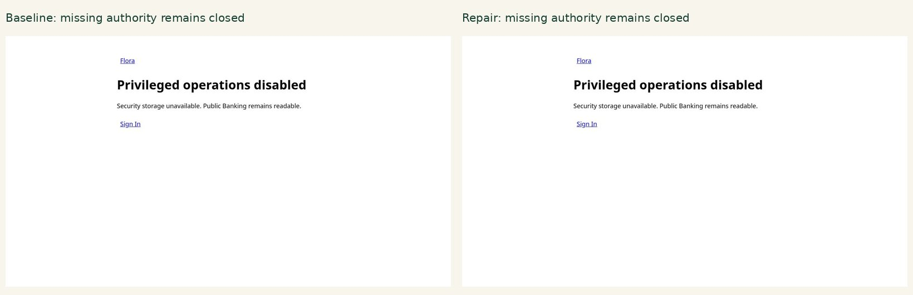

# Actual isolated HTTP and browser proof

These are actual loopback application renders from baseline `836a4c29015c59117b873e6324c9618f7eb41930` and the implementation worktree. Final exact-head CI reproduces them. All accounts/workspaces are synthetic, using the existing offline provisioning and real password/session/ACL services. Financial figures are genuine retained permitted research. This is **not** a Render login or production recovery.

## Unavailable authority stays closed

The same existing disposable authority file was preserved off-path during this fault and returned afterward. No replacement database/account was created. Both baseline and repaired code correctly show503 for the missing authority. The diagnostic now provides privileged-only finite distinctions; no storage details are added to Guest.

[HTTP proof](HTTP-Proof.json): missing schema row caused a baseline transport failure; repaired code returns a controlled503. It does not add the missing row or reset data.

## Existing valid authority — responsive owner journey

The preserved valid fixture allows real sign-in, workspace selection and authorised Nationwide earnings. Owner preparation, Guest/tenant/ACL/revocation/CSRF/origin/logout checks also passed. See [browser check results](Browser-Checks.json). Passwords/config/database files are never retained.

| View | Desktop1440 | Desktop1280 | iPad landscape | iPad portrait | Mobile390 | Mobile320 |
|---|---|---|---|---|---|---|
| Individual sign-in | [desktop](previews/after-sign-in-desktop.jpg) | [laptop](previews/after-sign-in-laptop.jpg) | [ipad-landscape](previews/after-sign-in-ipad-landscape.jpg) | [ipad-portrait](previews/after-sign-in-ipad-portrait.jpg) | [mobile](previews/after-sign-in-mobile.jpg) | [mobile-320](previews/after-sign-in-mobile-320.jpg) |
| Authorised Nationwide | [desktop](previews/after-authorised-nationwide-desktop.jpg) | [laptop](previews/after-authorised-nationwide-laptop.jpg) | [ipad-landscape](previews/after-authorised-nationwide-ipad-landscape.jpg) | [ipad-portrait](previews/after-authorised-nationwide-ipad-portrait.jpg) | [mobile](previews/after-authorised-nationwide-mobile.jpg) | [mobile-320](previews/after-authorised-nationwide-mobile-320.jpg) |

[Owner before Financial preparation](previews/after-authorised-before-prepare.jpg). No GET creates a Financial run. The protected POST reproduces the original stored analytical data.

No public artwork, layout or content was redesigned. No production or canonical data was changed. Chromium viewport/touch emulation is not a physical Safari or assistive-technology certification.
