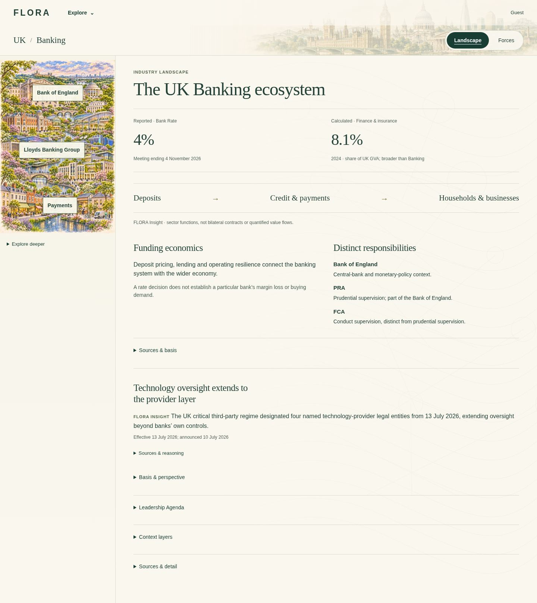
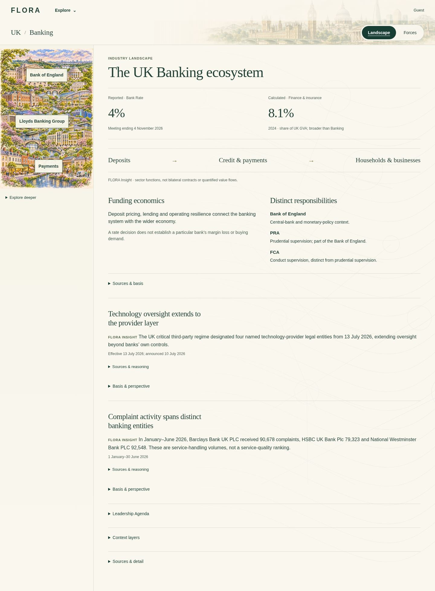
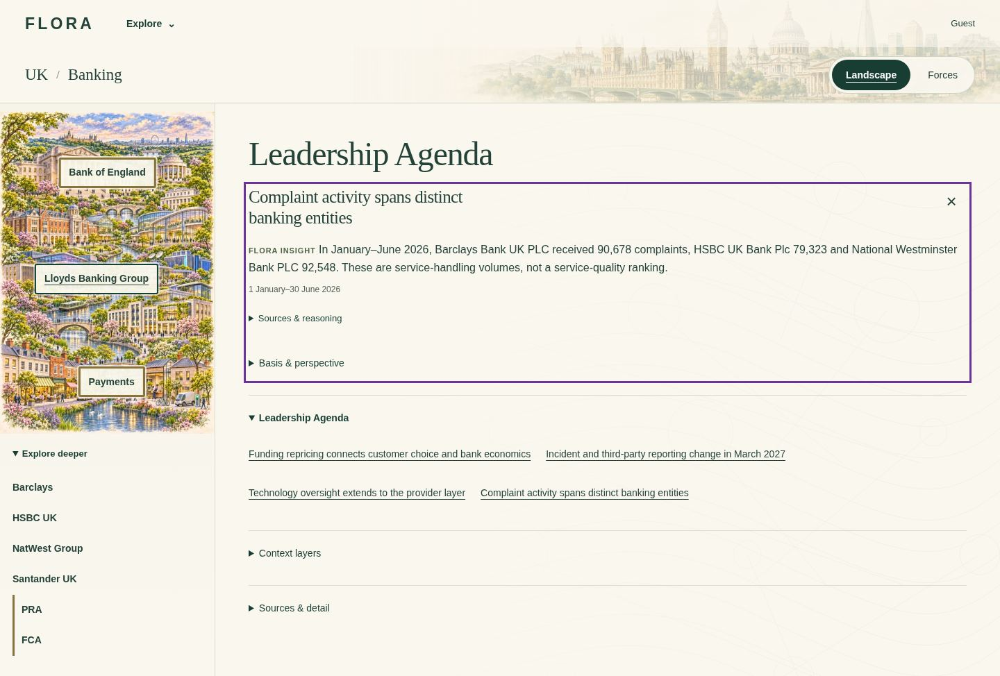

# Owner walkthrough and visual comparison

Use the isolated local fixture or the hosted browser artifact attached to the exact PR head. The live production service is not modified or independently verified by this work. Original URLs remain `/`, `/industries/banking`, `/enterprises/lloyds`; this draft creates no public research routes.

1. Start at UK Landscape. Select Banking, then Lloyds directly. Switch every original stream; confirm subject, selection, layer and browser history persist.
2. At `/industries/banking`, inspect the existing Top / Left / Main layout and original industry scene. The bounded complaint-activity concern appears below the existing provider intelligence in Main, without a new dashboard, chart, bank route or navigation system.
3. Open Leadership Agenda → **Complaint activity spans distinct banking entities**, or deep link `/industries/banking?agenda=service-landscape`. Confirm three reported legal-bank counts, the same period, and the visible statement that these are not a service-quality ranking.
4. Open **Basis & perspective** with keyboard Enter or touch. Each Reported fact has optional original FCA source/date/meaning; OGL attribution remains. No complaint-cost, harm-rate, backlog or buying-demand metric appears.
5. Switch Landscape/Forces with the agenda selected, then Back/Forward. Context and selection persist. UK/Lloyds retain three concerns; Banking has four unique concerns. No duplicate original EAI-2 entry appears.
6. At iPad portrait/mobile, expand the Left scene; confirm meaningful controls remain accessible and Main stays readable. Sources remain optional. No research gaps, owner decision forms, technical graph IDs or proposed actions enter core views.

## Actual-application previews

Before is validated main `b5b05f8`; after is the BIE-2 application tree. The comparison uses the same Banking scope and viewport. The new agenda did not exist before; its Main overview is therefore the corresponding baseline, rather than pretending an unavailable page existed.

| Viewport | Before Banking Main | After Banking Main | New optional agenda |
|---|---|---|---|
| Desktop1440×900 | [Before](previews/before-desktop-banking.jpg) | [After](previews/after-desktop-banking.jpg) | [Agenda](previews/after-desktop-peer-agenda.jpg) |
| iPad landscape1194×834 | [Before](previews/before-ipad-landscape-banking.jpg) | [After](previews/after-ipad-landscape-banking.jpg) | [Agenda](previews/after-ipad-landscape-peer-agenda.jpg) |
| iPad portrait834×1194 | [Before](previews/before-ipad-portrait-banking.jpg) | [After](previews/after-ipad-portrait-banking.jpg) | [Agenda](previews/after-ipad-portrait-peer-agenda.jpg) |
| Mobile390×844 | [Before](previews/before-mobile-banking.jpg) | [After](previews/after-mobile-banking.jpg) | [Agenda](previews/after-mobile-peer-agenda.jpg) |

[Browser evidence](previews/Browser-Checks.json) records334 pre-freeze checks over seven streams, the complete two-selection journey, four viewport sizes, keyboard/touch, native history/deep links, optional sources,320px,200% zoom and forced colours. Final-head reruns and the original VP-2/EAI-2 browser scenarios are reported in the PR validation comment. [ARIA snapshot](previews/Peer-Agenda-Accessibility.yml) supports inspection; it is not assistive-technology certification.

## Acceptance checklist

- [ ] Accept the bounded three-bank FCA numerical presentation and its non-ranking interpretation; no implied Evidence approval.
- [ ] Confirm accepted artwork/navigation and all original EAI-2 additions remain intact on the final-head previews.
- [ ] Review the six differentiated dossiers with original scope, currency, accounting period and counter-evidence; acknowledge remaining depth limits.
- [ ] Review source-reported relationship candidates and unresolved legal contracting endpoints; no contract values or supplier opportunities inferred.
- [ ] Review the News ledger as research-only, including publication/event separation,31 literal current dates,90-day boundaries, pending dates and deduplicated events.
- [ ] Retain identity-only actors, source/rights blockers and research deficiencies as owner review tasks, not accepted research completeness.
- [ ] Confirm eight existing evidence forms remain unexecuted, ADR-027 Proposed and SEC/ONS restrictions unchanged.
- [ ] Inspect final exact-head local/hosted security/regression/semantic/browser evidence and independent critique.
- [ ] Decide any subsequent integration/release separately. This draft grants no merge, canonical import, production write or deployment.
