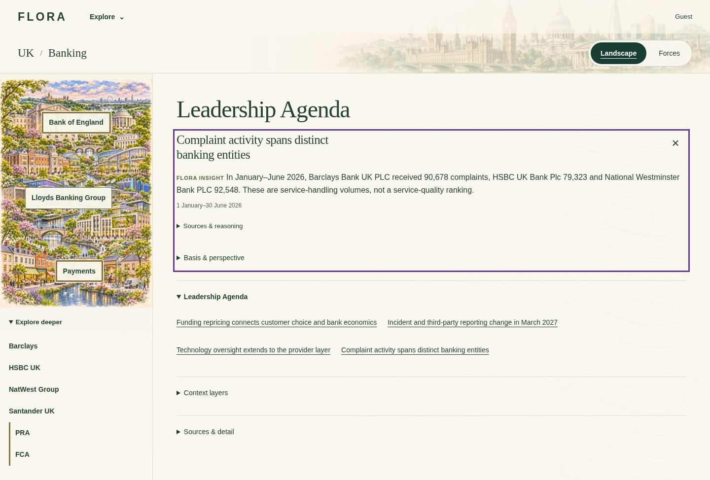
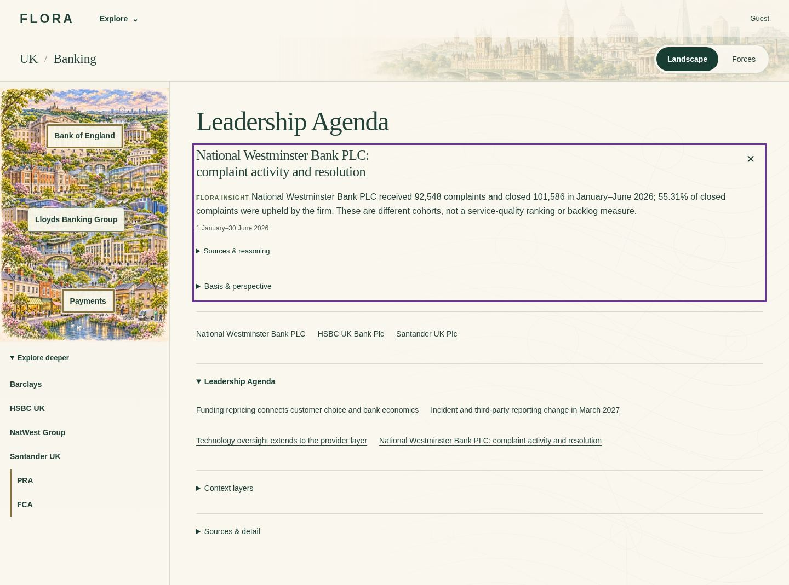
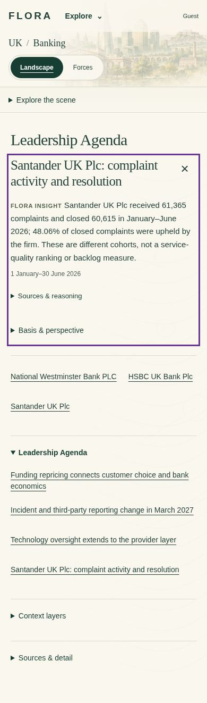

# Owner walkthrough and acceptance checklist

Review the exact PR head and its completed CI comment. This is a local/hosted test fixture, not a deployment or a claim that issuer research is accepted canonical memory.

1. Start at UK Landscape, select Banking, then Lloyds directly. Check all seven original streams, artwork and existing product tools.
2. Return to `/industries/banking`. The original four concerns and BIE-2 three-bank received-count view remain. The three contextual legal-bank links open the same service concern.
3. Open `/industries/banking?agenda=service-landscape&selected=natwest`. Check National Westminster Bank PLC, January–June2026, received92,548 /closed101,586 /firm-upheld55.31%. These are different cohorts, not backlog clearance or a service-quality ranking.
4. Select HSBC UK Bank Plc, then Santander UK Plc with one action. Their figures/identity change together. Santander data do not include TSB as a consolidated complaint group.
5. Open **Basis & perspective** with keyboard Enter or touch. Check three **Reported** facts, their original FCA link and period, and OGL attribution. Optional source access remains understandable; owner review fields and issuer financials are absent.
6. Switch Landscape/Forces with bank/agenda/layer selected; use Back/Forward and close the agenda. Subject and appropriate context persist. The overview shows the same selected service view rather than a different bank's facts.
7. At both iPad orientations and mobile, check Main readability, collapsible Left, touch targets, selected subject and source control. The portrait remains the original conceptual Banking scene, not a fabricated complete Twin of another bank.
8. Review the separate source/model decision pack:24 issuer assertions, three financial reconciliations, commercial counter-evidence and the independent source/rights/identity/acceptance states. No real canonical ID or acceptance receipt has been invented.

## Comparable actual-application images

Before is exact validated main `c295e05`; after is this application tree. The **same URL/scope/selected-bank/layer** is captured on each side. Before, the bank selection still showed the cross-firm BIE-2 concern; after, it composes the applicable legal-bank service outcome. No nonexistent baseline page is invented.

| Device | NatWest before / after | HSBC UK before / after | Santander before / after |
|---|---|---|---|
| Desktop1440×900 | [Before](previews/before-desktop-natwest.jpg) / [After](previews/after-desktop-natwest.jpg) | [Before](previews/before-desktop-hsbc-uk.jpg) / [After](previews/after-desktop-hsbc-uk.jpg) | [Before](previews/before-desktop-santander-uk.jpg) / [After](previews/after-desktop-santander-uk.jpg) |
| iPad landscape1194×834 | [Before](previews/before-ipad-landscape-natwest.jpg) / [After](previews/after-ipad-landscape-natwest.jpg) | [Before](previews/before-ipad-landscape-hsbc-uk.jpg) / [After](previews/after-ipad-landscape-hsbc-uk.jpg) | [Before](previews/before-ipad-landscape-santander-uk.jpg) / [After](previews/after-ipad-landscape-santander-uk.jpg) |
| iPad portrait834×1194 | [Before](previews/before-ipad-portrait-natwest.jpg) / [After](previews/after-ipad-portrait-natwest.jpg) | [Before](previews/before-ipad-portrait-hsbc-uk.jpg) / [After](previews/after-ipad-portrait-hsbc-uk.jpg) | [Before](previews/before-ipad-portrait-santander-uk.jpg) / [After](previews/after-ipad-portrait-santander-uk.jpg) |
| Mobile390×844 | [Before](previews/before-mobile-natwest.jpg) / [After](previews/after-mobile-natwest.jpg) | [Before](previews/before-mobile-hsbc-uk.jpg) / [After](previews/after-mobile-hsbc-uk.jpg) | [Before](previews/before-mobile-santander-uk.jpg) / [After](previews/after-mobile-santander-uk.jpg) |

[Original overview before](previews/before-desktop-banking.jpg) / [after](previews/after-desktop-banking.jpg). [Browser evidence](previews/Browser-Checks.json) records777 pre-freeze BIE-3 checks. Final-head reruns and original BIE-2/EAI-2/VP-2 browser results appear in the PR validation comment. ARIA snapshots are retained for each selected bank; they are not assistive-technology certification.

## Owner acceptance checklist

- [ ] Accept/defer the narrow legal-bank FCA presentation as a product decision, independently of canonical Evidence approval.
- [ ] Check received/closed/firm-upheld definitions, period, legal scope and visible non-ranking/backlog caveat.
- [ ] Confirm selected bank/lens/layer/history, keyboard/touch and UK→Banking→Lloyds remain coherent across device sizes.
- [ ] Review the24 individual financial/event proposals and their source locations, current contract limitations and unselected decisions.
- [ ] Review NatWest deposit definition and CAL basis corrections without overwriting the frozen BIE-2 pack.
- [ ] Confirm USD legal-bank versus Group scope and Santander post-acquisition periods/conditional phases.
- [ ] Decide the three exact source/use papers separately; do not accept ADR-027 or all issuer facts by implication.
- [ ] Reconcile real canonical/workspace identities and acceptance receipts only through authorised owner services.
- [ ] Retain Nationwide/Starling/ClearBank and all prior relationships/News as candidate work, not automatically approved coverage.
- [ ] Inspect independent critique and exact-head full local/hosted security, semantic, compatibility and browser evidence.
- [ ] Approve any subsequent integration/import/release separately. This draft grants no merge, production change or Render deployment.
