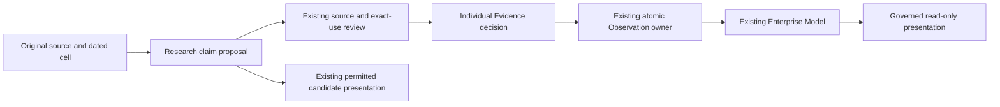

# Existing-owner traceability and bounded integration

## Baseline and authority

Branch `codex/flora-bie3-637` starts directly from verified main `c295e056cbae0f1adebc1070eb272d79b650a45f`, BIE-2 #636 merge. [Full post-merge push CI43755306107](https://github.com/rdidale-jpg/CIOS/actions/runs/43755306107) succeeded before branching. The merge retains reviewed BIE-2 head `f5e3e54ce944aede72feccfaa2a499655a83784e`; no historical draft branch is merged, retargeted, closed or deleted.

CIOS-AI, the Reference Architecture, Design Doctrine, Chief Architect Handbook and accepted ADR-002/005/009/010/012/014/015/016/024/026 govern. EIF-001 remains Review, EI-001/EI-012 retain their repository statuses, and ADR-027 remains Proposed; this sprint does not accept those documents wholesale. Accepted ADR boundaries and existing runtime contracts own the implemented path.

Authorised public `/deployment` and `/health` checks were unavailable with URLError. Production identity remains **UNVERIFIED**. The owner deployment plan, GitHub main, local fixture and hosted CI are not live-source proof. No authenticated production owner service or canonical receipt reconciliation was available; no private probing, fixture credentials or guessed target IDs substitute for one.

## Per-claim path and current blockers

The diagram describes owners and gates, not execution. The issuer branch stops at unaccepted proposals. The FCA branch uses the already established permitted public-candidate path and does not manufacture Evidence/Observation/Model acceptance. [Acceptance inventory](Acceptance-Inventory.json) distinguishes24 issuer research candidates, seven new permitted public assertions and two reused public received-count identities. All real canonical target/Evidence/Observation/model IDs remain null; existing production acceptance is **unverified**, not declared absent.

| Existing owner/interface | BIE-3 use and boundary |
|---|---|
| `research_intelligence.source_import.official_url` | Recheck actual positive publisher policy; no allowlist/path/permission change |
| `SourceSegment` / candidate research ownership | Located original facts plus actual retained-note digests; original-byte hash null; local proposal IDs are not accepted Evidence IDs |
| `memory.source_contracts.contract_for` | Read actual source-type capabilities. Original investor results support financial types; event/organisation claims do not gain foundation eligibility from them |
| `memory.service.FactualClaim / validate_factual_claim` | Probe existing field/domain/state compatibility with blank real Enterprise/Evidence IDs; the owning validator refuses unbound proposals |
| Financial `NumericFactValue` / table-adapter contracts | Existing typed USD/GBP/percent representation and route-specific provenance requirements; no fabricated extraction, bbox or archive metadata |
| `researcher_profile_adapter.adapt_researcher_payload` | Pure shared-profile mapping preview. Producer `id` deliberately omitted so a research alias is not automatically interpreted as canonical Enterprise identity |
| `CandidateReviewService`, mapping/reconciliation, import plan/promotion | Future authorised owner actions only; none called or staged |
| `memory.Observation / EnterpriseModelAttribute` | Existing durable memory owners; no Observation instantiated or model field written by review tooling |
| Existing relationship/graph owners | Retain source-backed candidate edges and proposed endpoint roles; no GraphNode/GraphEdge creation, new graph owner or supplier registry |
| `leadership_agenda._eai_release/_claims/_issue` | Fixed FCA release, disposable existing Banking assessment, same semantic and fail-closed path |
| `visual_panels` / `visual_streams.Context` | Select an existing bank alias within Banking and compose the same concern; no new route, Twin, scene, canonical ID or intelligence store |

The review JSON is not loaded by the public application. `tools/research/bie3_quality.py` is an offline compatibility/QA report over existing contracts, not an admission/qualification engine. It neither makes source-use decisions nor constructs accepted memory. Tests make canonical review/mapping/writes and Observation construction fail if called during these probes.

## Actual runtime change

One fixed Banking candidate release adds **seven** FCA cells: HSBC closed/upheld, NatWest closed/upheld and Santander received/closed/upheld. Existing BIE-2 HSBC/NatWest received IDs are reused, not cloned. Both fixed source packages resolve through the existing owner on temporary assessment copies.

`agenda(scope, data, selected=...)` retains all existing concern keys. When selected is NatWest, HSBC UK or Santander UK and its dependencies are eligible, only the existing `service-landscape` concern is composed for that legal bank. Otherwise the original BIE-2 cross-firm received-count concern remains. UK and Lloyds remain3 concerns each; Banking remains4. There is no second agenda or qualification engine.

Three small contextual bank links use existing Banking URLs and selected-bank aliases, clear a competing detail, retain lens/layer and open the same agenda concern. Main and detail consume the same resolved Issue and Statement facts. Received/closed cohorts, firm-upheld versus independent adjudication, Group/legal-bank boundaries and the non-ranking/backlog limitation remain explicit. No unsupported financials, source-rights administration, missing-data panel, research question or seller action enters the payload.

The original permitted concern remains a dependency parent: denial of its source removes every dependent bank profile/selector. Denial of only the new outcomes release removes selected outcomes/links while the prior three-bank received view survives. Wrong subject/period/unit, private/stale/revoked/retracted/contradictory inputs, missing content or changed pins are fail-closed. Review expiry remains15 December2026; it is not extended to keep content alive. Licence permission and editorial review expiry are independent states.

All171 prior research bytes remain pinned. Exactly two literal new artifacts extend the history inventory to173; `compare_history` is unchanged. The complete frozen BIE-2 pack is separately pinned in [Preserved-BIE2-Pack.json](Preserved-BIE2-Pack.json); corrections are append-only dispositions. [Protected owner hashes](Preserved-Owners.json) retain source policy, evidence/Model/permission/Offers/Pipeline boundaries.

## Visual and workflow preservation

Top/Left/Main, panels CSS, original seven illustrations/21variants, seven portraits/23 approved delivery assets, scene geometry,51 labels/32 active scene addresses, UK→Banking→Lloyds, existing peer exits and all seven streams remain. The new bank links are Main-context selectors, not additional image districts or canonical enterprise destinations. There is no portrait substitution suggesting a full researched Twin for these banks.

Existing Offers, seller development, employer approval, shared matcher, Material Pressure and Pipeline services are unchanged. Source/import acceptance, source revocation, workspace/IAM and real canonical identity remain with their owners. News #614, Owner #603, wider actor expansion and source-permission architecture implementation stay separate.

## Bounded subsequent integration plan — not executed

1. Owner reviews exact original document/use/right/attribution/link proposals in [Owner-Decisions](Owner-Decisions.md). Decide any needed source-admission architecture separately; do not use ADR-027 as an issuer-wide exception.
2. Through actual authorised owner services, resolve reporting/legal entity, workspace, existing source/assertion fingerprints and canonical receipt targets. Preserve Group/subsidiary and source identities; fail closed on ambiguous matches or cross-tenant ownership.
3. Obtain required original/extraction metadata through existing acquisition owners, without inventing byte hashes or converting a review note to a publisher archive. Preserve differing source-type eligibility and reporting/effective dates.
4. Owner reviews each Evidence assertion individually. Apply existing mapping/plan/approval/promotion controls only under separate explicit authority, then existing atomic Observation and Enterprise Model projection. Interpretation/hypothesis remains derived; no automatic Material Pressure or Pipeline creation.
5. Compose newly authorised read-only financials from those same owners in VP-2, preserving source/semantic/counter-evidence lineage. Re-run exact-head security, source/tenant/revocation, financial and browser checks before any release review.

Rollback of this draft's runtime slice is a reviewed code revert of the implementation and its two literal candidate additions, followed by full exact-head CI. No migration, production data reversal or Pipeline rollback is required now. Preserve candidate research/decision history and the branch. Later canonical imports, if separately authorised, use their existing governed compensation/history path rather than blind deletion.
