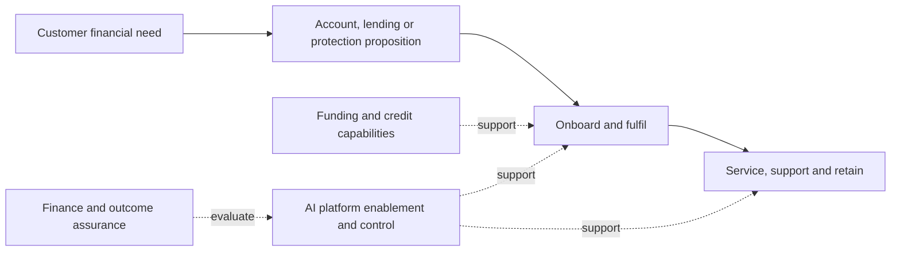

# Lloyds · platform-enabled banking economics

**Assessment, 18 November 2026.** Group-level analysis with a separate Lloyds Bank plc boundary; no accepted canonical Twin or qualified opportunity is claimed. Read [Claims](Claims.json), [financial reconciliation](Financial-Reconciliation.json) and the six Lloyds entries in [Capability Maps](Capability-Maps.json) for atomised lineage and scope.

## Executive judgement

The useful commercial question is no longer whether Lloyds needs an AI platform. It reports an existing platform, collaboration and controls. The unresolved economic question is whether adoption produces incremental benefits after operating cost, control effort, quality effects and other concurrent changes. That question sits inside a banking model where funding, credit risk, capital, customer service and non-interest businesses also shape value. A successful AI demonstration alone cannot explain Group returns.

This is a **hypothesis about what to examine**, not proof of deficient controls, missed benefits, customer demand or an external work package. Existing internal teams, platforms and supplier arrangements are material counter-evidence to a generic greenfield proposal. [BE-LBG-ENVOY; BE-LBG-AI-VALUE; BE-LBG-AI-THESIS]

## Identity, ownership and organisation

The public register distinguishes **Lloyds Banking Group plc, SC095000**, a Scottish public holding company, from **Lloyds Bank plc, 00002065**, a regulated-bank entity. Its active PSC entry names Group and reports at least 75% share/voting control plus director appointment rights. This is a positive, correctly typed relationship between two actual legal entities. It does not quantify an exact 100% holding or establish which entity signs a technology agreement. Companies House warns that it does not check the accuracy of filed information. [BE-LBG-IDENTITY; BE-LBG-CONTROL]

Current published management roles distinguish Consumer, Business & Commercial Banking, Corporate & Institutional Banking, Wealth & Insurance, and Connected Finance. These roles must not be silently mapped onto the earlier Retail / Commercial Banking / Insurance, Pensions & Investments reporting segments or legal subsidiaries. Charlie Nunn, William Chalmers, Ron van Kemenade and Javier Rodríguez de Colmenares provide published CEO/CFO/COO/CRO context; individual capability ownership, approval thresholds and Envoy RACI remain unverified. [BE-LBG-ROLES; BE-LBG-CURRENT-BUSINESS]

The existing public research reference `Assessment-Overlay.json::BK-ENT-001` is retained. No returned empty EnterpriseModel or generated slug is treated as proof of canonical import. Lloyds Bank's BIE-2 `actor:lloyds` is not reassigned to Group. [Identity-Crosswalk](Identity-Crosswalk.json)

## Economics: separate operating contribution from accounting bridges

The fresh issuer HTML table supports this **FY2025, consolidated Group, GBP millions** reconciliation:

| Bridge | Calculation | Meaning |
| --- | --- | --- |
| Net income | 13,635 + 6,120 − 1,454 = **18,301** | Net interest income plus other income, less operating lease depreciation. |
| Underlying profit | 18,301 − 9,761 − 968 − 795 = **6,777** | Operating costs, separately shown remediation, and impairment all matter. |
| Statutory PBT | 6,777 − 46 − 70 = **6,661** | Restructuring and volatility/other adjustments are not ignored. |

The tool's HTML table flattens repeated column labels; the first numerical value is FY2025, consistent with the surrounding annual summary. This is a fresh factual transcription and arithmetic QA, **not** import of previously blocked SEC-based RIE reconciliation or independent auditor assurance. [BE-S-LBG-FY25]

The newer retained observation reports **£6.6bn statutory PBT for nine months to 30 September 2026** and **£502.8bn customer deposits at that date**. A profit flow and a deposit stock do not form a ratio without a justified denominator/period. Neither is an available transformation budget. Calendar FY2025, nine-month 2026 and Nationwide's March fiscal year remain distinct. [BE-LBG-PBT9M; BE-LBG-DEPOSITS]

**Mechanism interpretation:** accounts and savings create a funding/customer relationship; lending deploys balance-sheet capacity subject to credit and capital constraints; servicing and distribution consume resources; wealth/insurance businesses use different fee, assets and risk mechanisms. Structural hedging, pricing and customer behaviour can affect NII, but deposit growth alone proves neither organic inflow nor stronger primacy. Public profit cannot reveal internal allocation between buffers, distributions, growth and change.

## Value streams and capabilities

The illustrative bank journeys are **financial need → account/funding or credit proposition → onboarding/decision → fulfilment → servicing/support**, alongside wealth/insurance journeys. A capability is a durable ability supporting several stages; AI enablement is not itself the customer's value stream.

All dotted placements are conceptual, not an organisational chart, systems topology or demonstrated causal chain. Six mapped capabilities cover funding relationships, lending, AI control, finance/capital, customer outcome assurance and wealth propositions. Their people/process/information/technology fields retain specific evidence gaps rather than assigning invented suppliers. [Capability-Maps]

### Deep selection: AI platform enablement and control

**Business purpose:** safely support customer and colleague use cases across existing journeys. **Economic mechanism:** incremental adoption and quality may change effort, loss or service outcomes, while inference, integration, assurance and support consume resources. Gross reported value, net incremental benefit, productivity and cash release are different quantities.

**Reported response:** the Group describes Envoy with Google Cloud and built-in monitoring/control arrangements. Approximately £50m AI value for FY2025 and expected >£100m for 2026 have different actual/expectation statuses. The public evidence does not attribute either figure to Envoy. The HTML announcement date is 1 May 2026; the linked variant's 28 April date remains a version discrepancy, not an invented implementation date. [BE-LBG-ENVOY; BE-LBG-AI-VALUE]

**Conceptual operating loop:** choose a bounded use case → define permissions and evaluation → release/monitor → assess outcomes and controls → revise or stop. The necessary information includes use-case identity, evaluation population, baseline, adoption, quality, incidents and recurring cost. Those are an investigation model, not a claim that the bank lacks such records. Published Group COO/CRO/CFO roles provide accountability context; named programme decision rights remain open.

## Ecosystem, strategy and change

`BK-ENT-001 → reported Envoy collaboration → SUP-GOOGLE` terminates at the **Google Cloud brand**. HMT's separately evidenced designation terminates at **Google Cloud EMEA Limited**. Joining these into a Lloyds Bank plc critical-workload contract is rejected. A standard Google entity table also cannot substitute for an executed agreement. [BE-E04; BE-E05; BE-N01]

The 2030 cost:income ambition below 45% is a management target, not achieved efficiency or a spend envelope. AI value and strategy therefore create a decision environment, not an opportunity qualification. Older financial/technology narratives, supplier leads and “Validated” Twin labels remain historical research unless their individual source, date and scope are established. [BE-LBG-STRATEGY]

## Relational SWOT and commercial investigation — Owner/research only

- **Strength:** an existing funding franchise and reported platform/control capability provide resources and incumbent responses. They weaken an assumption of blank-sheet need.
- **Constraint hypothesis:** adoption, measurement and assurance may mediate incremental benefit. No measured residual deficiency is established.
- **Potential influence:** examine still-open use-case evaluation or benefit-definition decisions only if an authorised conversation establishes them. A published strategy does not prove access.
- **Counter-explanation:** apparent cost/benefit movement may reflect pricing, volume, remediation, portfolio or other technology programmes rather than AI.

**Specific questions:** What is the agreed unit of net benefit and baseline? Which outcomes are independently measured versus management estimates? Which legal provider/services support a selected use case, and which approval role owns the decision? What work is already committed internally or to partners? What evidence would close the investigation because the response is already adequate?

**Falsifier:** a complete, accepted benefit/control model with no unresolved delivery or decision scope removes this hypothesis's commercial relevance. No buying authority, urgency, procurement or supplier value is assigned.
