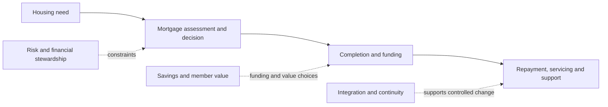

# Nationwide · member value, mortgage economics and integration

**Assessment, 18 November 2026.** The Society, consolidated reporting Group and Virgin Money brand/business histories are distinct. This is a source-grounded research assessment with a deeper Mortgage Lending capability, not a declaration that every operating dependency is known.

## Executive judgement

Nationwide is not a shareholder bank with a different logo. Its analysis must explain how savings/funding, mortgage and other customer services, member value and retained strength interact. Member rewards are part of the economic explanation; a lower statutory profit is not automatically inferior performance. Integration creates a separate question about customer continuity, operating convergence and delivered benefit—not evidence of failure merely because money is being spent. [BE-NBS-MUTUAL; BE-NBS-MEMBER-THESIS; BE-NBS-INTEGRATION]

## Legal, membership and reporting boundaries

Nationwide Building Society is the legal mutual deposit taker. The FY2026 consolidated Group is a reporting perimeter, not another incorporated customer/provider. The issuer states that Virgin Money business legally transferred on **2 April 2026**, after the **31 March 2026** reporting date. The brand and initial customer interfaces continuing after transfer do not prove that the same legal entity or technology architecture persists. Membership eligibility depends on the account and customer circumstances; not every former Virgin Money customer is automatically a member. [BE-NBS-MUTUAL; BE-NBS-TRANSFER]

Dame Debbie Crosbie is the published Chief Executive. No mortgage-platform RACI, integration procurement authority, named external buyer or current finance/transformation role is invented where the selected sources do not establish one. [BE-NBS-CEO]

A material repository discrepancy remains: the legacy Banking Knowledge Manifest uses `BK-ENT-003` for Nationwide/Virgin Money, while current banking navigation uses that number for NatWest Group. Use `Actor-Register.json::actor:nationwide`, `actor:nbs-group` and the RUD working subject with explicit owning paths. Do not resolve or import by the bare number. [Identity-Crosswalk]

## Independently reproducible earnings reconciliation

All values below are **GBP millions; 1 April 2025–31 March 2026; consolidated Group**. The finite RUD/AUTH-2 factual projection is the current reuse basis. BIE-2's earlier use decision for the same PDF remains in history and is not overwritten or treated as independent corroboration.

| Basis | Reconciliation |
| --- | --- |
| Underlying PBT | **6,378 income − 4,021 operating costs − 331 credit impairment = 2,026** |
| Statutory PBT | **2,026 + 1 income adjustment − 138 acquisition expense adjustment − 399 member rewards = 1,490** |

**£127m integration expenditure is already included in underlying operating costs.** Subtracting it again produces a false result. Neither £2,026m nor £1,490m represents cash free for suppliers. The Group's full-year Virgin Money contribution differs from the prior comparator's six months and 361-day financial period; financial-period changes also prevent simple organic-growth arithmetic. [RUD1-NATIONWIDE-FY26; Financial-Reconciliation]

The narrower **Society** FCA complaint data is another legal/operational perimeter. Received and closed cases are different cohorts and firm-upheld decisions are not independently adjudicated harm. Those observations cannot be turned into Group integration failure, customer loss, redress spend or a provider requirement.

## How value is created and retained

**Interpretation:** savings and other funding support mortgage/loan assets; asset yield, saver value, losses, service cost and capital determine the room for growth and member benefit. Competitive savings pricing can be valuable to members while compressing a conventional margin. Rewards and retained capital should be examined together rather than ranked against Lloyds' profit totals.

Cash and capital are distinct: a recognised accounting expense or reward adjustment does not identify its payment timing, prudential capital impact or residual liquidity. The current factual slice does not provide a complete balance-sheet/capital bridge, product profitability model or supplier spend breakdown. Those are genuine remaining research needs rather than blank public UI fields.

## Value streams and capability map

This is a conceptual operating explanation, not a verified internal hierarchy. The six mapped capabilities cover Mortgage Lending, Savings/Membership, Integration/Continuity, Member Value/Stewardship, Payment Service Coordination, and Prudential/Operational Risk. The actual platform/vendor links remain unverified unless separately evidenced. [Capability-Maps]

### Deep selection: Mortgage Lending

**Purpose:** turn a housing-finance need into an appropriate, fundable loan and sustained service relationship. **Economic contribution:** interest and other product economics must be assessed after funding cost, impairment, operating effort and capital; there is no sourced per-mortgage profit or transformation ROI in this tranche.

**Conceptual activities:** assess customer needs and affordability → value/security and credit decision → offer and complete → collect payments, service changes and support customers in difficulty. These activities differ from durable capabilities such as credit decisioning, funding, account servicing and risk assurance, which support several journeys.

**People and process:** mortgage/product/distribution, treasury, risk and service responsibilities are analytical role groupings, not attributed named reporting lines or buying authority. **Information:** affordability, property, loan, repayment and exception categories describe what such decisions require; no private borrower records, decision model or customer validation is accessed. **Technology:** a lending workflow and information control are logically needed, but no named origination platform, cloud supplier or AI exposure follows from that logic.

**Dependencies:** the Society's own funding/risk decisions and shared legal/payment services matter. Published Pay.UK guarantor membership is a governance relationship; it does not prove a particular cloud, middleware or payment contract. A technology dependency must identify actual legal parties and service scope before it is presented as company architecture. [BE-PAY-GOV]

## Integration and change: distinguish completed legal action from future operating benefit

The 2 April transfer is an issuer-reported completed legal event. Continued use of Virgin Money apps/websites/branches describes the immediate service interface; it is not a claim that back-end platforms have, or have not, been migrated. Reported integration expenditure describes a cost, not execution success. A responsible analysis links legal perimeter, service continuity, change milestones, expected benefits and realised outcomes separately. [BE-NBS-TRANSFER; BE-NBS-INTEGRATION]

The already-taken decisions include acquisition/legal transfer. Potentially open decisions include specific service/process convergence and benefit attribution, but their present availability, ownership and external workshare are not established. Old narrative Twin references to vendors and programmes are source leads, not automatically adopted relationships.

## Relational SWOT and commercial investigation — Owner/research only

- **Strength:** member purpose and an established service/funding base support a differentiated value proposition.
- **Constraint hypothesis:** legal integration, brand continuity and financial reporting can move at different speeds. That is a measurement challenge, not proof of an execution problem.
- **Opportunity hypothesis:** a still-open customer-continuity or mortgage-service decision could be investigable if validated. No such decision or supplier demand has been confirmed.
- **Counter-evidence:** existing management capabilities, an approved integration programme or completed convergence could already address the issue. Portfolio/acquisition scope may explain apparent performance differences.

**Specific questions:** Which mortgage or servicing outcomes are measured on a consistent pre/post-transfer perimeter? What benefits are already delivered and net of transition/run cost? Which milestones remain open rather than contractually committed? Who is accountable for customer continuity versus legal completion? What would demonstrate that the current response is sufficient?

**Falsifier:** equivalent customer/service outcomes and fully evidenced benefit delivery with no remaining decision gap close the commercial hypothesis. Evidence of a customer problem, buying programme, authority, budget and seller fit would be separate qualification work; none is manufactured here.
