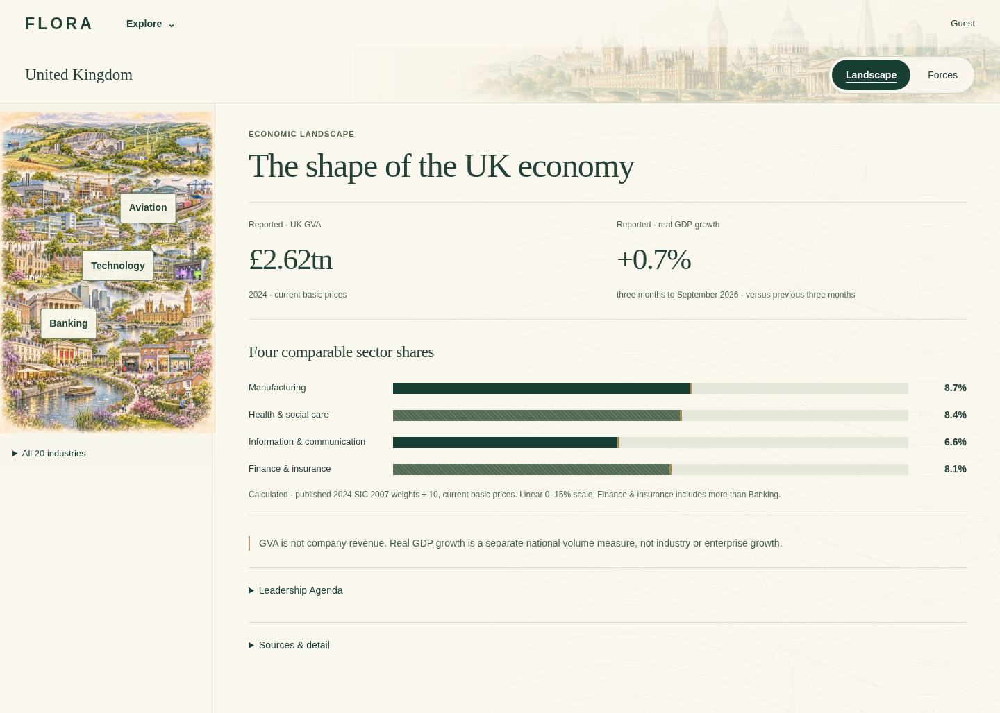
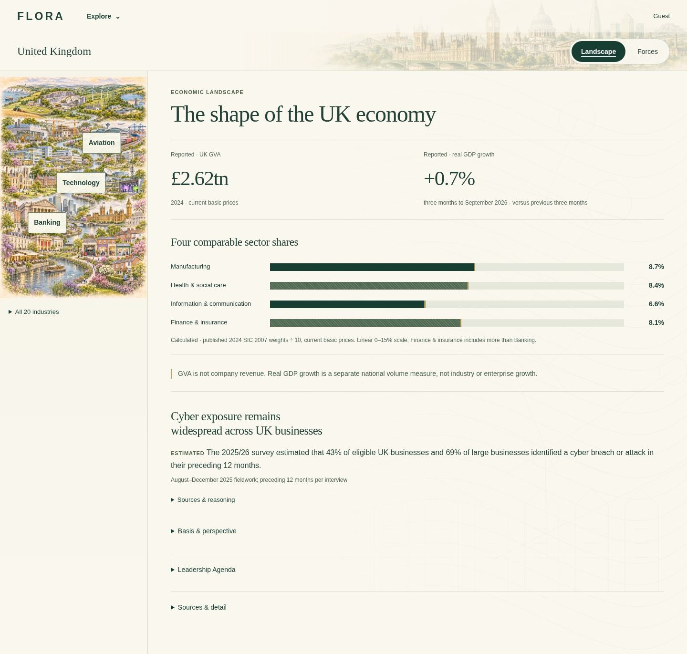
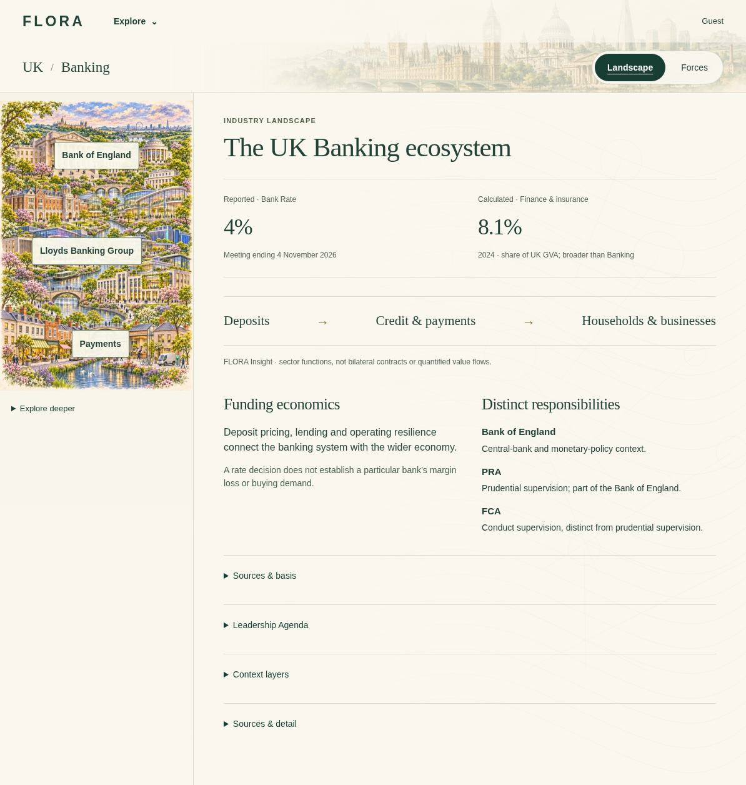
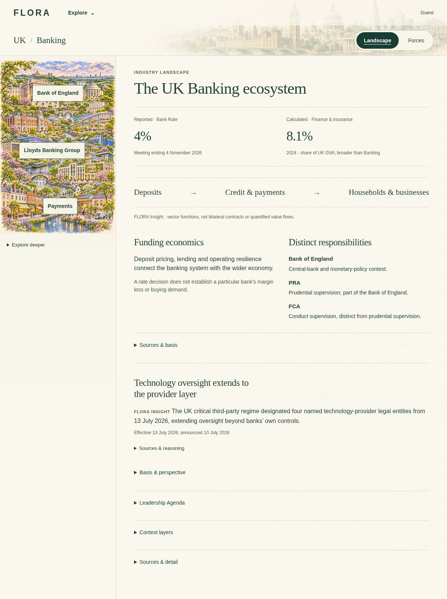
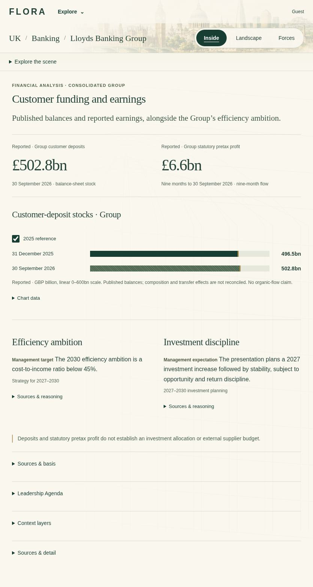
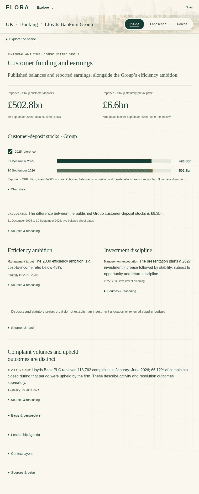
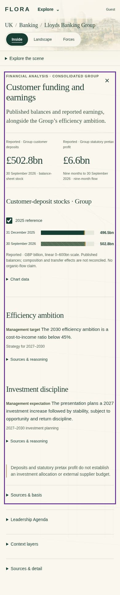
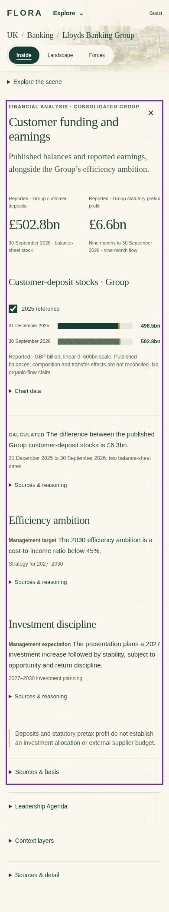

# VP-2 before/after walkthrough

Before is exact validated main `ce4314c3528d5f4beae6e0e4fa53209ddb56ff5c`; after is the application tree in this draft. The final PR validation comment records the exact tested SHA. These are real application captures in isolated local Chromium, not relabelled EAI-1 static/old-layout previews.

## Main workspace additions

| Context | Before | After |
|---|---|---|
| Desktop UK |  |  |
| iPad landscape Banking |  |  |
| iPad portrait Lloyds |  |  |
| Mobile financial detail |  |  |

## Agenda detail

| Detail | Desktop | iPad portrait | Mobile |
|---|---|---|---|
| Cyber estimates | [View](previews/after-desktop-uk-cyber.jpg) | [View](previews/after-ipad-portrait-uk-cyber.jpg) | [View](previews/after-mobile-uk-cyber.jpg) |
| Provider oversight | [View](previews/after-desktop-banking-provider.jpg) | [View](previews/after-ipad-portrait-banking-provider.jpg) | [View](previews/after-mobile-banking-provider.jpg) |
| Complaint outcomes | [View](previews/after-desktop-lloyds-service.jpg) | [View](previews/after-ipad-portrait-lloyds-service.jpg) | [View](previews/after-mobile-lloyds-service.jpg) |
| Deposit comparison | [View](previews/after-desktop-lloyds-funding.jpg) | [View](previews/after-ipad-portrait-lloyds-funding.jpg) | [View](previews/after-mobile-lloyds-funding.jpg) |

The [96-image set](previews) covers all seven streams, four agenda topics and financial detail at 1440×900, 1194×834, 834×1194 and 390×844. Before captures for the three new agenda keys use the corresponding existing overview/financial context because main did not implement those keys. The existing service-recovery key compares the same route before and after.

## Review journey

1. Open `/`. The accepted skyline/portrait/ivory composition remains. Below existing economic context, read the Estimated cyber view; inspect fieldwork, recall window, weighting, exclusions and unchanged overall prevalence on demand.
2. Select Banking, then Lloyds directly: the journey remains two selections. Existing subjects and the compact global product/account menu are retained.
3. On Banking Landscape, read the provider-layer insight. Its basis distinguishes 10 July publication from 13 July designation and names the four legal providers. It establishes no relationship with a particular bank.
4. On Lloyds Inside, compare the two dated Group deposit stocks and the £6.3bn calculated difference. There is one chart and one calculation. Toggle the native 2025 reference and inspect the table/method; do not interpret the difference as an organic flow or supplier budget.
5. Read the separate Lloyds Bank PLC complaint section. Received, closed and firm-upheld metrics have the same period but different cohort/denominator meanings. No Group-wide harm, deterioration or backlog-clearing claim is made.
6. Open Leadership Agenda. There are exactly three singular keys per scope. Existing service-recovery is enriched rather than duplicated. Switch streams and use Back/Forward/deep links; subject, selection, layer and agenda persist.
7. On portrait/mobile, open Explore the scene, select a subject and return to Main. Check keyboard focus/disclosures, touch, source controls and existing navigation. Existing extended VP-2 checks cover laptop/320px, full text enlargement, forced colours and missing art separately.

## Acceptance checklist

- [ ] Existing VP-2 composition, all seven portraits, original artwork and subject navigation remain intact.
- [ ] All four bounded additions are useful in Main and the existing agenda without implying buying demand.
- [ ] Estimates, actual stocks, targets, calculations, reporting periods and Group/Bank PLC identities are clear.
- [ ] Caveats, methods, original URLs and counter-evidence remain understandable on demand.
- [ ] No duplicate agenda keys/chart or contradictory financial reporting.
- [ ] Source denial removes dependent new content; the original eligible received-only view remains when the optional outcomes are withheld.
- [ ] Owner decisions, pending research and proposed source rules remain outside seller content.
- [ ] Responsive/keyboard/touch proof, independent critique and known limitations are acceptable.
- [ ] Any later merge/deployment decision is explicit and separate from Evidence/ADR acceptance.

No checklist box or evidence decision is selected on the owner's behalf. Stop at the draft PR for owner approval.
