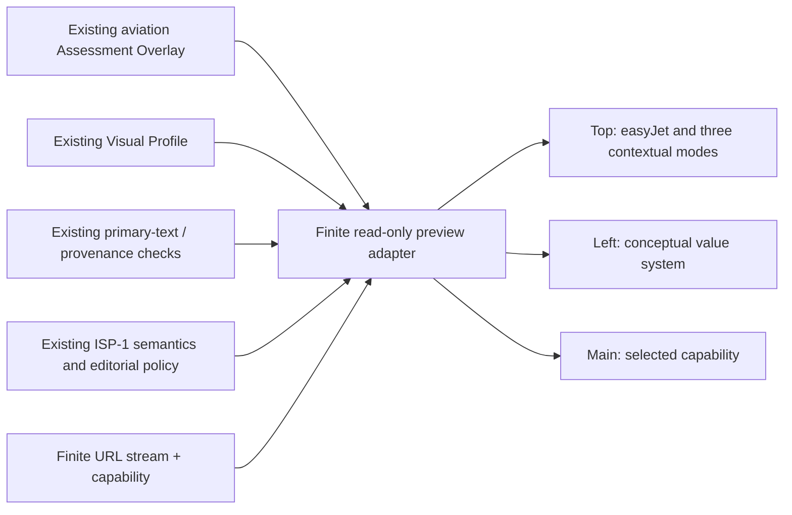

# Architecture and UX assessment

## Existing owners, one finite presentation experiment

This is a presentation adapter, not a second Enterprise Model, capability taxonomy, analytical engine, Source registry or persistence service. Its code binds three transient selection slugs to existing `VI-EJ-*` activity and `AV-CAP-*` references. Value-flow stages **Plan → Sell → Fly → Care** are illustrative sequential activities. Fleet Operations / Network Planning / Customer Service are durable ability groupings. Aircraft, maintenance, airports and information are enabling dependencies, not verified supplier edges or a legal organisational hierarchy.

The fixed registered aviation assessment path supplies current records on each request; no private lookup, browser intelligence cache or cross-tenant record selector exists. Root schema, authority, country/domain/enterprise identity, dates, unique IDs and restrictions are checked. Every consumed claim and Source has an exact reviewed fingerprint; source content is revalidated using the existing primary-content adapter, with ISP-1 eligibility and existing broader `working_restricted` lifecycle checks. Later source/claim revisions are omitted until editorial bindings are reviewed; they cannot silently inherit old presentation authority.

Whole-graph `load_assessment()` validation was unsuitable for this projection because one damaged snapshot removed independently valid disclosures. The adapter reads the **same existing registered owner file**, validating only its consumed pinned disclosures with existing model functions. Invalid or withdrawn source A suppresses its dependants; source B can still render. Malformed/ambiguous package roots fail closed. No change to research validation, primary source storage, SEC/ONS rules or canonical acceptance was needed.

`public_routes.py` adds one exact preview route with only `stream` and `capability`, plus three finite asset keys. The resolver additionally rejects unknown/blank/duplicate values. `web/app.py` adds only the exact dispatch and HEAD content-type bindings. Existing GET/private-read/CSRF/workspace guards stay byte-identical after removal of the reviewed additions. `etvis2_compatibility.py` verifies this whole-file predecessor equality and exact before/after hashes. Historical AUTH/UX/F2 checks delegate through that explicit evolution; the security comparator and approved failures/skips are unchanged.

## Navigation

Ordinary links contain the complete bounded state. JavaScript progressively fetches the same public route, changes Main and selected-link attributes, and pushes history only after a valid render. Left's DOM/illustration persists. Back/Forward fetches the URL state. An AbortController prevents a superseded response changing Main. Browser errors fall back to ordinary navigation. No source URLs, private IDs or hidden research records are embedded in Main.

Selection focuses and brings Main's heading into view, announces the state, and collapses the mobile scene after a capability choice. All controls remain real links with touch targets, visible selected/focus states and a no-JavaScript fallback. Mobile prioritises Main behind a compact scene disclosure; desktop and both iPad layouts keep three regions visible. Whole controls wrap at enlarged text rather than splitting words.

## Visual provenance and tradeoff

Top reuses the original approved content-addressed UK skyline through unchanged accepted panel styling. All 51 existing visual-stream files, seven scenes/21 variants/portrait artwork, original UK panorama and existing source/profile assets remain unchanged; `Retained-Inputs.json` records their hashes.

No accepted easyJet portrait or ET-VIS-1 generated comparison image exists in the verified repository or was attached to this commission. The added `enterprise_preview_assets/airline.svg` is an explicitly new conceptual editorial vector: layered terminal, engineering hangar, aircraft and route atmosphere. It incorporates the existing unmodified aviation `_art('aviation', ...)` fragment from `research_intelligence/visual_intelligence.py` as a closing landscape, without replacing that owner or any original image. Drawing placements/aircraft are decorative, not actual sites, quantity, geography, company architecture or supplier workshare. No paid image/research call was made.

The palette and editorial hierarchy fit FLORA. Independent visual critique found the vector **flatter and simpler than the original rich illustrations**. It is a replaceable prototype scene requiring explicit owner visual acceptance, not evidence that equivalent artistic quality has been achieved. Its navigation coordinates are presentation percentages, separate from research identity and Main semantics; future approved artwork can replace it without changing intelligence owners.

## Bounded modes

Landscape provides the deepest capability explanation. Forces explains conceptual economic mechanisms with dated factual context where available; no qualified Material Pressure is inferred. What's changing? presents only a few retained dated company announcements, explicitly distinguishing historical operations disclosures and adjacent connectivity/booking-channel context from an evidenced capability performance change. This is not a live News stream or a new ripple mechanism. There is no opportunity, recommendation, invented impact or default owner-admin panel.
