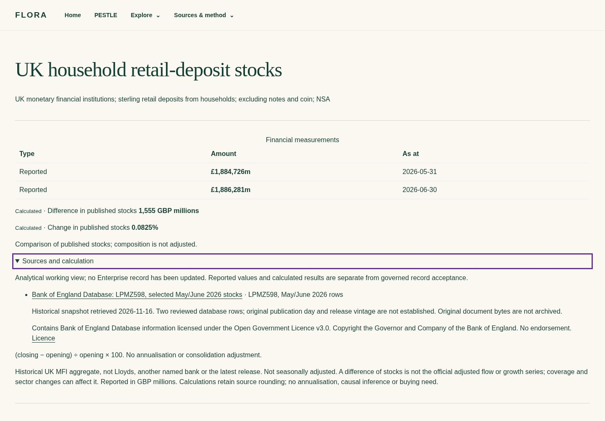
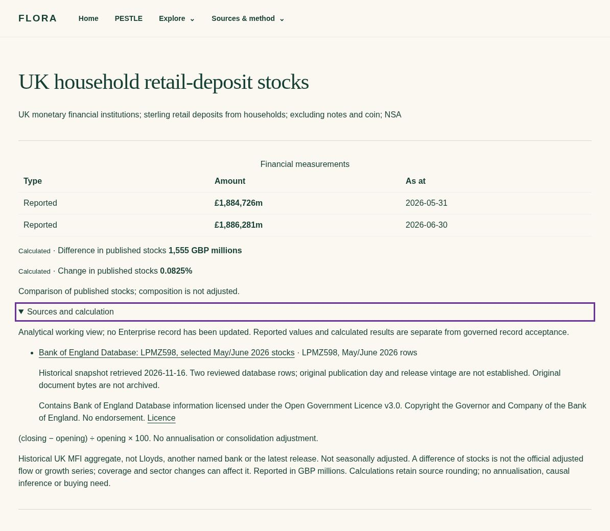
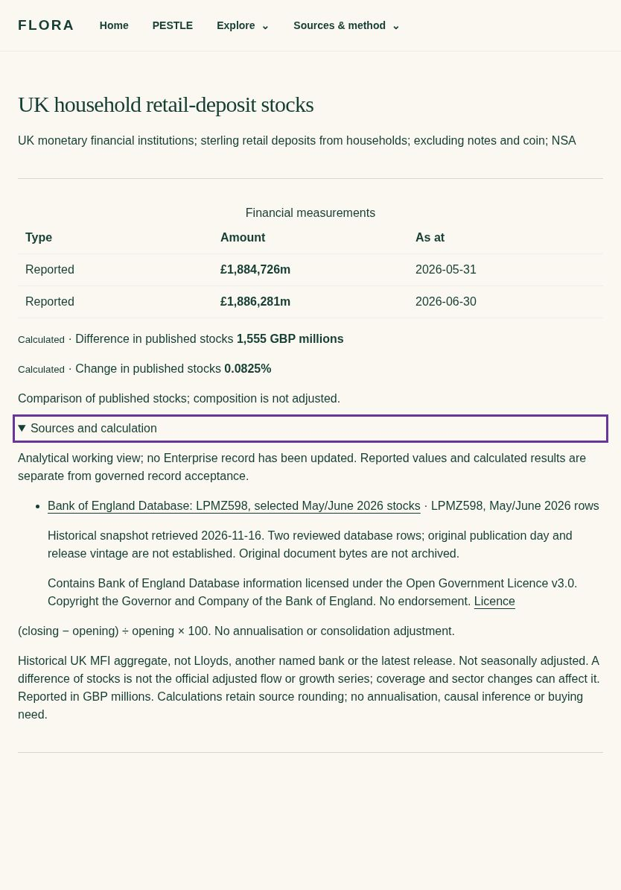
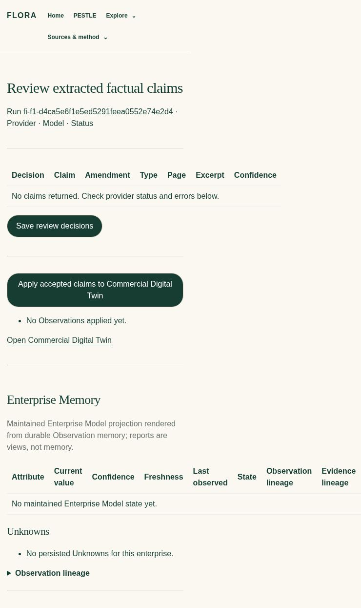

# Reproducible validation and visual comparison

The final exact SHA, hosted run URLs/outcomes and proof manifest are recorded in the draft PR's completion comment. Committed previews show the candidate application; the final proof is regenerated after commit so its `head` is the actual tested SHA, rather than embedding a self-referential SHA in this commit.

## Checks

| Layer | Scope |
|---|---|
| F1 |85focused tests: real source/typed stock semantics; synthetic flow/fiscal/calendar/sign/precision/assumptions; actual candidate repository/reload/idempotency; exact derivations; use/revision withdrawal; forged/missing payload; real tenant/resource/ACL/capability denial; protected write rollback; canonical-operation rejection; all173prior source bytes and unchanged comparator |
| Existing regression gate | `python tools/ci/flora_ci.py --output /tmp/flora-f1-ci`:27suites,388strict security; unchanged versioned failure/skip comparison and integrity/audit checks |
| Existing semantics/history | Existing FIG-1 hosted workflow:53FIG tests and629semantic/compatibility/source/visual/history cases. Six stale successful inventory/design-epoch assertions are explicitly corrected; no approved failure/skip baseline or comparator code is changed |
| Existing products | Existing main workflow:371Technology/Offers/library/triggers/development/visual/product checks and39CI-control tests |
| Real source proof | `python tools/research/f1_proof.py --output /tmp/flora-f1-proof`:actual retained BoE inputs, existing run storage/reload, deterministic calculation, withdrawal/sanitized reads, unchanged historical run; synthetic authority only |
| F1 browser | `python tools/research/f1_proof.py --output /tmp/flora-f1-proof --preview --baseline-root /path/to/validated-main`:70checks, including equivalent baseline/current desktop/iPad landscape/iPad portrait/mobile,320px,200% text with intact amounts, keyboard/touch sources, source licence, anonymous denial, direct URL/history and retained seven streams/two-selection journey |
| Full visual browser regression | `python tools/ci/flora_vp2_preview.py --output /tmp/flora-f1-visual`:709existing checks, including retained destinations/lenses/global tools, responsive/zoom/touch/keyboard/source access and loopback performance samples |

Selectors overlap and are not summed as unique coverage. Full-gate acceptance requires the exact existing36inherited failures and10approved skips, with zero unexplained signature changes. A direct financial compatibility subset also exposes five of those inherited authority-related failures; it is not falsely described as a clean raw pytest suite. Full comparator matching, not baseline refresh, determines acceptance. Physical iPad/Safari, production availability and screen-reader certification are not claimed.

## Investigated issues

The first working-tree full run correctly rejected the two new unregistered source files in two history-dependent suites. The existing inventory now names exactly those two hashes, preserving all earlier bytes. A new regression verifies the old173-entry cut and unchanged comparator against baseline. The BIE3 and unified successful-count assertions now expect the exact175file inventory. The FIG-1 test verifies that the **accepted FIG-1 design commit** changed no runtime/architecture/history; it no longer mistakes a later commissioned implementation for that historical design. No original source identity, approved failure/skip, comparator tolerance or old research byte is refreshed.

The first committed-head semantic run then exposed three additional older history-count assertions (INT-1/EAI-1/BIE-2). Each is corrected individually from173to175 with the exact two F1 paths included in its expected addition set. Their original161/163/169entry byte comparisons, unknown-file negatives and verbatim comparator checks remain. These are six successful-case assertion reconciliations in total, not inherited-failure signature changes:

| Case | Original scope retained | Correction |
|---|---|---|
| INT-1 `test_all_161_prior_history_expectations_and_comparator_are_exactly_preserved` |161prior entries and comparator | Exact175inventory and explicit F1 pair |
| EAI-1 `test_all_163_prior_sources_and_exact_comparator_remain_and_unknown_additions_fail` |163prior entries and negative checks | Exact175inventory and explicit F1 pair |
| BIE-2 `test_all_169_previous_research_bytes_and_byte_comparator_unchanged` |169prior entries and comparator | Exact175inventory and explicit F1 pair |
| BIE-3 `test_old_171_research_bytes_and_exact_comparator_preserved` |171prior entries and negative checks | Exact175inventory and explicit F1 pair |
| Unified `test_both_reviewed_workstreams_remain_ancestors_with_exact_source_cuts` | Existing ancestors and exact history guard | Exact175count/category |
| FIG-1 `test_runtime_canonical_source_history_and_accepted_architecture_are_unchanged` | Actual accepted design-only741e01c cut | Pin historical scope; current exact175inventory separately guarded |

Early browser failures were isolated harness startup/path coupling and the new view's mobile table/legacy header at200% text. The Financial hash now uses an existing pure helper; the proof starts the full runtime against its complete checkout, and the F1-only page gets a responsive table/header treatment. These findings did not require production configuration or global visual redesign.

## Before/after

The comparison opens the **same non-production candidate run** with the validated main reader and the new reader under identical synthetic authority. The old reader ignores the typed extension and shows its generic empty canonical-claim review; the new reader displays the sourced analytical result without canonical promotion. No before screenshot is presented as a real historical production run or approved import. All original seven scenes,21responsive variants,7portrait scenes and23delivery assets remain unchanged; existing asset/hash and navigation suites plus the full visual browser run check preservation.

| Device | Before | After |
|---|---|---|
| Desktop |  |  |
| iPad landscape |  |  |
| iPad portrait |  |  |
| Mobile |  |  |

Workflow artifacts contain sanitized proof/browser results and previews only. Do not upload private CI scratch directories, authority databases, enrollment deliveries, cookies, environment configuration or raw tool logs.
