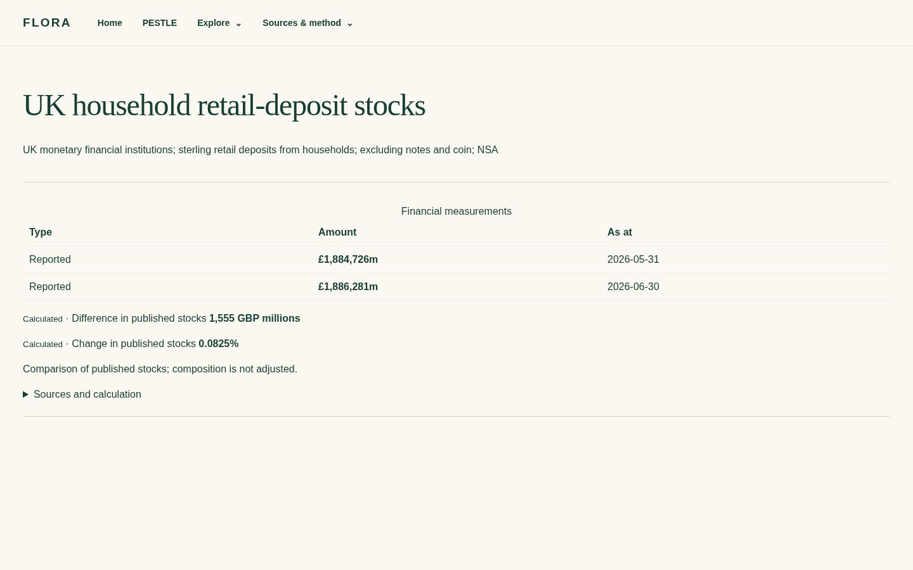
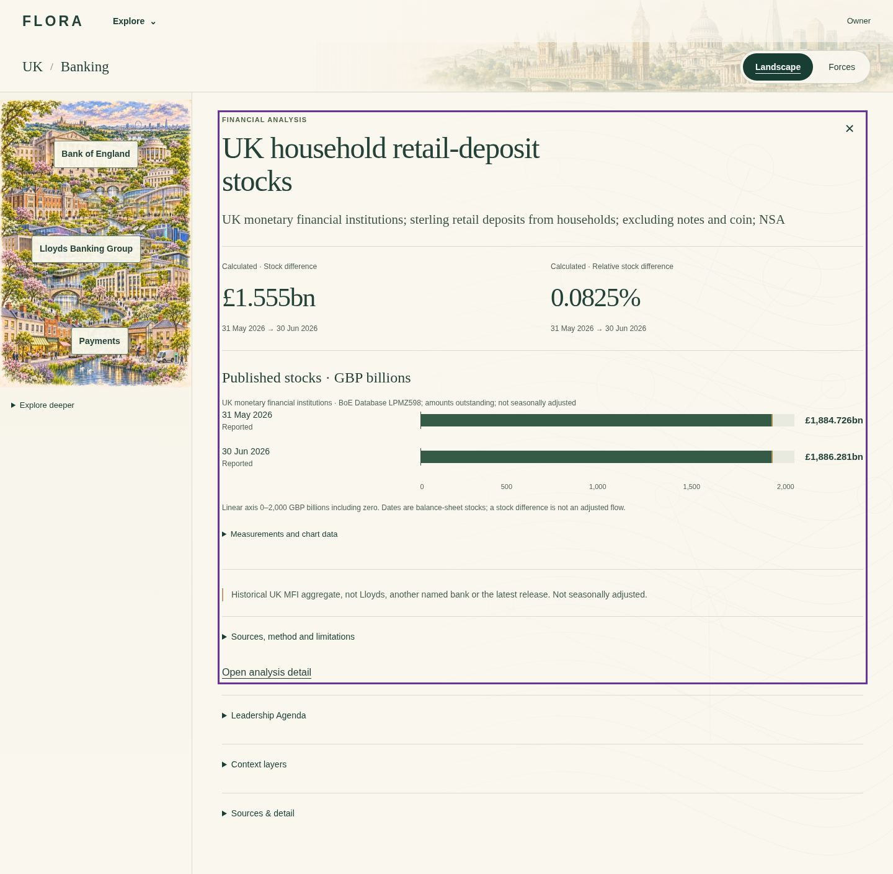
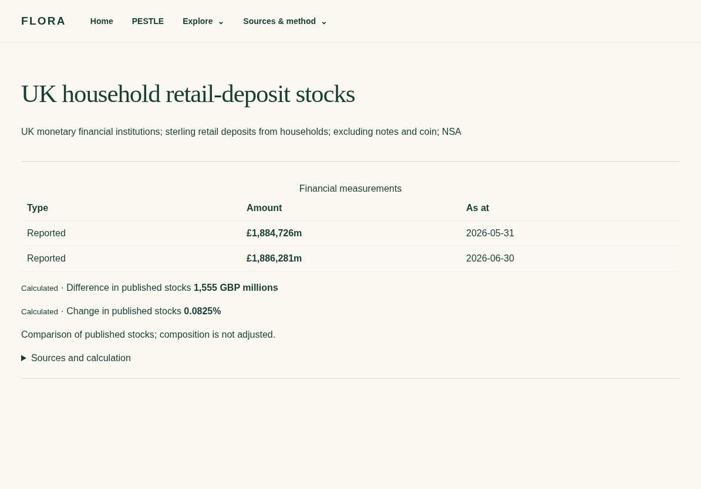
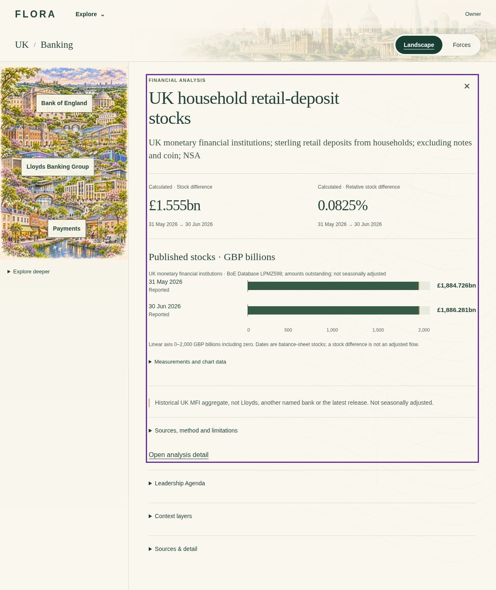
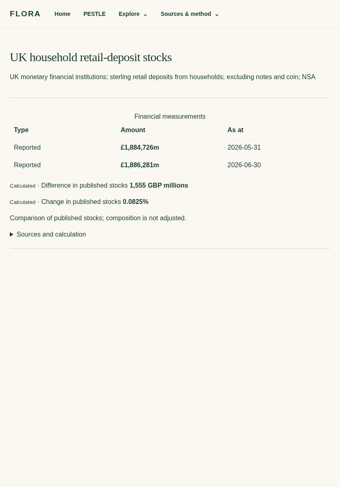
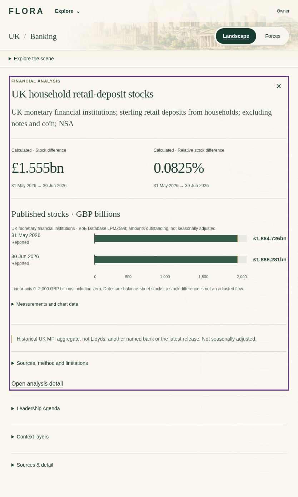
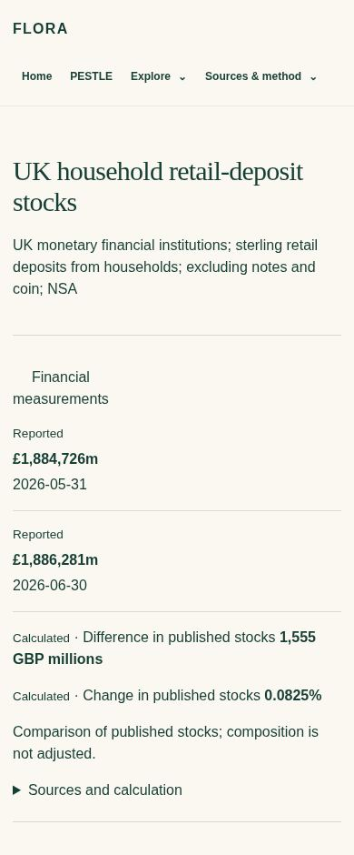
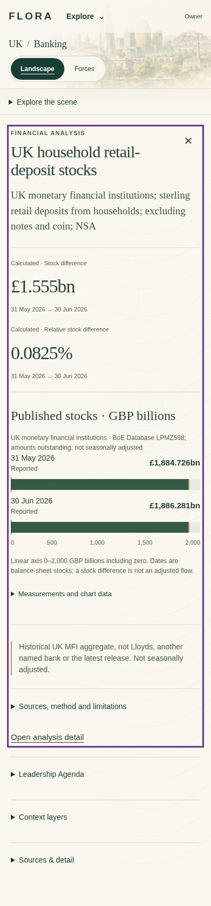

# Actual application comparison

Before is the F1 standalone detail route on the verified F1 commit. After is the same actual persisted BoE run in F2 Main. Authority is synthetic and isolated; financial inputs are genuine retained permitted BoE data. These are application screenshots, not design mockups or production previews. Default views keep disclosures closed; inspection screenshots expand exact data and sources.

## Desktop 1440

Before

After

## iPad landscape

Before

After

## iPad portrait

Before

After

## Mobile 390

Before

After

## Additional checks

- [Desktop 1280](previews/after-laptop.jpg)
- [Mobile 320](previews/after-mobile-320.jpg)
- [Mobile 200% text](previews/after-mobile-200pct.jpg)
- [Expanded mobile sources/data](previews/inspection-mobile.jpg)
- [Forced colours](previews/after-forced-colours.jpg)

No production data or account is used. Device sizes/touch/text scaling/forced colours are Chromium emulations. Existing artwork and navigation are retained unchanged.
