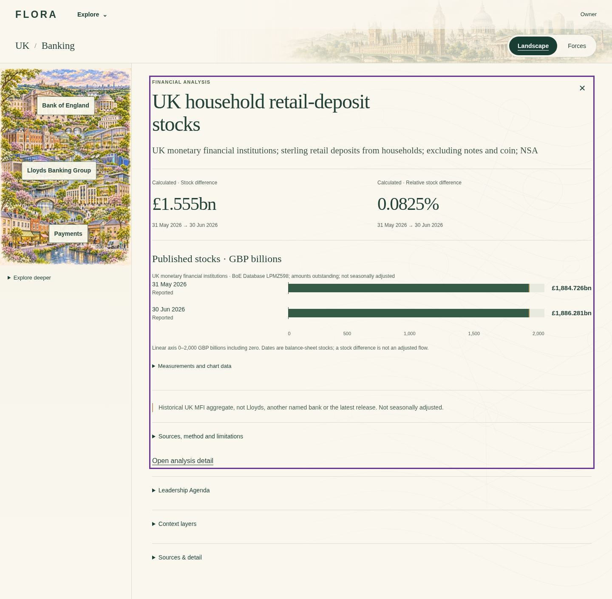
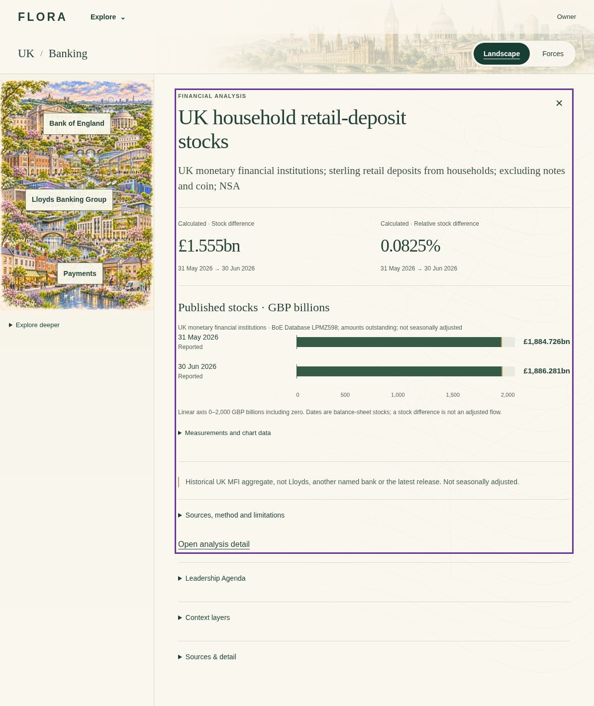
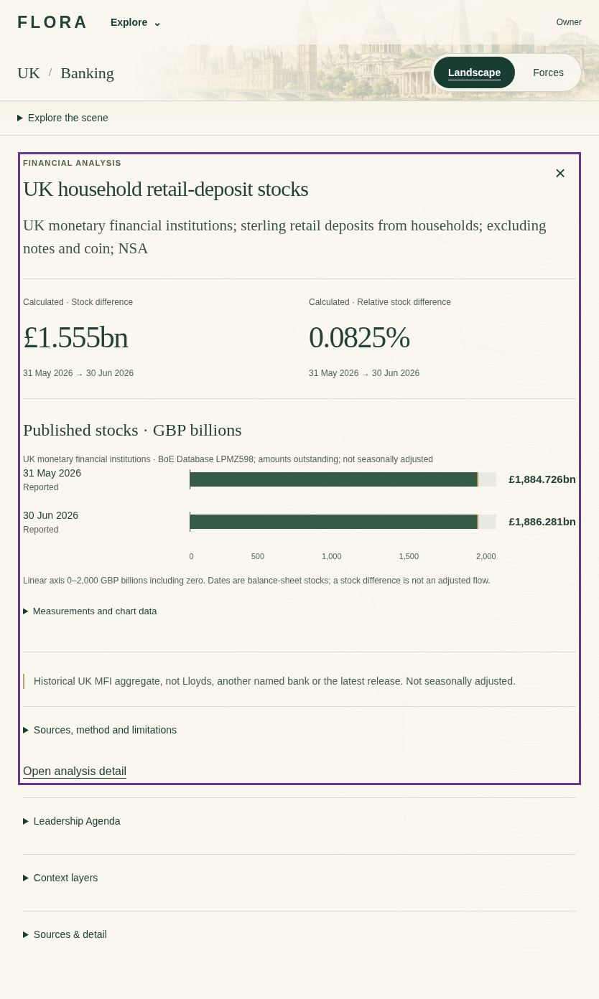
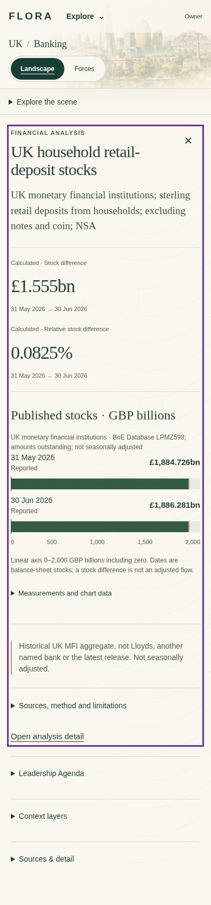

# Actual Main control: before / after

These screenshots show the real, permitted BoE analysis before F3 (validated F2) and after F3. The accepted Main, artwork and navigation are intentionally preserved. **They do not show newly admitted issuer data.** No bank data is injected through an owner/static preview bypass. Synthetic contract cases are tests only. Authentication/workspace are isolated nonproduction fixtures.

## Desktop 1440

Before — validated F2

After — F3 preservation control

## iPad landscape

Before — validated F2

After — F3 preservation control

## iPad portrait

Before — validated F2

After — F3 preservation control

## Mobile 390

Before — validated F2

After — F3 preservation control

## Additional responsive/accessibility states

- [Desktop 1280](previews/after-laptop.jpg)
- [Mobile 320](previews/after-mobile-320.jpg)
- [Mobile at 200% text](previews/after-mobile-200pct.jpg)
- [Expanded mobile data/source detail](previews/inspection-mobile.jpg)
- [Forced colours](previews/after-forced-colours.jpg)

Focus outlines in applicable captures are accessibility states. Chromium emulation is not physical iPad/Safari or screen-reader certification. Exact-head runtime/source proof and browser artifacts are linked in the PR validation comment.
