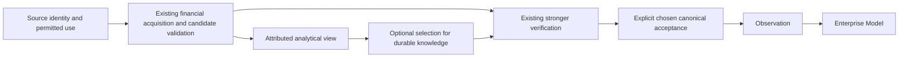

# FIG-1 — useful financial analysis without unnecessary canonical promotion

**Status: proposed decision for owner / Chief Architect review. Design only; no authority or runtime change.**

## Decision recommended

Choose **Option B: a governed analytical-view pathway alongside optional canonical acceptance**, implemented by extending existing Financial, Source and presentation owners. Start with Option A's measurement/candidate correctness work, then make the existing analytical lane reusable across the five banks. Canonical Observation/Model migration is not a prerequisite for useful analytical output. Defer Option C's wider lifecycle migration.

A source-permitted, accurately attributed measurement can support an analytical view without being individually promoted to canonical Evidence first. A calculation, chart point, scenario or analytical sentence need not become an Observation. Source permission, measurement verification and canonical authority stay distinct. This is consistent with accepted ADR-011; it grants no new source permission.

The current implementation is **both too narrow and sometimes over-coupled**, rather than uniformly over-governed. Essential source/tenant/financial controls should remain; routine repeated work and release-specific wiring should shrink. Some empty outputs arise from missing metric/date/persistence support, not from a legitimate requirement for more approvals.

## Evidence behind the challenge

- **Accepted architecture already permits the distinction.** ADR-011:21–25 permits attributed candidate financial intelligence before structured verification and reserves canonical writes for accepted facts;33–36 protects useful rapid results when verification fails. ADR-012:39–43 separates analytical package acceptance from object-specific canonical promotion. Neither requires individual canonical promotion for every visible number.
- **Main already does it.** `leadership_agenda._eai_release/_claims` composes permitted candidate releases without canonical mutation. `intelligence_presentation.difference` returns `derived_view_not_canonical`. `rapid.run_rapid_financial_intelligence` persists candidate financial runs with accepted count zero. These capabilities should be reused, not replaced.
- **The universal manual-approval premise is also inaccurate.** `document_review._is_auto_acceptable/_apply_automatic_claims` already supports automated financial acceptance under its governed context. Its write-oriented acceptance pipeline is not the right gate for every analytical view. ADR-010 focuses humans on ambiguity, contradiction and material exceptions.
- **Real friction is visible in code.** Multiple source configurations, acquisition-only receipts called accepted, eight-metric/BT-biased financial paths, repeated extraction/normalisation/prose projection definitions and bespoke release/source/claim pin wiring complicate industry-wide use. Source hashes and target approval fingerprints protect different risks; they must not be discarded as duplicates.
- **EAR-1 found real defects, not useful safeguards.** Deposits are missing from the catalogue/table aliases; a stock date becomes an unsuitable fiscal flow period; transient numeric attributes disappear on Observation reload; deposit projection falls back to prose; lifecycle helpers disagree on stale/withdrawn/retracted encodings. Fix these under existing owners instead of requiring more research records or accepting a prose Model as numeric success.

[Actual gates, owners, risks and proportionality](Current-Architecture.md) · [machine-readable audit](Gate-Audit.json) · [three options](Options.md).

## Current versus proposed

Today, a few fixed releases reach the analytical view, while much richer research is blocked by source-use decisions and generic financial support. Other paths couple useful output to one narrow source/verification implementation or Model projection. Proposed: one reusable existing-owner analytical lane validates eligible measurements and reproducible derivations, with optional stronger verification and explicit durable selection. No new source registry, financial database, canonical engine or parallel matcher.

**Do not conflate the arrows:** analytical eligibility is not Evidence acceptance, automatic observation creation, a source licence or a Pipeline qualification decision.

## What the five exemplars prove

| Exemplar | Legitimate analytical result | Boundary retained |
|---|---|---|
| NatWest Group | Distinct total/ex-central deposit stocks and Group earnings context | Group versus bank, stock versus flow, acquisition/APM basis |
| HSBC UK Bank plc | Legal-bank reported USD earnings reconciliation | Neither Holdings nor a UK geography/GBP result |
| Santander / TSB | Operating/credit/restructuring bridge and acquired-period TSB contribution | Group Holdings versus bank, May–September versus9M, decided integration versus procurement |
| Nationwide | Underlying→statutory bridge including member rewards | Mutual economics, full-year Virgin versus six-month prior perimeter |
| Starling | Declining Group revenue/PBT alongside platform/deposit growth; Engine investment/ARR definitions | Platform accounts versus UK customers; intragroup investment/committed ARR versus supplier spend/recognised revenue |

[Five differentiated source-to-analysis traces](Banking-Analysis.md) and the [A–J specification/coverage](Analysis-Specification.json) disclose the remaining accounting, risk, cash-flow and investment gaps. These are research/design exemplars, **not newly admitted live financial data or complete bank dossiers**. No cross-bank league table or fabricated comparison is produced.

## Small contracts, existing owners

1. **One source-use decision referenced many times:** exact purpose/audience/retention/attribution/rights basis under the existing source owner. Approved category/document-series defaults can automate routine routing after genuine lawful-use review; exceptions and changed terms still stop use. Do not infer permission from a public URL, official status or policy category.
2. **A typed reported measurement with explicit temporal meaning:** existing financial value, source locator, precision, legal/perimeter/basis and `instant` or `duration`. Unknown catalogue mapping need not suppress a properly labelled candidate metric; it must suppress unsupported comparison/canonical mapping.
3. **Reproducible derived results:** formula, input revisions, assumptions and scenario versions retained in existing financial-run/presentation ownership. Estimated/assumed dependencies never become reported truth through arithmetic.
4. **Optional durable knowledge:** material, reusable verified reported facts can follow the existing acceptance→Observation→Model path. Keep item-level validation, provenance and compensation; evaluate explicit batch/subset approval rather than routine manual clicks for every unambiguous record.
5. **One coherent use-time decision:** existing source/lifecycle/permissions resolve dependencies before any view/title/count/cache/export. Canonical writes still recheck actual scope, plan/review/source/target versions and authority. Caches are not a permission bypass.

[Source-use proposal](Source-Use-Policy.md) · [financial contract proposal and EAR reconciliation](Financial-Contract.md).

## Authority and changes requested

No new ADR is needed to establish that eligible noncanonical analysis may exist: ADR-011 already does so. Owner acceptance is needed for this implementation direction, the bounded financial/source contract changes and any new source-use defaults. Legal/source authority must establish applicable commercial processing/reuse, including database and contractual issues. Proposed ADR-027 remains Proposed and is not extended to issuers.

A later **proposed clarification** to ADR-011 could align its legacy Fact/Inference/Recommendation and Unknowns language with the six existing presentation types and progressive inspection: core views remain simple, unsupported slots are omitted, gaps/contradictions remain inspectable in appropriate owner/source detail. It must not erase evidence or silently accept a draft paper. No accepted ADR is edited here. Option C changes to the role of financial Observations would require explicit ADR-001/002/012 reconciliation and are not recommended now.

## First useful implementation sprint and success

The smallest first sprint should repair typed stock/flow semantics and candidate numeric persistence in existing owners, and deliver **at least one actual authorised source-backed analytical result** through the existing candidate/run owner. It must prove a value survives reload, a reproducible derivation remains noncanonical and a revoked/conflicting source removes dependent output. Re-rendering today's hard-coded arithmetic or producing only fixtures is insufficient. Use currently eligible actual inputs; do not make the sprint contingent on admitting all five issuers or pretend engineering grants permission. If no actual source is eligible, report that blocker and partial completion instead of declaring the sprint complete. Canonical Observation/Model fixes and selected durable migration remain separately scoped and optional for this first analytical outcome.

Then extend the same lane to the five-bank A–J specification as source use becomes eligible; replace per-release renderer edits with validated data-driven composition under the same owners. Measure useful source-backed dimensions, reproducibility, denied-comparison precision, source-revocation coverage and fewer routine manual interventions. Do not invent timing savings or set research coverage to100% because files exist.

[Bounded roadmap, migration, tests and rollback](Roadmap-and-Acceptance.md). A fixed [synthetic proof](Proof.md) exercises the existing contracts without real source permissions or canonical writes. Independent architectural and commercial critiques are included in the review pack.

**Current decision:** the challenge pack is review-ready after exact-head validation. It authorises no implementation, publisher admission, Evidence promotion, EAR-1 merge or deployment. Stop for owner architectural acceptance.
