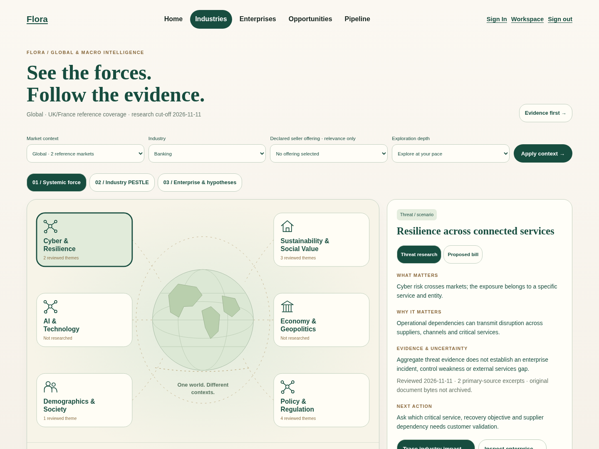
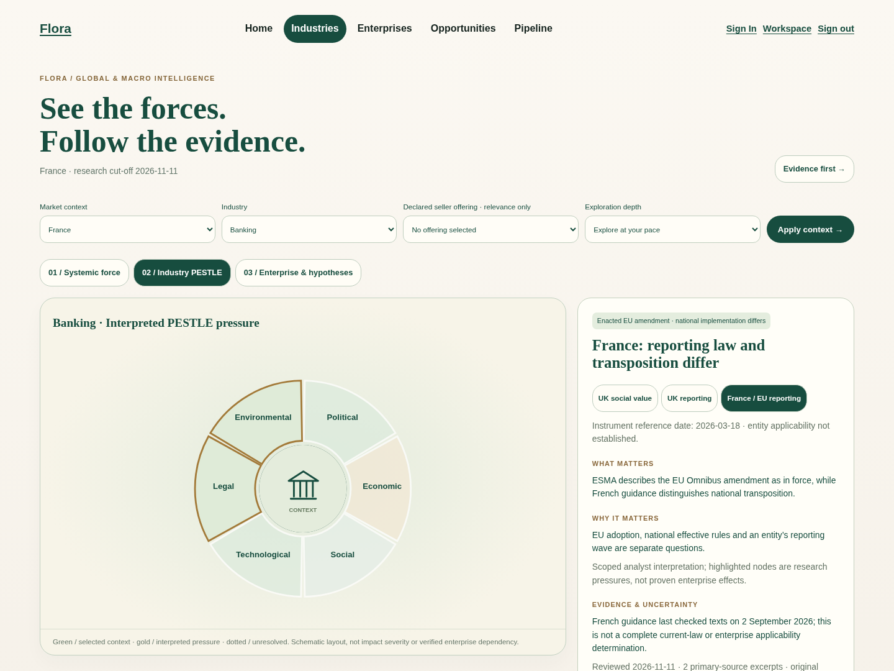

# Owner visual acceptance gallery

Actual Chromium captures from the running feature build, using disposable localhost storage and public research only. Desktop **1440×1080**, tablet **1024×768**, phone **390×844**. Files ending `-visual` are viewports scrolled to the diagram; other captures start at the top. No images are mock-ups or composited product claims.

The live production service is unchanged. Open this feature build at `/macro`; Home also has **What’s changing? Macro Intelligence**. The gallery can be viewed directly in GitHub without downloading a ZIP.

## Start with the visual

Six categories surround a schematic globe. Counts show reviewed themes, not risk severity. UK and France are the reference contexts; AI/technology and economy coverage is explicitly incomplete rather than fabricated.

[Tablet first viewport](previews/atlas-tablet.png) · [Phone first viewport](previews/atlas-mobile.png) · [Phone visual](previews/atlas-mobile-visual.png)

## Follow a force through industry and enterprise

Gold marks interpreted pressure, not a verified enterprise effect. An enacted EU instrument and French national implementation remain distinct. Exact company applicability is Unknown.

| Investigate | Desktop | Tablet / phone |
| --- | --- | --- |
| Cyber → Banking PESTLE | [View](previews/cyber-pestle-desktop.png) | Shared touch/keyboard interactions tested |
| Cyber → Lloyds context → existing hypothesis | [View](previews/lloyds-context-desktop.png) | [Tablet](previews/lloyds-context-tablet-visual.png) · [Phone](previews/lloyds-context-mobile-visual.png) |
| UK social-value procurement | [View](previews/social-value-desktop.png) | [Phone](previews/social-value-mobile-visual.png) |
| UK sustainability → easyJet research hypothesis | [View](previews/easyjet-reporting-desktop.png) | No asserted mandate or confirmed demand |
| France sustainability / transposition | [View](previews/france-reporting-desktop.png) | [Tablet](previews/france-reporting-tablet-visual.png) · [Phone](previews/france-reporting-mobile-visual.png) |
| France cyber → Aviation / unknown entity | [View](previews/france-cyber-desktop.png) | No French customer opportunity is invented |
| Proposed cyber legislation | [View](previews/proposed-bill-desktop.png) | Proposal status remains visible |
| Unresearched category | [View](previews/coverage-gap-desktop.png) | Blank does not mean safe, compliant or no opportunity |

## Executive and detailed evidence

| Theme | Executive | Full evidence |
| --- | --- | --- |
| Cyber | [1-page PDF](previews/cyber-executive.pdf) | [6-page appendix](previews/cyber-appendix.pdf) |
| UK social value | [1-page PDF](previews/social-executive.pdf) | [6-page appendix](previews/social-appendix.pdf) |
| France sustainability | [1-page PDF](previews/france-executive.pdf) | [7-page appendix](previews/france-appendix.pdf) |

[Browser check record](previews/browser-results.json) · [PDF checks/hashes](previews/pdf-checks.json) · [Rendered-source manifest](previews/source-manifest.json) · [Primary-source audit](Source-Audit.md)

## Owner checklist — not yet performed

- [ ] The first view communicates the product purpose and encourages visual exploration without reading a report.
- [ ] UK/France context, instrument status and unknown entity scope are understandable.
- [ ] Selecting a category/factor/capability reveals one useful contextual panel; touch, keyboard and Back feel natural.
- [ ] A new seller can explain a relevant hypothesis and distinguish seller fit from customer demand.
- [ ] An expert can reach a precise source passage and its dates without mandatory orientation.
- [ ] An intermediate seller can compare countries and move between overview and detail without losing context.
- [ ] Executive exports are useful; complete evidence and limitations remain available.
- [ ] Visual quality is acceptable across desktop, tablet and phone.

Suggested timed exercise: give a new seller 20 seconds on the UK cyber view, then ask what changed, which part of Banking may be affected, what remains Unknown and what to validate next. Repeat with an expert’s direct evidence route and the intermediate UK/France comparison. Record actual time, errors and explanation quality. **No timed human comprehension test has occurred and no pass is claimed.**

Physical iPad/Safari, screen-reader evaluation and owner commercial-usefulness acceptance remain outstanding. The prototype supports candidate intelligence exploration, not compliance certification, customer qualification or deployment approval.
