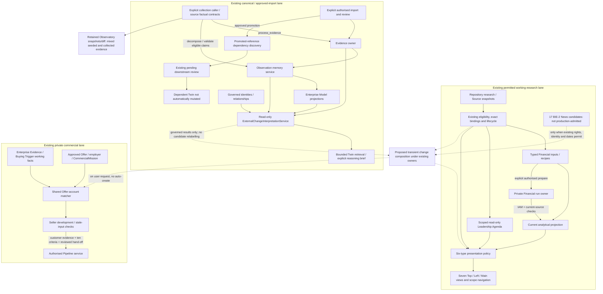

# Current intelligence architecture

Solid arrows mean explicit code consumption/calls, **not continuous updates**.
Dotted edges are proposed integration. Navigation is presentation, not a data
dependency or evidence of enterprise exposure.

| Connection | Observed state | Limit |
| --- | --- | --- |
| UK → Banking → Lloyds navigation | Core route/context logic | No automatic applicability or model update |
| Macro context → capability interpretation | Disposable macro/context-trace associations | Enterprise applicability may remain unestablished |
| Source revision/withdrawal → Financial/Main | Exact-input and eligibility checks | Omit/recompute on read, not a background subscriber |
| Evidence/Observation → Enterprise Model | Authorised canonical memory service | Derived snapshots/pressure reassessment through owning paths, not any file change |
| Trusted collection → memory / Observatory comparison | `collect` calls `process_evidence` and before/after snapshots | Source/factual contracts and controlled invocation; not per-fact human approval or permission to expose an internal mutator publicly |
| Governed external change → enterprise consequence | Existing external-change interpreter | Exact canonical support, relationships and permitted caller scope required |
| Promoted subject → dependent package review | Stable-ID discovery / pending reconciliation | No causal score or dependent mutation |
| Offer/research revision → private candidate staleness | Existing digest comparison | Explicit reassess before reviewed hand-off |
| Enterprise → industry pattern → UK synthesis | No general implementation demonstrated | Needs comparable independent evidence and additional UK context |

## Missing or disconnected

1. **Editorial integration.** Richer Porter/value-chain, operating, supplier,
   financial and research views survive elsewhere. Current dispatch and curated
   eligibility select a narrower core; some old `lens=` URLs resolve to the new
   composition. Retained handlers are not all current UX.
2. **Change identity and comparison.** Publication-sorted timelines and retrieval
   timestamps establish neither an event's prior state nor a delta. Legacy bank
   event pages explicitly contain illustrative anchors.
3. **Enterprise exposure.** Country force, industry role, provider brand and
   regulated contracting legal entity are different endpoints.
4. **Recomposition across lanes.** Working views invalidate locally; canonical
   external-change reasoning already exists. Neither proves a general working
   source-to-industry-to-enterprise refresh loop. Connect outputs through existing
   owners without forging canonical support for candidate facts.
5. **Upward learning.** A declared sample, comparable basis/period, independence
   and falsifiers are missing from a general peer-pattern product. A retained
   Observatory already compares heuristic organisation/hypothesis/score snapshots
   using mixed seeded and collected evidence; it is not governed industry learning.
   One enterprise
   is an exemplar, not industry prevalence or national causation.
6. **Refresh operations.** Collection/source/publication facilities exist. Enabled
   production schedules, lawful weekly supply and freshness were not verified;
   no scheduler is proposed here.
7. **Selection semantics.** Retained selected-bank state can coexist with industry
   Forces content. A later implementation must make the subject consistent rather
   than add an independent selector.

Missing wiring does not justify a new universal engine or registry.
