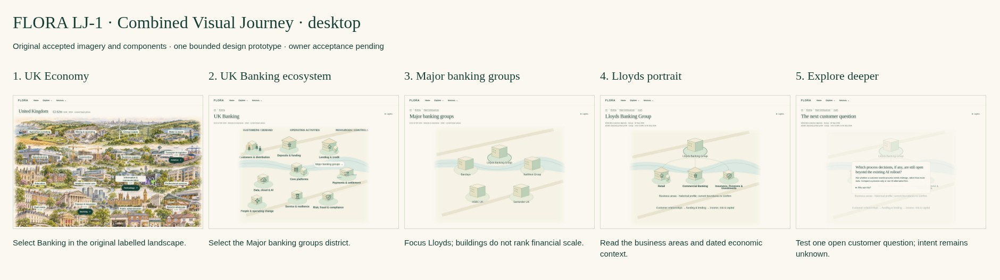

# FLORA LJ-1 — Combined Visual Journey

**Current design revision: [LJ-2 — three scopes with Landscape / Forces](lj2/README.md).** Earlier LJ-1/LJ-1R are rejected historical design evidence, not accepted implementation briefs.

**Historical rejected LJ-1 pack.** The owner required rich independent artwork and a four-level journey. The [current LJ-1R correction, before/after comparisons and evidence audit](rich/README.md) supersede this original five-state design. Original files remain historical evidence, not an accepted implementation brief.

Design-only response to [Issue #608](https://github.com/rdidale-jpg/CIOS/issues/608) and its approved LJ-1 commission. Based on original accepted `origin/main` at `0cb07c2e78ccb16240c799b31cd62736e2135529`. **No rejected VA-1 layout or artwork is imported.** Separate branch/PR; #603 and #609 are untouched. Owner visual/architecture acceptance is pending; no production implementation is authorised.

## Open the one interactive journey

Download [LJ-1-demo.zip](LJ-1-demo.zip), extract the whole folder and open **01-uk.html**. It uses native links, SVG and disclosures without JavaScript or a server. This is a static anonymous design demonstration, not a signed-in FLORA application. Alternatively serve this repository folder with `python -m http.server 8777 --bind 127.0.0.1 --directory docs/flora-runtime/living-journey-lj1` and open `http://127.0.0.1:8777/01-uk.html`.

**UK Economy → Banking → Major banking groups → Lloyds → Explore deeper.** Select Banking on the UK illustration; select the Major banking groups district in the Banking scene; focus the Lloyds building; open Explore deeper. Districts and other bank buildings can also be selected. Back and scope breadcrumbs retain the selected layer. Layers is optional: Enterprises / Customers & Suppliers / Regulators. No forms, storage, external fonts, API, private data, new subscriptions or app routes.

## Five-state storyboard



| State | What the seller sees / does | Desktop | iPad landscape | iPad portrait | Mobile |
|---|---|---|---|---|---|
| **1 · UK economy** | Original 20 labels and image; select Banking | [Image](previews/desktop-01-uk.jpg) | [Image](previews/ipad-landscape-01-uk.jpg) | [Image](previews/ipad-portrait-01-uk.jpg) | [Image](previews/mobile-01-uk.jpg) |
| **2 · Banking ecosystem** | Original nine illustrated activity districts; select Major banking groups | [Image](previews/desktop-02-banking.jpg) | [Image](previews/ipad-landscape-02-banking.jpg) | [Image](previews/ipad-portrait-02-banking.jpg) | [Image](previews/mobile-02-banking.jpg) |
| **3 · Major banking groups** | Five named enterprise buildings; focus Lloyds | [Image](previews/desktop-03-groups.jpg) | [Image](previews/ipad-landscape-03-groups.jpg) | [Image](previews/ipad-portrait-03-groups.jpg) | [Image](previews/mobile-03-groups.jpg) |
| **4 · Lloyds portrait** | Business areas, deposits/profit, operating mechanism, strategic pressure; Explore deeper | [Image](previews/desktop-04-lloyds.jpg) | [Image](previews/ipad-landscape-04-lloyds.jpg) | [Image](previews/ipad-portrait-04-lloyds.jpg) | [Image](previews/mobile-04-lloyds.jpg) |
| **5 · Next customer question** | Test whether a process decision remains open beyond the existing AI rollout; optional counter-evidence | [Image](previews/desktop-05-deeper.jpg) | [Image](previews/ipad-landscape-05-deeper.jpg) | [Image](previews/ipad-portrait-05-deeper.jpg) | [Image](previews/mobile-05-deeper.jpg) |

These are focus states within the same accepted architectural/river scene grammar, not five dashboards. Group and enterprise focus are semantic relayouts of the same illustration primitives, **not a literal geographic or photographic zoom**. The UK-to-industry transition uses the actual accepted UK artwork and accepted Banking SVG, preserving their distinct established illustration treatments. No new commissioned artwork is claimed. Viewport-only captures use the `-viewport.jpg` suffix; complete-page links above reveal below-fold material.

[Mobile storyboard](previews/mobile-storyboard.jpg) · [iPad landscape storyboard](previews/ipad-landscape-storyboard.jpg) · [iPad portrait storyboard](previews/ipad-portrait-storyboard.jpg)

### Optional layers

[Desktop supplier layer](previews/desktop-04-lloyds-suppliers.jpg) · [Desktop regulator layer](previews/desktop-04-lloyds-regulators.jpg) · [iPad suppliers](previews/ipad-landscape-04-lloyds-suppliers.jpg) · [Mobile regulators](previews/mobile-04-lloyds-regulators.jpg).

- **Enterprises:** five selected known Banking identities, not a comprehensive market census or quantitative ranking. HSBC UK is the UK enterprise, not HSBC Group. Identical building sizes communicate navigation, not economic equality.
- **Customers & Suppliers:** one reviewed named example, Google Cloud → Lloyds Envoy platform collaboration. It does not assert an exclusive supplier contract, new demand or whole-Group workshare. Named enterprise customers are unavailable and no customer edges are invented. Industry-wide supplier coverage is unavailable, so the industry layer explicitly uses a Lloyds reference case.
- **Regulators:** PRA/FCA appear as sector-policy actors. The prototype does not draw a regulator → Lloyds legal-entity edge without specific entity/activity evidence. Applicability remains a question, not a proven firm relationship.

## Reference audit and preservation

| Original reference | Retained | Bounded enhancement |
|---|---|---|
| `visual_v2_assets/uk-economy.webp`, `economy.json`, `visual_v2._home` | Artwork bytes, 20 verbatim industry labels/coordinates, original responsive left/right fold, GVA context, researched-route distinctions | Banking link opens this isolated journey; other two researched industries are explicitly outside this bounded demo |
| `design_system.py`, `design_assets/design.css` | Paper/forest palette, serif title, compact wordmark/header, native disclosure/focus anatomy | Static design header retains Home/Explore/Sources; no fake identity or auth controls |
| `research_intelligence/living_map.py` `_scene`, `_asset`, `_building` | Actual accepted Banking illustration primitives, river/road scene, nine activity names, original activity positions in wide view | Progressive district/enterprise focus; remove all-at-once actors/flows; strengthen text size on iPad; responsive rearrangement of the same primitives |
| `research-model/Living-Map.json` and reviewed assessment | Existing activity and entity references, conceptual flow status and evidence limits | Design-only source map; no new model, taxonomy, relationship store or matcher |
| Original Lloyds portfolio/profile | Three historical business-area labels and retained banking mechanism | Explicit current-boundary gap; do not silently claim source-verified current segmentation |

[Accepted Banking reference SVG](assets/accepted-banking-reference.svg) records the original scene before projection. [Reference hashes](Reference-Hashes.json) fingerprint artwork, data and renderer. Nothing is copied from PR #609. Unlike rejected VA-1, LJ-1 does not replace the original UK scene with a marketing hero, lose sector labels, add a three-card gateway or introduce a high-contrast theme family.

## Lloyds commercial story and limits

The portrait combines customer relationships, funding/lending and income/risk/capital as an **explanatory banking mechanism**, not an actual system architecture or departmental dataflow. Retail; Commercial Banking; Insurance, Pensions and Investments are retained historical profile labels. A claim-level primary citation/effective date for the divisions is not established in the reviewed excerpt set: current segmentation is visibly marked to confirm. Owner acceptance must not turn this profile gap into a verified organisational fact.

Reviewed Q3 source references support **£502.8bn customer deposits at 30 September 2026** and **£6.6bn statutory pretax profit for the nine months to 30 September 2026**, consolidated Group. These are different stock/flow measures, neither revenue nor supplier budget. Optional deposit snapshots retain **£496.5bn at 31 December 2025** separately. No revenue-growth or comparable cross-bank size statistic is supplied, estimated or inferred. Industry **8.1%** is broad SIC K Finance & insurance share of 2024 UK GVA at current basic prices, not Banking-only market share.

The next question is: **Which process decisions, if any, are still open beyond the existing AI rollout?** This is a customer-validation question, not an early-influence score or a sales opportunity. Envoy controls and an existing Google collaboration weaken greenfield/missing-control pitches; the quarterly investment commentary also cautions against assuming an unrestricted new budget. Ask about a remaining measurable business outcome and the decision still available to influence; compare process-only/non-AI alternatives. Intent, procurement, buyer, funding, external scope and timing remain unknown. #604 remains separate; no influence-window engine or automatic qualification is implemented.

[Evidence and relationship mapping](Evidence-Mapping.json) records on-image names, original IDs/paths, dates, entity/metric boundaries, status, source links and rights limits. Reviewed excerpts are inherited, not fresh verification or full original-file archives. No research is promoted.

## Design critique and outstanding decisions

- **Retained:** instantly labelled UK panorama; warm Banking illustration; clear type hierarchy; source-on-demand; known enterprise identities.
- **Enhanced:** one navigable journey, selectable districts/buildings, layer-aware breadcrumbs/back, readable text alternatives, focused commercial question and counter-evidence.
- **Removed from defaults:** terminal enterprise tables, full simultaneous network edges, actor/ranking overload, technical IDs and duplicate source prompts. Source limitations remain in optional inspection/mapping.
- **Unresolved:** primary confirmation of current Lloyds divisions; named customers and wider supplier contracts; firm-level regulator scope; comparable growth; final artwork commissioning and literal-zoom expectations.
- **Above/below fold:** the wide scene can extend below a short iPad viewport; phone scenes preserve readable names rather than compressing the entire industry into tiny labels. Group and division buildings require scrolling. The single next action is intentionally after the scene; owner must decide whether a persistent contextual action is preferable on phones. This is a disclosed discoverability risk, not a claimed usability pass.
- **Visual continuity:** original UK art is richer than the accepted Banking SVG. The storyboard preserves the actual originals rather than pretending they are the same master image. Future artwork unification would be a separate accepted design decision, not licensed by this prototype.
- **Density:** long insurance/division labels need wrapped SVG text; phone and iPad renders are provided for actual pixel inspection. Semantic text fallback is optional, not the primary terminal table.

## Accessibility and responsive checks

Captures at 1440×1000, 1194×834, 834×1194, 390×844 and 320×780; all five states and both optional layers. No JavaScript, motion or remote font. Native SVG links, HTML disclosures, skip-to-scene, contextual back, one H1, equivalent semantic links and visible focus. Reduced-motion CSS and forced-colour handling retain meaning. 720px layouts model the width of a 1440px desktop at 200%; they are not physical-device/OS magnification certification.

[Browser checks](previews/Browser-Checks.json) cover overflow, all state/layer selections, two complete journeys, layer preservation on back, district and enterprise focus, source opening and keyboard skip. Manual real iPad/Safari, VoiceOver/NVDA, contrast-over-art and slow-network review remain owner checks. Static design checks do not prove live IAM, matching or Pipeline behaviour: those services are not invoked or changed.

## Owner acceptance checklist — pending

- [ ] UK industry names and Banking structure are recognisable immediately.
- [ ] Major banking groups are discoverable visually, without a table.
- [ ] Lloyds focus, back and layer state remain clear on iPad and phone.
- [ ] Historical divisions/current-boundary limitation is acceptable or must be resolved first.
- [ ] Two financial metrics are useful and their dates/scopes are clear.
- [ ] Supplier example and sector regulators communicate only supported relationships; absent cases are honest.
- [ ] The next question is commercially useful without implying an early/live opportunity.
- [ ] Images, text size, mobile scrolling, keyboard and optional sources meet beautiful simplicity.
- [ ] Semantic focus versus literal zoom and differing original art treatments are acceptable.
- [ ] Separate architecture and visual sign-off precede any product implementation.

No production app, IAM, source store, historical research, Offers, matching, Pipeline, Render configuration or data changes. No merge/deploy. To undo this design commission, close/revert its isolated documentation branch; no business-data rollback is needed. PR #603/#609 stay untouched.

## Reproduction and validation record

From repository root, using the existing Python dependencies and Playwright/Chromium:

```sh
PYTHONPATH=. python docs/flora-runtime/living-journey-lj1/review-tools/build.py
python -m http.server 8777 --bind 127.0.0.1 --directory docs/flora-runtime/living-journey-lj1
# Separate terminal:
node docs/flora-runtime/living-journey-lj1/review-tools/preview.cjs
node docs/flora-runtime/living-journey-lj1/review-tools/storyboard.cjs
python docs/flora-runtime/living-journey-lj1/review-tools/package.py
python docs/flora-runtime/living-journey-lj1/review-tools/check.py
```

**67 responsive/state checks passed**, including two complete no-JS journeys; native district/enterprise focus, optional sources, layer-preserving back, keyboard skip and five zoom-width captures also passed. Rendered SVG labels are checked at a minimum 14 CSS pixels after viewBox scaling in the five device layouts. **441 local links/assets checked, zero broken; 14 HTML documents; no script/form/iframe.** Reference hashes match original main, and the portable ZIP matches the reviewed state files. [Static checks](Design-Checks.json).

This is design validation, not a new full application/security CI run. Only a new documentation directory changes; existing application, tests, workflow and research files remain byte-unchanged. A future runtime implementation must run its full security/regression/access-control checks against its own exact head. No acceptance or live authorisation claim is inferred from static screenshots.
