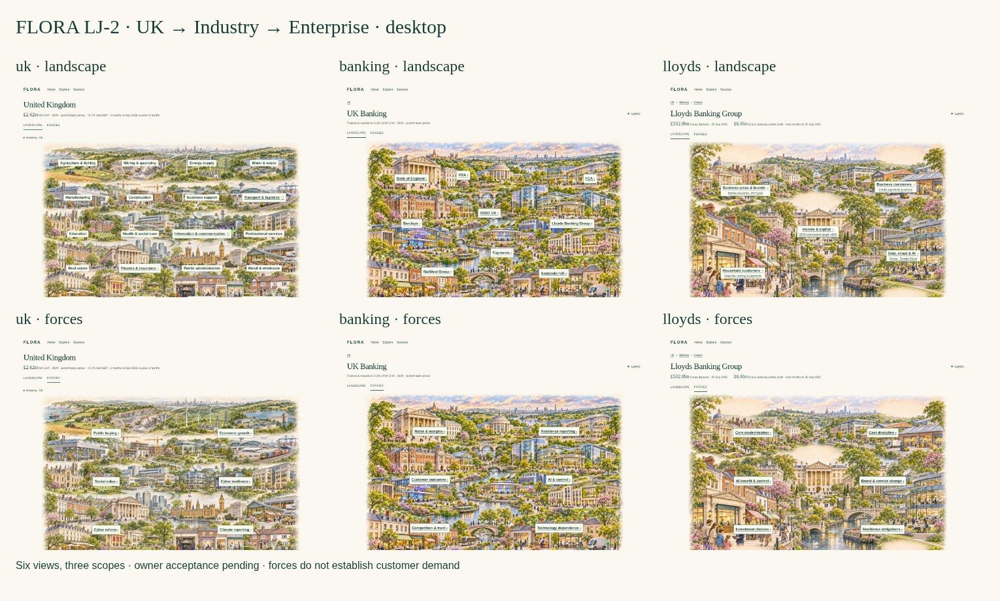

# FLORA LJ-2 — UK → Industry → Enterprise

Design-only continuation of PR #610 and [owner decision](https://github.com/rdidale-jpg/CIOS/pull/610#issuecomment-6880285212). LJ-1R is not accepted; this revision also requires owner visual acceptance. **Three mandatory scopes, two lenses each; no Groups stop or compulsory Builder.**

[Download the offline demo](LJ-2-demo.zip), extract it and open `uk-landscape.html`. Banking is one integrated ecosystem with all five bank identities, BoE, PRA, FCA and payments. Clicking Banking in UK then Lloyds in Banking reaches the enterprise in **two deliberate clicks**. The other banks have equal entry affordances and honest bounded-profile states. No current financial/research completeness is implied.

| Scope / lens | Desktop | iPad landscape | iPad portrait | Mobile |
|---|---|---|---|---|
| UK Landscape | [Image](previews/desktop-uk-landscape.jpg) | [Image](previews/ipad-landscape-uk-landscape.jpg) | [Image](previews/ipad-portrait-uk-landscape.jpg) | [Image](previews/mobile-uk-landscape.jpg) |
| UK Forces | [Image](previews/desktop-uk-forces.jpg) | [Image](previews/ipad-landscape-uk-forces.jpg) | [Image](previews/ipad-portrait-uk-forces.jpg) | [Image](previews/mobile-uk-forces.jpg) |
| Banking Landscape | [Image](previews/desktop-banking-landscape.jpg) | [Image](previews/ipad-landscape-banking-landscape.jpg) | [Image](previews/ipad-portrait-banking-landscape.jpg) | [Image](previews/mobile-banking-landscape.jpg) |
| Banking Forces | [Image](previews/desktop-banking-forces.jpg) | [Image](previews/ipad-landscape-banking-forces.jpg) | [Image](previews/ipad-portrait-banking-forces.jpg) | [Image](previews/mobile-banking-forces.jpg) |
| Lloyds Landscape | [Image](previews/desktop-lloyds-landscape.jpg) | [Image](previews/ipad-landscape-lloyds-landscape.jpg) | [Image](previews/ipad-portrait-lloyds-landscape.jpg) | [Image](previews/mobile-lloyds-landscape.jpg) |
| Lloyds Forces | [Image](previews/desktop-lloyds-forces.jpg) | [Image](previews/ipad-landscape-lloyds-forces.jpg) | [Image](previews/ipad-portrait-lloyds-forces.jpg) | [Image](previews/mobile-lloyds-forces.jpg) |

Also captured: 320px fallback and six 720px zoom-width layouts. [iPad continuity](previews/ipad-landscape-continuity.jpg) · [Portrait continuity](previews/ipad-portrait-continuity.jpg) · [Mobile continuity](previews/mobile-continuity.jpg).

## Before / after and visual critique

[Banking comparison](previews/banking-comparison.jpg) · [Lloyds comparison](previews/lloyds-comparison.jpg). Before pixels are unchanged LJ-1R at `381a9f463fa426a1dbbb2e0a2ed55a6b66838666`; native matched desktop viewport, no independent recrop. Full views above show below-fold content.

The new independently composed Banking image integrates institutions, five banks, contemporary workplaces and digital/payment infrastructure, so the old separate Groups scene is unnecessary. UK original image/20 names/positions remain intact, with exactly three green outlined native public journey links, underline/arrow non-colour cues. Lloyds retains its distinct purpose-composed rich image and immediately visible facts/brand/technology/economic story. Each scope keeps the same subject/artwork when switching lenses; informative pressure overlays replace the structural labels. This is a lens change, not another website or depth level. Architecture is conceptual, not real company premises, ownership or height-based economics.

Traditional masonry, contemporary glass workplaces and frontier digital/compute cues share warm daylight, trees, depth and architectural texture. Forces use concise on-image labels, then one selected dated explanation with counterpoint and validation question. The full evidence matrix is review material, not a default UI word wall. Phone halves preserve artwork/readable labels, but require scrolling; physical iPad/Safari, VoiceOver/NVDA and network performance still need owner review. Full-resolution artwork remains large (~4MB per PNG); deployment encoding is unimplemented.

## Intelligence and source-to-visual mapping

- [Force trace](Force-Trace.json): 18 scope-specific overlays, original claim/source IDs, dates, kind/status, counter-evidence and open questions. A transient design projection only, **not a second intelligence or Material Pressure model**.
- Landscape actors, metrics, source rights and limits reuse [LJ-1R mapping](../rich/Evidence-to-Visual.json), [audit](../rich/Research-Audit.json) and the original UK registry/basis. Banking now integrates the same five identities within the same ecosystem; no new actor relationship is invented. [Artwork/route/metric integrity](Design-Checks.json).
- UK growth is the stored **+0.7% real GDP, three months to September 2026 versus prior three months**, distinct from **£2.62tn 2024 GVA at current basic prices**. Frozen source, not fresh verification, narrow industry growth or forecast. Banking 8.1% remains the broader Finance & insurance section's 2024 GVA share. Original rounding/source discrepancy remains unresolved.
- UK Forces reuse `visual_v2.insight` over existing validated UK macro/PESTLE records. Political/social views overlap the available social-value evidence. Specific geopolitical, workforce, energy-price and economy-wide AI series are insufficient in these selected records; no new claims are invented to simulate coverage. Broader macro enrichment is an explicit outstanding decision.
- Banking Forces address rates/margins, PRA reporting, customer outcomes, technology dependence, competition/trust and AI/control. Lloyds-specific control evidence is labelled as an enterprise example, never extrapolated to every bank. Some inherited industry mechanisms/citations have weaker status and no current publication date; that is retained.
- Lloyds Forces address core renewal, cost discipline, benefit/control, brand/service changes, investment choices and resilience applicability. Targets, planned changes, reported actuals and inferred commercial questions remain distinct. Source date and temporal context are inspectable at the selected force. No force proves an unresolved customer problem, procurement, budget, timing window or opportunity.
- [Nine research deficiencies](Research-Gaps.md) are byte-preserved: current income/cost reconciliation, comparable growth, segments/brands/legal subsidiaries, operations/systems, wider supplier/customer relations, firm-specific regulatory applicability, leadership, infrastructure participation and open external need. No gap is silently resolved by artwork or pressure text.

Reviewed architecture: accepted Banking baseline; original visual interaction/source contract; ADR-026 Material Pressure Qualification and Ownership; original macro, source and Enterprise Twin owners. This prototype neither runs nor replaces qualification gates, creates a durable pressure, nor changes source facts. #604 remains separate.

## Navigation and preservation

Landscape | Forces links retain UK/Banking/Lloyds scope and selected enterprise. Layer links and back preserve context. Optional URL-only JavaScript copies an already selected bank fragment to lens links; without JavaScript the selected bank panel provides an explicit context-preserving lens link. No storage or backend. Enterprise Builder is an optional future-scope disclosure for #611, not another mandatory level, working simulator or scenario store. Economy/Government remains a separate UK contextual note/future #607 lens, not a top navigation tool or a fabricated Government dataset.

All changed files are design documentation/prototypes/assets/review tooling. No application routes, IAM, evidence, historical model, Offers, matching, Pipeline, production or Render change. PR #603/#609 untouched. Earlier rejected prototypes remain historical evidence, not current entry points.

## Checks and owner acceptance

[Browser results](previews/Checks.json) · [Accessibility snapshot](previews/Accessibility.yml). Tested no-JS six-view rendering at five sizes, direct two-click journey, Lloyds scope retained across repeated lens switches, force evidence/counterpoint, native keyboard skip, selected-bank URL enhancement, and six zoom-width layouts. These are design checks, not full app/security CI or physical screen-reader certification.

- [ ] Two deliberate clicks reach Lloyds from UK, with no Groups stop.
- [ ] Both lenses at each scope preserve subject/context and reveal useful insight.
- [ ] Integrated Banking is as rich and clear as UK and Lloyds; bank access remains neutral.
- [ ] Actuals/targets, external pressure, inferred impact and unknown buyer need remain distinguishable.
- [ ] Nine deficiencies and macro-coverage limits are explicit; enrichment priorities agreed.
- [ ] Desktop/iPad/mobile, keyboard, sources and progressive detail meet beautiful simplicity.
- [ ] Enterprise Builder stays future/optional under #611; #604 remains separate.
- [ ] Owner visual acceptance precedes any implementation.

**Draft; no claim of acceptance. No merge or deployment.**
