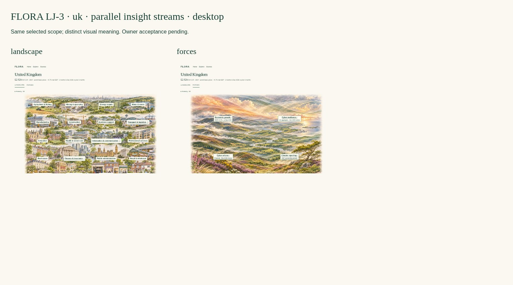
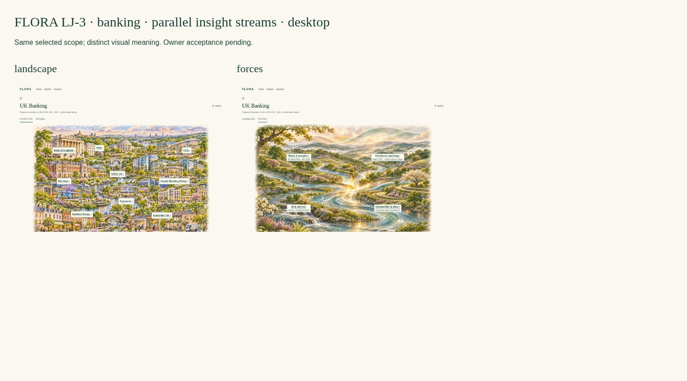
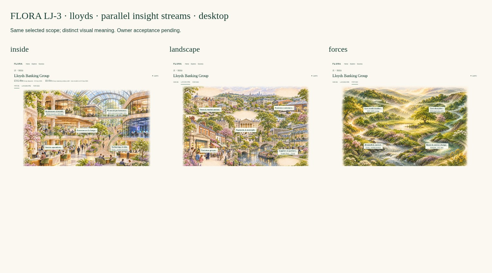

# FLORA LJ-3 — Parallel Insight Streams

**Latest review: [LJ-3N navigation correction, updated previews and acceptance checklist](navigation/README.md).** The offline ZIP now contains LJ-3N. Images and original content below document the earlier LJ-3 presentation; retain them as before evidence. Current navigation results supersede the earlier navigation assertions.

Design/critique only, continuing PR #610 under the [owner’s semantic decision](https://github.com/rdidale-jpg/CIOS/pull/610#issuecomment-6880657983), Issue #608 and the uploaded LJ-3 brief. **Owner visual and architectural acceptance is pending.** No runtime implementation is authorised.

## One journey, parallel views

[Download the offline prototype](LJ-3-demo.zip), extract everything and open `uk-landscape.html`.

- UK: **Landscape | Forces**.
- Banking: **Landscape | Forces**.
- Lloyds: **Inside | Landscape | Forces**.

UK → Banking → Lloyds remains two deliberate clicks. Inside is the default enterprise entry, **not an added depth level**. The selected country is fixed UK, industry Banking, enterprise Lloyds. Stream switches preserve that scope. Back to Banking restores the selected Lloyds label/context; optional URL-only JavaScript carries selected-company fragments across stream links, with native context links as the no-JS baseline. No store, session or IAM authority is created.

## Cross-stream visual comparison

### UK

### Banking

### Lloyds — three meanings, one enterprise

The three existing **Landscape raster compositions are byte-preserved** from LJ-2 `f4a62d8f0b57968f5cce3d2abcac986dac6ac61d`. UK labels and outlines are retained. Banking retains its integrated institution/enterprise world. Lloyds’ existing exterior composition is retained while its semantic labels/panels are refined to external customers, peers, providers, oversight and infrastructure. No Landscape is redrawn to fit the navigation.

Four new original illustrations distinguish the streams: UK’s open atmospheric horizon, Banking’s confluence of currents/terraces, Lloyds’ nested counter-currents and calm central opening, and an internal cutaway/atrium enterprise world. They share cream/sage/green/gold, handcrafted texture, depth and warm light. **Forces are not another building scene with new labels.** These are artistic metaphors, not weather forecasts, quantitative contours, causal maps, a severity ranking or actual premises/floorplans.

## Full-size previews

| Scope / stream | Desktop | iPad landscape | iPad portrait | Mobile |
|---|---|---|---|---|
| UK Landscape | [Image](previews/desktop-uk-landscape.jpg) | [Image](previews/ipad-landscape-uk-landscape.jpg) | [Image](previews/ipad-portrait-uk-landscape.jpg) | [Image](previews/mobile-uk-landscape.jpg) |
| UK Forces | [Image](previews/desktop-uk-forces.jpg) | [Image](previews/ipad-landscape-uk-forces.jpg) | [Image](previews/ipad-portrait-uk-forces.jpg) | [Image](previews/mobile-uk-forces.jpg) |
| Banking Landscape | [Image](previews/desktop-banking-landscape.jpg) | [Image](previews/ipad-landscape-banking-landscape.jpg) | [Image](previews/ipad-portrait-banking-landscape.jpg) | [Image](previews/mobile-banking-landscape.jpg) |
| Banking Forces | [Image](previews/desktop-banking-forces.jpg) | [Image](previews/ipad-landscape-banking-forces.jpg) | [Image](previews/ipad-portrait-banking-forces.jpg) | [Image](previews/mobile-banking-forces.jpg) |
| Lloyds Inside | [Image](previews/desktop-lloyds-inside.jpg) | [Image](previews/ipad-landscape-lloyds-inside.jpg) | [Image](previews/ipad-portrait-lloyds-inside.jpg) | [Image](previews/mobile-lloyds-inside.jpg) |
| Lloyds Landscape | [Image](previews/desktop-lloyds-landscape.jpg) | [Image](previews/ipad-landscape-lloyds-landscape.jpg) | [Image](previews/ipad-portrait-lloyds-landscape.jpg) | [Image](previews/mobile-lloyds-landscape.jpg) |
| Lloyds Forces | [Image](previews/desktop-lloyds-forces.jpg) | [Image](previews/ipad-landscape-lloyds-forces.jpg) | [Image](previews/ipad-portrait-lloyds-forces.jpg) | [Image](previews/mobile-lloyds-forces.jpg) |

[Landscape-iPad Lloyds comparison](previews/ipad-landscape-lloyds-comparison.jpg) · [Portrait-iPad comparison](previews/ipad-portrait-lloyds-comparison.jpg) · [Mobile comparison](previews/mobile-lloyds-comparison.jpg). Five primary sizes include 320px fallback; seven 720px zoom-width renders are committed. `-viewport.jpg` shows above-fold pixels; full images show all content. [Selected Lloyds force](previews/desktop-lloyds-selected-force.jpg) demonstrates the five-question interaction and optional sources.

## Stream semantics and immediately useful content

**Inside:** current reported deposits and nine-month statutory profit retain dates/Group scope. Business/brand change, service operations, technology/data and governance/change are separate areas within a conceptual interior. Halifax’s branch timetable and the labelled 2030 cost:income target remain distinct from current performance. Current legal/segment structure, income/cost/growth reconciliation and leadership are explicitly unknown. The art’s people, rooms and levels do not invent named executives, actual teams or hierarchy.

**Landscape:** external customer groups, business customers, peer identities, infrastructure/oversight and the one supported Google Cloud → Envoy → Lloyds announced collaboration. Industry peers are not a bilateral contract or quantified competitive effect. No new named customers, supplier contracts, workshare, legal-entity obligations or physical dependency is drawn. Internal performance/operating-story content has been removed from the default exterior view.

**Forces:** four selected evidenced topics initially appear at each scope, not an exhaustive or algorithmically ranked list. Selection answers: **What is changing? Why does it matter? Who/what is affected? What remains uncertain? What decision might follow?** Dates, source/status and timing limitations are progressive. Impact pathways are specific: cost discipline → finance/service process; core renewal → operations/continuity; AI/control → platform and frontline workflows; branch transition → assisted service. From a selected Lloyds force, “Inspect the possible internal pathway” opens the relevant Inside area without leaving Lloyds. These pathways are **interpretations to validate**, not actual qualified Material Pressures or confirmed customer needs.

A known deadline/announced programme is not an early shaping window. Internal/incumbent delivery, existing controls, process-only alternatives, unknown applicability and unresolved customer outcomes remain counter-evidence. No demand, procurement, funding, buyer, urgency, external scope or sales opportunity is inferred. #604 is separate.

## Navigation and architecture specification

| Dimension | Meaning / owner |
|---|---|
| Scope | UK / Banking / Lloyds, using existing country/industry/entity identities |
| Stream | Parallel view of the same intelligence; 2 at UK/Industry, 3 at Enterprise |
| Selected item | Native URL fragment; bank selection restored on return, no private persistent state |
| Depth | Optional focused detail and sources; not another compulsory journey stage |
| Evidence | Existing macro/Twin/assessment/source owners; original dates/status/rights retained |
| Material Pressure | ADR-026 qualification remains authoritative; this prototype qualifies none |
| Future News / Topic Cards / Tools | Reserved conceptual stream slots with scope, access, source/freshness and context contracts; no UI screens, feeds or implementations in LJ-3 |
| Enterprise Builder | Optional future scope disclosure under #611; no scenario/formula/financial store |

Reviewed original Banking architecture baseline, visual interaction/source contract and accepted ADR-026. Canonical Enterprise/Evidence/Observation ownership and Material Pressure gates are not changed. `Stream-Mapping.json` is a **design trace/projection**, not a parallel intelligence, pressure or enterprise database. No application route or backend is touched. Private streams in future must resolve actual permissions before display; a selected stream cannot confer access.

## Sources, gaps and truth boundaries

[Stream source-to-visual map](Stream-Mapping.json), [preserved landscape trace](Landscape-Trace.json), [original reviewed-source audit](Research-Audit.json), [nine unchanged research requirements](Research-Gaps.md), [art/integrity provenance](Design-Checks.json).

The nine deficiencies remain: current income/cost reconciliation; comparable growth; current businesses/brands/legal subsidiaries; operations/system inventory; broader customer/supplier relationships; firm-specific regulatory scope; current leadership; infrastructure participation; remaining external need/influence. No invented figure or organisation fills an image. Broader macro geopolitical/energy/workforce/AI-series coverage remains incomplete in the selected records; ungrounded categories are omitted. UK country aggregates and sector context do not establish a consequence for an individual bank. Older repository-reported references retain weaker status; current events are not silently refreshed.

Actuals (£502.8bn deposits / £6.6bn nine-month pretax profit), future targets (<45% cost:income in 2030) and qualitative economic interpretation are visibly distinct. There is **no** internal cost allocation, forecast, model-derived revenue or scenario engine. Source rights and original research records remain unchanged. No research collection or promotion is performed.

## Commercial usefulness and critique

The seller can now distinguish how Lloyds works, who surrounds it and what may change its choices, without extra mandatory screens. The Inside/Forces/externals imagery is clearly differentiated while keeping FLORA’s palette and craft. Four initial pressure labels keep the default calm; selected force detail supplies an actionable validation question and counterpoint rather than a sales pitch.

Outstanding owner decisions: the natural-field Forces metaphor is intentionally calm and may understate tension or feel too scenic; it encodes no severity. Decide whether the overlays convey business relevance strongly enough. Inside is not yet a complete verified enterprise operating model—the nine data gaps materially limit depth. Mobile fold/scrolling preserves legibility but delays some areas below the fold. Physical iPad/Safari, VoiceOver/NVDA and image delivery budgets remain manual acceptance work. Full-resolution art is large; production encoding is out of scope. **Counts/screenshots do not constitute visual or architectural acceptance.**

## Validation and owner checklist

**37 core/journey checks passed** across seven views and five device sizes, plus keyboard, selected-company restoration, five-question inspection and seven zoom views. **650 local links/assets checked, zero broken; 17 native state/layer pages; all three Landscape image hashes and nine gaps preserved.**

[Browser results](previews/Checks.json) · [Inside semantic accessibility snapshot](previews/Inside-Accessibility.yml) · [Static validation](Design-Checks.json).

No-JS core views at 1440×1000, 1194×834, 834×1194, 390×844, 320×780; seven zoom-width views; native keyboard skip/context focus; primary labels ≥14px, ≥44px touch links; bounds/collision checks; two-click entry; all enterprise streams retain Lloyds; back restores selected company; force selection exposes the five questions and sources. Optional URL-only JavaScript selection preservation is checked separately. This is design-artifact validation, not a new app/security CI run or real-device/screen-reader certification.

- [ ] Three existing Landscape images preserved; new Inside and three Forces scenes are memorable and distinct.
- [ ] Seven views feel like one coherent product, not extra depth levels.
- [ ] Internal organisation/performance, external ecosystem and pressure/change remain separate.
- [ ] Force interpretation, actuals/targets, applicability, counter-evidence and timing are understandable.
- [ ] Useful commercial questions do not masquerade as qualified buyer need.
- [ ] Context, previous company, keyboard/mobile navigation and source access are clear.
- [ ] Nine research gaps and macro coverage limits remain explicit; enrichment agreed before factual implementation.
- [ ] Owner gives explicit visual and architectural acceptance before implementation.

STOP for owner review. PR #610 stays draft; #603/#609 untouched. No app/IAM/Offers/Pipeline/canonical research change, merge, production change or Render deployment.
