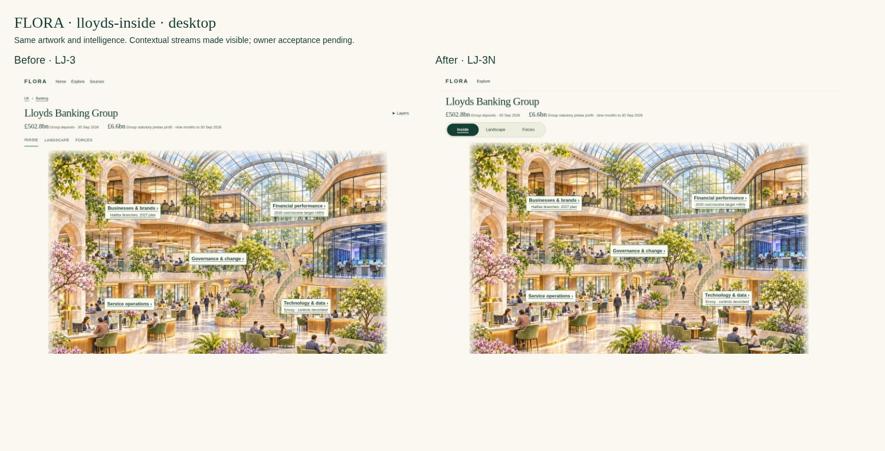
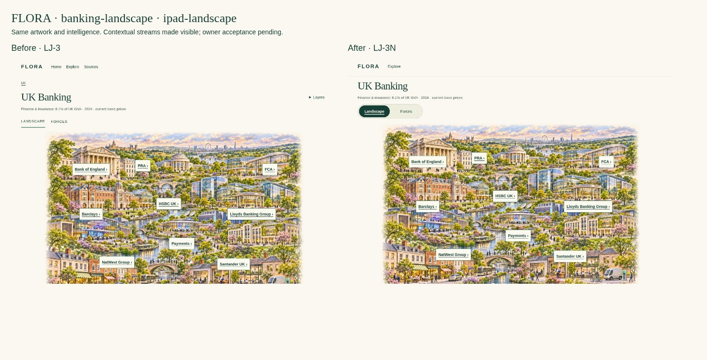
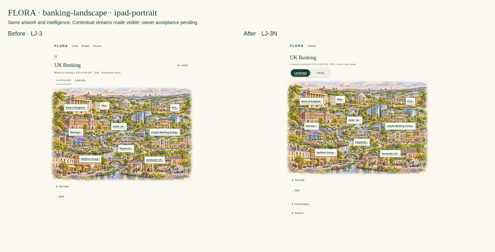
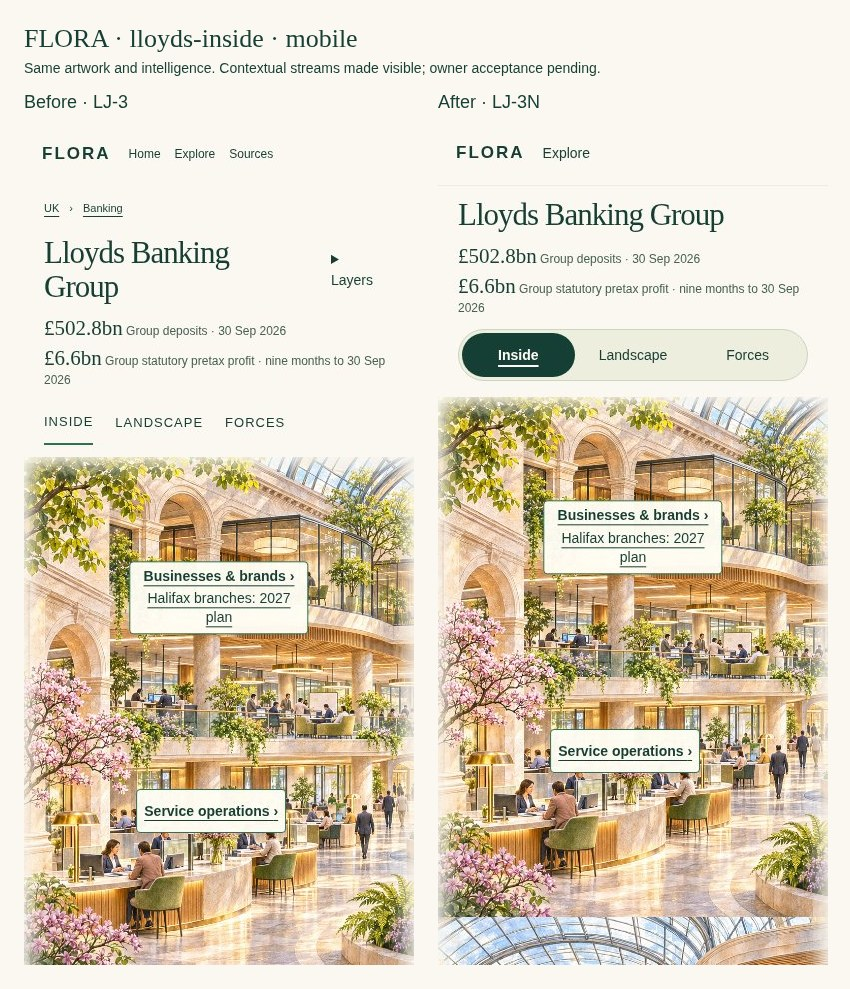
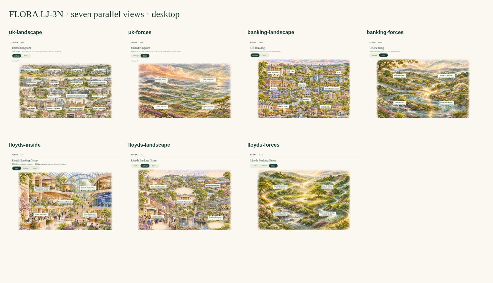

# FLORA LJ-3N — Parallel Stream Navigation

Navigation-only continuation of draft [PR #610](https://github.com/rdidale-jpg/CIOS/pull/610), [Issue #608](https://github.com/rdidale-jpg/CIOS/issues/608) and the [latest owner decision](https://github.com/rdidale-jpg/CIOS/pull/610#issuecomment-6881171867). **Stop for owner acceptance.** The seven LJ-3 images are provisionally accepted, not implementation or research-completeness approval.

[Download the updated interactive prototype](../LJ-3-demo.zip). Extract every file and open **uk-landscape.html**. No installation, credentials or server is needed. Alternatively serve `docs/flora-runtime/living-journey-lj1` locally and open `/lj3/uk-landscape.html`.

## One scope, parallel streams

| Scope | Visible control | Default entry |
|---|---|---|
| UK | Landscape · Forces | Landscape |
| UK Banking | Landscape · Forces | Landscape |
| Lloyds Banking Group | Inside · Landscape · Forces | Inside |

Global **FLORA / Explore** occupies the header. It exposes only the implemented global exploration destination in this static prototype. The contextual segmented switcher sits directly above the artwork, after one scope title and the unchanged financial context. There is no stream dropdown, additional depth level or duplicated breadcrumb. The selected stream has a dark green capsule, bold underlined text and `aria-current="page"`; colour alone does not convey selection. All links have 44px minimum touch height and a visible keyboard focus ring.

Native links expose actual page destinations and remain usable without JavaScript. They are navigation links, not ARIA tabs pretending to switch in-page tab panels. Enter activates the focused link; standard browser Back/Forward and deep links work. Document titles identify scope and stream, and the skip link says “Skip to main content”.

Country UK, industry Banking and enterprise Lloyds are encoded in the existing fixed prototype pages. Layer suffixes remain in every stream destination. A tiny URL-only enhancement updates Banking stream and layer links with the current supported selected-bank fragment, including modifier-click/new-tab destinations; it uses no storage, API, account or permission logic. Native bank-detail stream links also retain selection without JavaScript. With JavaScript disabled, the top-level stream links retain scope/layer but not an arbitrary selected-bank fragment; use the selected bank's explicit contextual stream link for that fallback. No claim is made that unrelated focused content IDs transfer between different streams.

## Before / after

The left images below are the unmodified LJ-3 previews from `9384071c246ff83acbe134a0864f2ab0520e9b1d`; right images show this correction. Neither side represents a new artwork generation.









**Retained:** all seven artwork files, original labels/positions, UK available-industry outlines, dated financial context, source text, force and bank detail, relationships, Enterprise Builder future disclosure, text view and existing layer variants. Existing source/identity limitations and nine research gaps remain unchanged.

**Changed:** contextual stream choices become a single prominent segmented switcher at every scope. Inside → Landscape now opens `lloyds-landscape.html`; previously both controls opened Inside. Browser titles distinguish streams. Bank selection survives both stream and layer navigation when the URL enhancement is enabled.

**Removed from the default header:** redundant breadcrumb, subtle spaced uppercase stream navigation and Sources/Methods dropdown. Sources and context layers now use optional inline disclosures below the image, with all original source content retained. There are no new global dropdowns, additional explanatory panels, future-stream buttons or artwork overlays. No data redesign, image crop change or economic claim is introduced.

**Trade-offs:** the capsule is taller than the previous text-only choices; removing redundant chrome offsets this, especially on phones. Below-image layers/sources are less immediately discoverable; they remain in natural reading order and keyboard accessible. Existing phone artwork reflow still requires scrolling. Large original image payloads remain a later production concern. This correction does not decide research completeness, force severity, production navigation for unimplemented tools, or the future Enterprise Builder.

## Seven views at equivalent sizes



| Scope / stream | Desktop 1440×1000 | iPad landscape 1194×834 | iPad portrait 834×1194 | Mobile 390×844 | Mobile 320×780 |
|---|---|---|---|---|---|
| Uk Landscape | [View](previews/desktop-uk-landscape.jpg) | [View](previews/ipad-landscape-uk-landscape.jpg) | [View](previews/ipad-portrait-uk-landscape.jpg) | [View](previews/mobile-uk-landscape.jpg) | [View](previews/mobile-320-uk-landscape.jpg) |
| Uk Forces | [View](previews/desktop-uk-forces.jpg) | [View](previews/ipad-landscape-uk-forces.jpg) | [View](previews/ipad-portrait-uk-forces.jpg) | [View](previews/mobile-uk-forces.jpg) | [View](previews/mobile-320-uk-forces.jpg) |
| Banking Landscape | [View](previews/desktop-banking-landscape.jpg) | [View](previews/ipad-landscape-banking-landscape.jpg) | [View](previews/ipad-portrait-banking-landscape.jpg) | [View](previews/mobile-banking-landscape.jpg) | [View](previews/mobile-320-banking-landscape.jpg) |
| Banking Forces | [View](previews/desktop-banking-forces.jpg) | [View](previews/ipad-landscape-banking-forces.jpg) | [View](previews/ipad-portrait-banking-forces.jpg) | [View](previews/mobile-banking-forces.jpg) | [View](previews/mobile-320-banking-forces.jpg) |
| Lloyds Inside | [View](previews/desktop-lloyds-inside.jpg) | [View](previews/ipad-landscape-lloyds-inside.jpg) | [View](previews/ipad-portrait-lloyds-inside.jpg) | [View](previews/mobile-lloyds-inside.jpg) | [View](previews/mobile-320-lloyds-inside.jpg) |
| Lloyds Landscape | [View](previews/desktop-lloyds-landscape.jpg) | [View](previews/ipad-landscape-lloyds-landscape.jpg) | [View](previews/ipad-portrait-lloyds-landscape.jpg) | [View](previews/mobile-lloyds-landscape.jpg) | [View](previews/mobile-320-lloyds-landscape.jpg) |
| Lloyds Forces | [View](previews/desktop-lloyds-forces.jpg) | [View](previews/ipad-landscape-lloyds-forces.jpg) | [View](previews/ipad-portrait-lloyds-forces.jpg) | [View](previews/mobile-lloyds-forces.jpg) | [View](previews/mobile-320-lloyds-forces.jpg) |

Full-page previews include optional closed disclosures and footer; `-viewport.jpg` files record the initial fold. Seven `zoom-*.jpg` captures check a 720×500 effective viewport. Before/after files exist for UK Landscape, Banking Landscape and Lloyds Inside at all five sizes; seven-stream boards also exist at all five sizes.

## Navigation evidence

**106 grouped browser checks passed:** all 43 exact stream-link destinations across 17 native state/layer pages; 35 responsive scenes; keyboard activation at seven primary views; skip link; desktop/mobile two-click UK → Banking → Lloyds journey; native Back/Forward and return to selected Lloyds; seven optional source disclosures; no-JS selected-bank contextual link; seven zoom renders; 15 touch selection/layer round trips across five banks and three layers; hash-change selection update; 17 fresh deep links; selected-bank retention when changing layer; forced-colour active border. No horizontal overflow, label collisions or stream/art overlap in the 35 responsive scenes; existing interactive art labels remain at least 14px with 44px target height. Zero browser script errors.

**575 local links/assets, zero broken.** Additional invariants compare all 17 artwork/label blocks, metrics, focus panels, story content, Builder/text disclosures and full source bodies to the LJ-3 baseline. All seven artwork files are SHA-256 identical; source maps/audit and nine research gaps are byte-identical. Application routes, canonical records, IAM, Offers and Pipeline services are outside the changed design-pack paths.

[Structured navigation results and seven hashes](previews/Navigation-Checks.json) · [Content integrity results](previews/Integrity-Checks.json) · [Inside accessibility tree](previews/Inside-Accessibility.yml) · [Static link/package results](../Design-Checks.json).

Reproduce from repository root with Playwright/Chromium available:

```sh
python -m http.server 8777 --bind 127.0.0.1 --directory docs/flora-runtime/living-journey-lj1
# In another terminal:
node docs/flora-runtime/living-journey-lj1/lj3/navigation/review-tools/check.cjs
python docs/flora-runtime/living-journey-lj1/lj3/navigation/review-tools/integrity.py
python docs/flora-runtime/living-journey-lj1/lj3/review-tools/check.py
```

`navigation/review-tools/update.py` reconstructs this navigation markup from the immutable LJ-3 HTML baseline; shared CSS/JS are separately maintained. `boards.cjs` generates comparisons from the preserved earlier and new previews. `../review-tools/package.py` rebuilds the deterministic offline ZIP. Earlier `../review-tools/build.py` and `preview.cjs` are historical LJ-3 generators; do not run them to regenerate LJ-3N.

These are static design-artifact checks in Chromium, including touch emulation, not real-device Safari/iPad or VoiceOver/NVDA certification. Manual assistive-technology review remains pending. No application/security or hosted CI result is claimed: this design pack is outside the FLORA application-validation workflow's path filters. No workflow or production deployment configuration is changed.

## Future stream contract — no new UI

News, Topic Cards and Tools may later extend the same scope-relative navigation model. A future stream must resolve its actual capability and access before display, accept existing country/industry/enterprise identities and compatible selection/layer state, declare supported context explicitly, produce a deep-linkable URL and preserve normal history/focus behaviour. Unsupported selections must fall back deliberately within the same scope. These are design constraints for existing service owners, not a new intelligence model, route implementation, access grant or store. No inactive future-stream buttons have been created.

## Owner acceptance walkthrough

- [ ] Open UK Landscape: one country identity, original 20 labels and green available-industry outlines remain; Landscape is clearly selected.
- [ ] Select Forces then Landscape in one action each. The UK scope remains unchanged.
- [ ] Select Banking in the UK image. Banking opens directly with Landscape active.
- [ ] Select a supported bank and switch streams; the bank and layer remain selected. Back/Forward restores the visited view.
- [ ] Select Lloyds directly from Banking. Inside opens, without an intermediate banking-groups page.
- [ ] Switch Inside → Landscape → Forces → Inside; each distinct original composition opens at the same enterprise. Confirm Landscape no longer reopens Inside.
- [ ] Return to Banking: Lloyds remains selected. Open a copied deep link to a stream/layer/selected-bank URL.
- [ ] Review desktop, both iPad orientations, 390px and 320px. Artwork remains unobstructed and all stream choices are visible without a dropdown.
- [ ] Use Tab, Shift+Tab and Enter; confirm focus/current indication, skip link, text view and optional sources. Complete physical-device/screen-reader review before implementation approval.
- [ ] Accept the navigation visually, or provide specific corrections. Image/data completeness and future tools remain separate decisions.

**No merge, Render action, production-data change or runtime implementation. PR #603/#609 remain untouched.**
