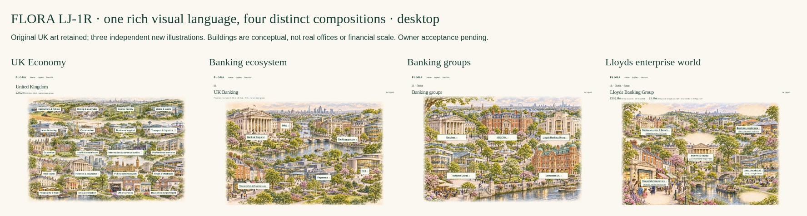

# FLORA LJ-1R — Rich Visual Continuity Correction

Continues draft PR #610 under [#608](https://github.com/rdidale-jpg/CIOS/issues/608) and the [owner’s corrective commission](https://github.com/rdidale-jpg/CIOS/pull/610#issuecomment-6879655251). **Original LJ-1 is rejected. This correction is ready for owner visual review, not accepted for implementation.** #603 and #609 remain untouched.

## Review the four compositions



[Download the navigable offline prototype](LJ-1R-demo.zip), extract the complete folder and open **01-uk.html**. It has four levels, native image links and disclosures, no JavaScript, no app services and no login fixture. Technology/Aviation and other-bank “existing profile” links are explicitly external links to existing FLORA public routes; destination access rules remain authoritative.

| Screen | Desktop | iPad landscape | iPad portrait | Mobile 390 | Mobile 320 |
|---|---|---|---|---|---|
| Original UK panorama | [Image](previews/desktop-01-uk.jpg) | [Image](previews/ipad-landscape-01-uk.jpg) | [Image](previews/ipad-portrait-01-uk.jpg) | [Image](previews/mobile-01-uk.jpg) | [Image](previews/mobile-320-01-uk.jpg) |
| Banking ecosystem | [Image](previews/desktop-02-banking.jpg) | [Image](previews/ipad-landscape-02-banking.jpg) | [Image](previews/ipad-portrait-02-banking.jpg) | [Image](previews/mobile-02-banking.jpg) | [Image](previews/mobile-320-02-banking.jpg) |
| Neutral Banking groups | [Image](previews/desktop-03-groups.jpg) | [Image](previews/ipad-landscape-03-groups.jpg) | [Image](previews/ipad-portrait-03-groups.jpg) | [Image](previews/mobile-03-groups.jpg) | [Image](previews/mobile-320-03-groups.jpg) |
| Lloyds commercial world | [Image](previews/desktop-04-lloyds.jpg) | [Image](previews/ipad-landscape-04-lloyds.jpg) | [Image](previews/ipad-portrait-04-lloyds.jpg) | [Image](previews/mobile-04-lloyds.jpg) | [Image](previews/mobile-320-04-lloyds.jpg) |

[Landscape iPad continuity](previews/ipad-landscape-continuity.jpg) · [Portrait iPad continuity](previews/ipad-portrait-continuity.jpg) · [Mobile continuity](previews/mobile-continuity.jpg). The board is an overview, not a legibility certification; use the individual full-resolution images above. `-viewport.jpg` captures show what is above the fold without hiding complete-page content. `zoom-200-*` captures use 720 CSS pixels, the width equivalent of a 1440px desktop at 200% zoom.

## Before / after — same screen and viewport

Original rejected LJ-1 before images remain byte-identical to commit `208015805e12772fb425cb014870db697f878f6d`. After images are real browser renders, not visual mockups pasted over screenshots. No independent zoom or crop is applied to comparison frames; native page framing/content changes are visible. Full before/after pages remain linked so below-fold material is not concealed.

| Screen | Desktop comparison | iPad landscape | iPad portrait | Mobile |
|---|---|---|---|---|
| Banking | [Before / after](previews/desktop-02-banking-comparison.jpg) | [Before / after](previews/ipad-landscape-02-banking-comparison.jpg) | [Before / after](previews/ipad-portrait-02-banking-comparison.jpg) | [Before / after](previews/mobile-02-banking-comparison.jpg) |
| Groups | [Before / after](previews/desktop-03-groups-comparison.jpg) | [Before / after](previews/ipad-landscape-03-groups-comparison.jpg) | [Before / after](previews/ipad-portrait-03-groups-comparison.jpg) | [Before / after](previews/mobile-03-groups-comparison.jpg) |
| Lloyds | [Before / after](previews/desktop-04-lloyds-comparison.jpg) | [Before / after](previews/ipad-landscape-04-lloyds-comparison.jpg) | [Before / after](previews/ipad-portrait-04-lloyds-comparison.jpg) | [Before / after](previews/mobile-04-lloyds-comparison.jpg) |

Full before: [Banking](../previews/desktop-02-banking.jpg), [Groups](../previews/desktop-03-groups.jpg), [Lloyds](../previews/desktop-04-lloyds.jpg). Full after: individual device links above. There are also three 320px comparison boards in `previews`.

## Visual continuity rule and style guide

- **Original retained:** the UK raster bytes, all 20 original SIC-sector labels and image-relative coordinates; warm paper `#fbf8f1`, forest ink `#153e34`, editorial serif titles, readable sans-serif controls, native focus/disclosure and source-on-demand anatomy.
- **New purpose-composed art:** three independent 1536×1024 illustrations, generated expressly for Banking ecosystem, Banking enterprise district and Lloyds commercial world. Each uses the original UK image as an artistic-language reference only. None repeats, crops, filters or composits the previous scene to impersonate another level. No simplified SVG building asset is used in the corrected scenes.
- **Shared craft:** elevated architectural perspective, masonry/glass/roof texture, foreground life, layered river/gardens/streets, warm daylight, restrained cream/sage colours and a distant UK city atmosphere. Different environments and buildings serve each level’s subject.
- **Separate truth and pixels:** generated architecture is conceptual illustration, **not an actual office, headquarters, campus, tenant, system diagram, property or corporate relationship**. Bank names are semantic navigation labels; neither height nor footprint expresses financial rank. Brand logos, supplier signage and numeric claims are not baked into artwork.
- **Integrated labels:** a small pale backing provides contrast without a competing dark panel. Label and evidence mappings are independent of raster pixels. Across a desktop image join, labels live on a shared overlay, so no text is clipped. Phone layouts fold both exact image halves rather than compressing names below readable size; centre-edge labels receive reviewed alternate anchors/clamping.

[Artwork provenance and hashes](Artwork-Provenance.json) records original/generated boundaries. Original generated PNGs remain unedited and the original UK image matches main. The shared visual language is substantially stronger than the rejected schematic version by implementation review. **Only the owner can accept whether it is at least as compelling as the original panorama.**

## Four-level experience and meaningful interaction

1. **UK:** twenty verbatim original industry labels, exactly three thin green outlines with underline/arrow and ≥44px native touch targets. Broad Finance & insurance opens Banking; Information & communication opens the existing Technology journey; Transport & logistics opens existing Aviation. No second repeated Banking/Technology/Aviation label list appears on the image. Other labels remain inert. The registry is existing `visual_v2.RESEARCH`, backed by current source route handling in `web/app.py`; this static public demo does not infer private user capability. **Available does not mean fully researched or qualified.** Live destination access checks still apply.
2. **Banking:** independently composed ecosystem showing Bank of England, PRA, FCA, customer roles, payments and banking enterprises. BoE and PRA have distinct role labels while PRA is identified as the Bank’s prudential function, not an independent commercial institution. FCA remains a distinct conduct actor. No generic sector rule is turned into a Lloyds entity-specific obligation. Infrastructure has CHAPS/RTGS and other payment-function context on demand; operator/participant contracts remain gaps.
3. **Groups:** five equal native entry points, same visual treatment and no default Lloyds highlight, recommendation, selected building or “Focus Lloyds” CTA. Selecting any bank opens the same kind of contextual profile panel. Lloyds offers the commissioned illustrated pilot; other banks offer their actual bounded repository profile plus an explicit current-depth limitation and the existing public profile link. Equivalent access does not falsely claim equivalent research depth. No quantitative bank size comparison is drawn.
4. **Lloyds:** distinct commercial world, with households, business customers, brands/change, income/capital and data/cloud/AI. Visible on screen four: dated deposits/profit; Halifax branch-change plan; 2030 cost:income target clearly labelled; Envoy/Google collaboration; economic mechanism, strategic pressure and unresolved customer-outcome question. Deeper panels explain actual versus unknown. No mandatory fifth question page remains in the active journey.

Enterprises / Customers & Suppliers / Regulators are optional native layers. Highlights and contextual notes change without asserting extra edges. Selected layer survives scope/back navigation. The generic groups view does not add a Lloyds supplier prompt. Sources and the semantic Text view are optional. “**Model the Enterprise · future tool**” opens a scope note only; [#611](https://github.com/rdidale-jpg/CIOS/issues/611) owns the future architecture/design. No modelling engine, simulator, scenario, formula, private assumption, new state store, write or qualification is implemented.

## Evidence-supported versus missing inputs — outside the end-user images

This legend and the research requests are review material, not extra on-image UI. [Research audit](Research-Audit.json) preserves 16 claim records, dates/status and source limits; [evidence-to-visual map](Evidence-to-Visual.json) binds all 36 on-image labels to owners, scope and gaps; [interaction geometry](Interaction-Mapping.json) binds each label to its own artwork. These are design trace files, **not a second evidence/Twin/relationship architecture**.

| Dimension | Supported/inherited input | What is deliberately not asserted |
|---|---|---|
| Actual scale/profit | £502.8bn consolidated Group customer deposits at 30 Sep 2026; £6.6bn Group statutory pretax profit for the nine months to that date, reviewed Q3 source | Deposits are a stock, profit is a flow; neither is income/revenue, supplier budget or market share |
| Income, costs, growth | Mechanisms from the existing Twin; reviewed 2030 ambition `<45%` cost:income and projected gross savings (scope caveat retained) | No reconciled **current** net interest/other/total income, operating expenses, impairment, margin, matched-period growth or synthetic P&L; no old FY2024 fixture labelled current |
| Businesses/brands/entities | Historical portfolio brands; primary-supported July 2026 Halifax branch-brand timetable through 2027; customer/business roles | No current segment/subsidiary ownership chart. Brands, divisions and regulated legal entities are not conflated; implementation progress not assumed |
| Technology and operations | Envoy and described controls/monitoring; Google collaboration; current strategy direction; older Vertex/model-migration references with their original lower status | No complete current core/payments inventory, ownership, critical-service dependency graph or actual site map. Illustrated factories represent business customers, not Lloyds-owned operations |
| Suppliers/partners/customers | Named Envoy collaboration only; household/business roles | No exclusive contract, renewal, workshare, named corporate customer, second supplier or procurement invented |
| Regulation/infrastructure | BoE/PRA/FCA and payment-system roles from existing sources | No inferred firm/activity obligation or bank-specific infrastructure contract; institutional/entity proof still needs targeted review |
| Pressures/influence | Core modernisation, service continuity, AI benefit/control trade-off; investment-cycle caveats; customer-outcome validation question | No named buyer, available external scope, budget, urgency or early-influence classification. #604 remains separate |
| Leadership | No current primary-supported leadership record selected | No named leader or buyer shown |

**Data completeness is not accepted.** The audited excerpt set cannot support the owner’s full current organisational/financial/technology picture. [Nine targeted research requests](Research-Gaps.md) specify the missing primary documents/fields and design consequences: current income/cost reconciliation; comparable growth; current segments/brands/subsidiaries; operations/systems; suppliers/partners/customers; entity regulatory scope; leadership; infrastructure relationships; and remaining commercial influence. No research is automatically commissioned, collected, canonicalised or fabricated. A richer visual composition does not fill these evidence gaps.

## Validation and critique

**52 responsive/state/journey checks passed**: 20 core renders and 30 optional layer states plus two complete journeys. Five primary views: desktop 1440×1000, iPad 1194×834 and 834×1194, mobile 390×844 and 320×780. All bank choices, label bounds/collisions, one title, 20 unique UK labels, exactly three outlined links, ≥14px primary labels, ≥44px touch height, layer-aware back and no horizontal overflow are checked. Native keyboard skip and focused context selection pass; an ARIA snapshot is linked below. Four 720px zoom-width captures are included. No-JS and reduced-motion are the tested baseline. [Browser results](previews/Browser-Checks.json) · [Lloyds accessibility tree](previews/Lloyds-Accessibility.yml). Static validation checks **294 local links/assets**, four distinct artwork hashes, unchanged UK bytes/labels/positions, all 36 label bindings, unchanged research hash, all 15 pinned before images and a four-level archive with no fifth page. [Static results](Design-Checks.json).

- **Improved:** genuine distinct rich architectural subjects at every deeper level; neutral bank selection; more insight directly on Lloyds; no repeated placeholder buildings or compulsory question level.
- **Current limits:** phone fold requires scrolling, including reaching some Lloyds facts below the fold. Equal navigation does not make other banks’ evidence as deep as Lloyds. The illustrations are a commercial metaphor, not an actual enterprise/location model. Current org/finance completeness is limited as above.
- **Performance:** unedited full-resolution generated PNGs are about 4MB each. This design pack proves visual composition, not a production image-delivery budget. Responsive encodings, network timing, Safari masks, actual iPad and VoiceOver/NVDA still need acceptance and a separately approved implementation. No external font/feed/CDN requests are introduced by the prototype itself.
- **No false certification:** Chromium screenshots and semantic-tree checks are not a physical-device or screen-reader certification, a financial model verification, independent research approval or a fresh full application/security CI run.

## Owner acceptance checklist — pending

- [ ] The three new scenes match the original UK panorama’s craft, warmth, depth and visual appeal.
- [ ] All original UK names remain instantly legible; exactly available public journeys are outlined without repeated names.
- [ ] Banking conveys distinct BoE/PRA/FCA, enterprises, customer and infrastructure roles without false relationships.
- [ ] Every bank has an equal entry; no premature Lloyds steering.
- [ ] Lloyds provides materially more useful intelligence on level four, with actuals, targets, interpretation and unknowns distinguishable.
- [ ] Research gaps and current-data limitations are acceptable for a design prototype; required enrichment precedes factual implementation.
- [ ] Mobile fold, touch/keyboard semantics, sources and optional layers feel simple rather than cluttered.
- [ ] Model the Enterprise remains optional and future-scoped under #611.
- [ ] Owner visual acceptance and architecture approval precede any implementation.

**Stop here for owner review. No merge/deploy.** Production routes, data, permissions, Offers, source/canonical ownership, matching and Pipeline remain unchanged. Original LJ-1 code/previews/archive remain historical rejected evidence; current entry point is this four-level correction. PR #603/#609 are untouched.

Reproduce with repository dependencies:

```sh
PYTHONPATH=. python docs/flora-runtime/living-journey-lj1/rich/review-tools/audit.py
PYTHONPATH=. python docs/flora-runtime/living-journey-lj1/rich/review-tools/build.py
python docs/flora-runtime/living-journey-lj1/rich/review-tools/mapping.py
python -m http.server 8777 --bind 127.0.0.1 --directory docs/flora-runtime/living-journey-lj1
# Separate terminal:
node docs/flora-runtime/living-journey-lj1/rich/review-tools/preview.cjs
node docs/flora-runtime/living-journey-lj1/rich/review-tools/boards.cjs
python docs/flora-runtime/living-journey-lj1/rich/review-tools/package.py
python docs/flora-runtime/living-journey-lj1/rich/review-tools/check.py
```
