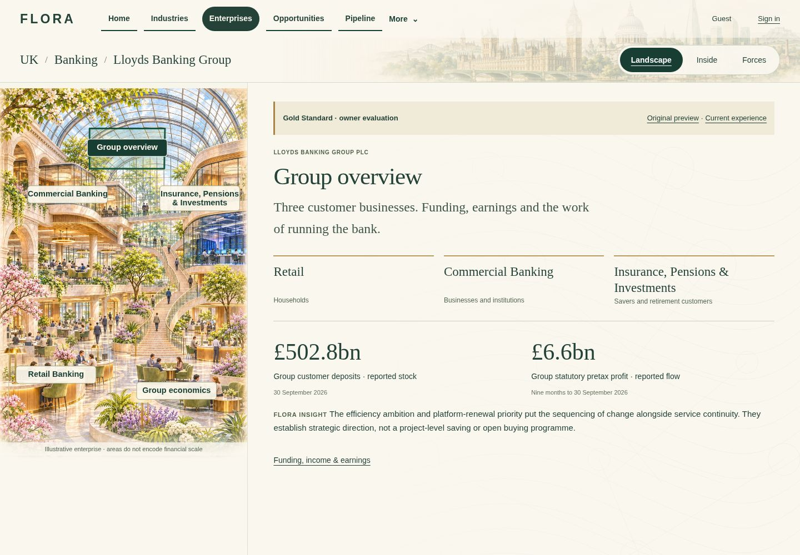
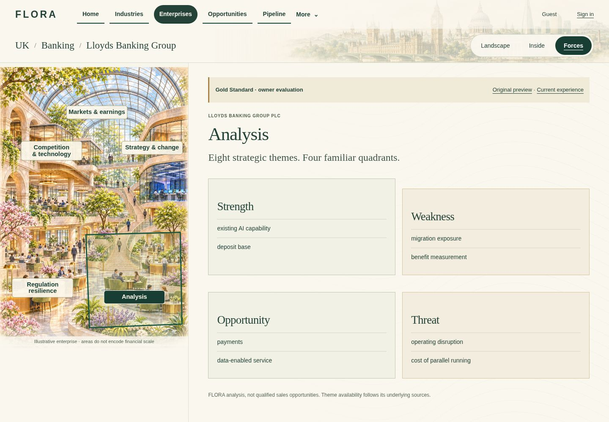

# Lloyds Gold Standard v1 — owner evaluation

This is an integrated, read-only Lloyds experience using the existing Top / Left / Main runtime. It is **draft implementation, not deployed or owner-accepted**. The current default and #730 preview remain available. No Source permission, Financial run, canonical record, Material Pressure or Pipeline object is created.

**Baseline:** verified main `eaca26f2b31c3c9227bb797d60f7d3492a8313d1` (#730). Full main CI passed in [run 45334483807](https://github.com/rdidale-jpg/CIOS/actions/runs/45334483807). The final PR head and hosted checks are identified in the PR, avoiding a self-referential commit in this document.

## Owner walkthrough

Run the ordinary Flora application from this branch. Open **Enterprises → Lloyds → Preview New Experience → Gold Standard evaluation**. Direct application route: `/enterprises/lloyds/preview/gold`. This route is not claimed available on Render.

1. **Landscape → Group overview:** immediately see the three businesses and eligible Group funding and earnings, not an automatic Retail selection.
2. Select **Group economics** in the illustration: funding/income/earnings/capital mechanism, dated deposit stocks, three distinct segment business models and Central / Equity boundary. Select **Efficiency & investment** for reported plans versus actual results. No segment profit numbers are released.
3. Select **Retail / Commercial / Insurance, Pensions & Investments**: customer groups, activities, economic mechanisms and conceptual value streams. Group figures are not allocated to these businesses. Inside retains the original division as orientation, not proof of a dependency.
4. **Inside → Operating model / Capabilities:** distinguish value streams, activities and durable capabilities; open credit/service detail and capability accountability.
5. **Applications & AI → Envoy / Copilot:** inspect the actual kind of disclosure, operational scope and missing contract/version/support/renewal information. **Suppliers & partners** distinguishes collaboration and product licences from contracts. **Transformation** opens five supported programme dossiers; no buying intent is inferred.
6. **Forces:** examine markets, regulatory applicability, competition or strategy/timeline. **Analysis** on Left opens the four-quadrant SWOT; select each of eight themes for evidence-backed interpretation, counter-evidence and a specific commercial investigation question. SWOT is not repeated under every force.
7. Evidence is one contextual Level 3 destination, never an accordion wall. Dates, source homepage attribution, accounting/entity limits and material caveats remain inspectable. Commercial questions and explicit Unknown contract fields appear only in deeper inspection; no research-completeness panels on arrival.
8. Switch perspectives, then Back / Forward / reload; return to the original preview or current experience. iPad portrait/mobile use the existing **Explore Lloyds** illustration disclosure. Native links remain usable without JavaScript.

## What is measurably different

[Inventory.json](Inventory.json) and [audit.py](audit.py) enumerate the original identities, sources, held records, model objects, research packages and unchanged images. The finite public research overlay has 45 claims, of which **39 concern Lloyds**. **19 Lloyds claim identities are currently eligible; all 19 have substantive Main destinations**, versus 14 reachable in #730. Five additions are investment timing in two periods, gross-savings ambition, colleague licences and the branch announcement's role-reduction limitation. Fourteen other eligible items receive deeper economic, operating, programme or strategic context. These are all 19 supported underutilised Lloyds items; there are fewer than twenty.

This is **19/19 of that eligible Lloyds claim set**, not 100% of Lloyds research, canonical truth or enterprise completeness. Twenty other Lloyds claims remain held. Four external policy statements are separate context. Existing capability/library and relationship counts are not financial facts or automatically verified edges. The ledger gives explicit denominators and original IDs; old duplicate candidates are retained, not silently deleted or promoted.

## Readiness and limitations

The eligible experience is ready for owner browser evaluation once the exact-head checks pass. **The desired reported segment-profit acceptance point remains incomplete**: LEI-1 H1 research does not supply public Source/Financial authority. All new segment income, profit, impairment, capital and reconciliation values remain excluded. Existing rounded Group profit and two deposit stocks are unchanged in authority and precision. No private Financial runs are discovered, and existing Financial Analyst access remains on its original route.

Named executives, programme budgets, application installations/versions, support/contract/renewal dates and legal contracting entities remain unverified where no eligible input exists. Google/Envoy is a disclosed collaboration; Copilot is disclosed licences. Neither proves contract scope, estate-wide dependency, adoption or net benefit. [Restrictions and research demands](Research-and-Rights.md) detail the held inventory.

The ten referenced 24 November owner screenshots/eight separate screenshot notes were not supplied in the attachment or #730 comments. The complete eight-workstream commission and real baseline browser renders drive this implementation. Direct visual comparison to those absent owner images, physical-device testing, final owner visual acceptance and deployment remain outstanding. No inaccessible production/canonical data is claimed inspected.

## Owner checklist

- [ ] Group arrival communicates the business within seconds and retains the original illustration.
- [ ] Divisions, stock/flow economics and held segment-profit limitation are clear.
- [ ] Operating model, capabilities, applications and programmes offer useful differentiated depth.
- [ ] Analysis is immediately discoverable; all eight SWOT themes are usable and not repeated elsewhere.
- [ ] Caveats are commercially understandable; no invented system, supplier contract, buying need or allocation appears.
- [ ] Desktop and both iPads are comfortable; mobile, keyboard, touch and history work.
- [ ] Original default, original preview, Banking and Aviation/easyJet remain intact.
- [ ] Accept this as an optional evaluation release only; replacement of either existing Lloyds experience requires explicit owner acceptance.

[Reconciliation and architecture](Architecture-and-Reconciliation.md) · [Commercial critique](Critique.md) · [Validation and rollback](Validation.md)

## Browser gallery

Actual application renders, not mock-ups. Before is the exact #730 merge checkout. After capture manifests include runtime hashes, while exact-head hosted browser artefacts name the tested commit. The gallery is a dated review artefact, never a runtime snapshot or substitute for live Source checks.

| View | Before | Gold Standard |
| --- | --- | --- |
| Desktop | [Original preview](previews/before-desktop-original-preview.jpg) | [Group](previews/after-desktop-group.jpg) · [Economics](previews/after-desktop-economics.jpg) · [Inside](previews/after-desktop-operating-model.jpg) · [Applications](previews/after-desktop-applications.jpg) · [SWOT](previews/after-desktop-analysis.jpg) |
| iPad landscape | [Original](previews/before-ipad-landscape-original-preview.jpg) | [Group](previews/after-ipad-landscape-group.jpg) · [Economics](previews/after-ipad-landscape-economics.jpg) · [SWOT](previews/after-ipad-landscape-analysis.jpg) |
| iPad portrait | [Original](previews/before-ipad-portrait-original-preview.jpg) | [Group](previews/after-ipad-portrait-group.jpg) · [Illustration](previews/after-ipad-portrait-illustration-expanded.jpg) · [Applications](previews/after-ipad-portrait-applications.jpg) |
| Mobile | [Original](previews/before-mobile-original-preview.jpg) | [Group](previews/after-mobile-group.jpg) · [Economics](previews/after-mobile-economics.jpg) · [SWOT](previews/after-mobile-analysis.jpg) |

