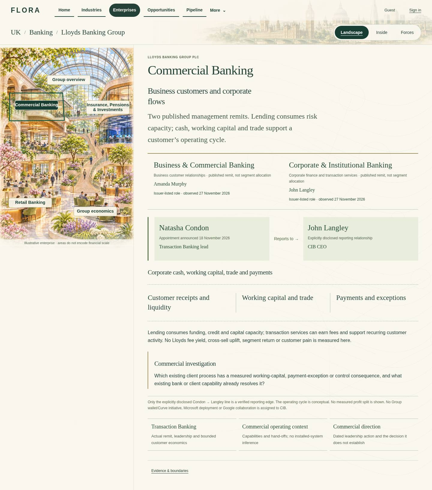
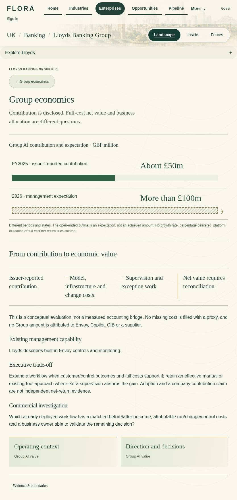

# Actual browser comparisons

These are isolated HTTP browser renders, not Render deployment evidence. Before: main `08763fca342fcaf67c37f261948d8a8c9642d2c3`. After: runtime commit `226747cc8192cdf3ca8b2e72ecb78659f8775cc7`; the subsequent evidence commit does not change runtime bytes. Chromium emulates iPads/mobile; physical Safari is not certified.

The full runs produced 24 before and 71 after captures, including 108 reversible topic-switch journeys. The manifests retain all hashes; this gallery retains selected comparable images.

## Desktop

| Subject | Before | After |
| --- | --- | --- |
| group | [Before](captures/before-desktop-group.jpg) | [After](captures/after-desktop-group.jpg) |
| inside | [Before](captures/before-desktop-inside.jpg) | [After](captures/after-desktop-inside.jpg) |
| forces | [Before](captures/before-desktop-forces.jpg) | [After](captures/after-desktop-forces.jpg) |
| commercial | [Before](captures/before-desktop-commercial.jpg) | [After](captures/after-desktop-commercial.jpg) |
| ai-goal | [Before](captures/before-desktop-ai-goal.jpg) | [After](captures/after-desktop-ai-goal.jpg) |
| workforce | [Before](captures/before-desktop-workforce.jpg) | [After](captures/after-desktop-workforce.jpg) |

## Ipad Landscape

| Subject | Before | After |
| --- | --- | --- |
| group | [Before](captures/before-ipad-landscape-group.jpg) | [After](captures/after-ipad-landscape-group.jpg) |
| inside | [Before](captures/before-ipad-landscape-inside.jpg) | [After](captures/after-ipad-landscape-inside.jpg) |
| forces | [Before](captures/before-ipad-landscape-forces.jpg) | [After](captures/after-ipad-landscape-forces.jpg) |
| commercial | [Before](captures/before-ipad-landscape-commercial.jpg) | [After](captures/after-ipad-landscape-commercial.jpg) |

## Ipad Portrait

| Subject | Before | After |
| --- | --- | --- |
| group | [Before](captures/before-ipad-portrait-group.jpg) | [After](captures/after-ipad-portrait-group.jpg) |
| inside | [Before](captures/before-ipad-portrait-inside.jpg) | [After](captures/after-ipad-portrait-inside.jpg) |
| forces | [Before](captures/before-ipad-portrait-forces.jpg) | [After](captures/after-ipad-portrait-forces.jpg) |
| commercial | [Before](captures/before-ipad-portrait-commercial.jpg) | [After](captures/after-ipad-portrait-commercial.jpg) |

## Mobile

| Subject | Before | After |
| --- | --- | --- |
| group | [Before](captures/before-mobile-group.jpg) | [After](captures/after-mobile-group.jpg) |
| inside | [Before](captures/before-mobile-inside.jpg) | [After](captures/after-mobile-inside.jpg) |
| forces | [Before](captures/before-mobile-forces.jpg) | [After](captures/after-mobile-forces.jpg) |

## Connected detail

Commercial Banking now connects economics, actual remits and the dated management decision. Group AI contribution remains separate from its later expectation and from any platform allocation.

- [desktop: ai-economics](captures/after-desktop-ai-economics.jpg)
- [desktop: commercial-context](captures/after-desktop-commercial-context.jpg)
- [desktop: commercial-direction](captures/after-desktop-commercial-direction.jpg)
- [desktop: finance-leader](captures/after-desktop-finance-leader.jpg)
- [ipad-landscape: ai-economics](captures/after-ipad-landscape-ai-economics.jpg)
- [ipad-landscape: commercial-context](captures/after-ipad-landscape-commercial-context.jpg)
- [ipad-landscape: commercial-direction](captures/after-ipad-landscape-commercial-direction.jpg)
- [ipad-landscape: finance-leader](captures/after-ipad-landscape-finance-leader.jpg)
- [ipad-portrait: ai-economics](captures/after-ipad-portrait-ai-economics.jpg)
- [ipad-portrait: commercial-context](captures/after-ipad-portrait-commercial-context.jpg)
- [ipad-portrait: commercial-direction](captures/after-ipad-portrait-commercial-direction.jpg)
- [ipad-portrait: finance-leader](captures/after-ipad-portrait-finance-leader.jpg)

## Findings

All four sizes passed interaction, geometry, whole-region targets, focus, touch, keyboard, history/reload and withdrawal checks. The selected executive appears before the roster. The accepted three compositions and original artwork remain. Native screen/PDF inspection did not reproduce a dark-background/oval defect, so no speculative runtime colour fix was made. Dense detail still requires scrolling; this is not a complete divisional P&L or workforce allocation.
