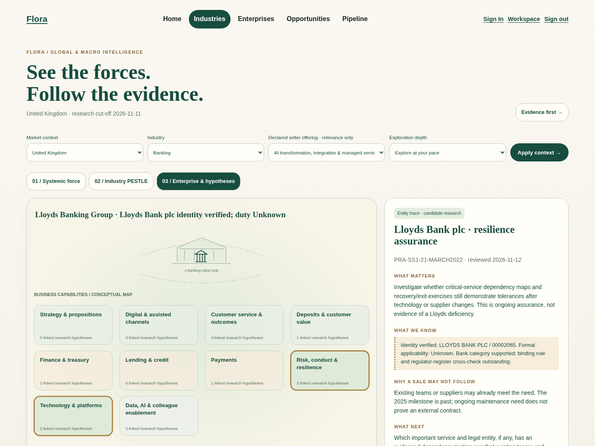
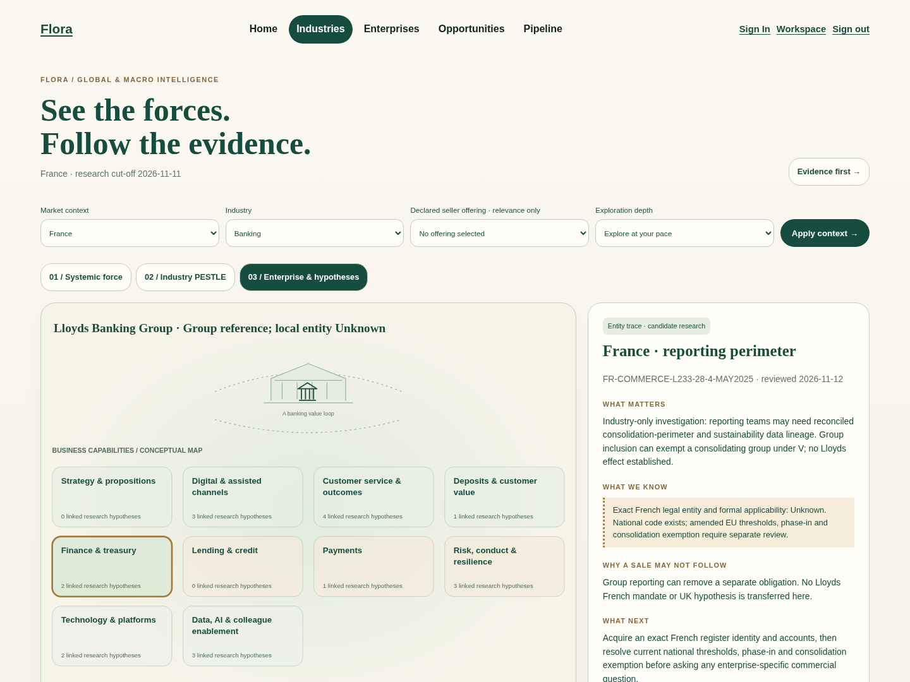

# Owner acceptance gallery

Actual Chromium screenshots from isolated localhost FLORA; no production connection or seeded demonstration records. Matched before is #564 `4c374ac`; after is this implementation. Desktop 1440×1080, tablet 1024×768, phone 390×844. `panel` captures scroll to the inspector; they are not full-page composites. Source hashes and automated results are retained below.

## UK: a precise investigation, not a presumed deal

| Viewport | Before | After | Selected panel |
| --- | --- | --- | --- |
| Desktop | [v1](previews/uk-before-desktop.png) | [v2](previews/uk-after-desktop.png) | [Inspect](previews/uk-after-desktop-panel.png) |
| Tablet | [v1](previews/uk-before-tablet.png) | [v2](previews/uk-after-tablet.png) | [Inspect](previews/uk-after-tablet-panel.png) |
| Phone | [v1](previews/uk-before-mobile.png) | [v2](previews/uk-after-mobile.png) | [Inspect](previews/uk-after-mobile-panel.png) |

Walkthrough: Home → Macro Intelligence → UK / Cyber & Resilience → Industry PESTLE → Enterprise. Inspect Lloyds Bank plc identity separately from Unknown binding-rule applicability. Open the official register/SS1/21 directly or use the dossier. Follow existing RCO-LBG-005 to its original evidence and capture controls; browser Back retains the Macro context/offering. Nothing is captured automatically.

## France: useful industry context with an honest entity blocker

| Viewport | Before | After | Selected panel |
| --- | --- | --- | --- |
| Desktop | [v1](previews/france-before-desktop.png) | [v2](previews/france-after-desktop.png) | [Inspect](previews/france-after-desktop-panel.png) |
| Tablet | [v1](previews/france-before-tablet.png) | [v2](previews/france-after-tablet.png) | [Inspect](previews/france-after-tablet-panel.png) |
| Phone | [v1](previews/france-before-mobile.png) | [v2](previews/france-after-mobile.png) | [Inspect](previews/france-after-mobile-panel.png) |

Walkthrough: France → Sustainability → France/EU reporting → Enterprise. Inspect the national text, consolidation exemption and unresolved legal entity. No UK hypothesis or implied French subsidiary appears. Compare UK/Global contexts without interpreting a coverage gap as legal exemption.

## Exports and actual checks

- UK: [2-page executive](previews/uk-executive.pdf) · [15-page full evidence](previews/uk-appendix.pdf).
- France: [2-page executive](previews/france-executive.pdf) · [11-page full evidence](previews/france-appendix.pdf).
- [Matched browser checks / PDF hashes](previews/browser-results.json): 12 case/revision/viewport checks, six keyboard dossier-and-Back journeys, no horizontal overflow or JavaScript errors, no-JS direct evidence navigation. Full PDFs checked for located passages and decision/edge manifests; executive PDFs retain Unknowns.
- [Original atlas compatibility browser checks](previews/existing-browser-results.json): 30 page checks, nine seller-persona/device journeys, keyboard/touch-emulated/reduced-motion, no-JS and original print modes. Focused counts overlap strict-gate totals and are not added twice.
- [Rendered source manifest](previews/source-manifest.json).

The single inspector replaces the generic enterprise explanation only for the two reviewed context/industry/force combinations. The six-category atlas and other views remain. Visual inspection found readable hierarchy and preserved illustrated language; a phone inspector requires scrolling, and full machine-readable appendix manifests produce long PDFs. No claim of faster human comprehension or increased sales conversion is made.

## Owner checklist — pending human evaluation

- [ ] Explain the difference between precise entity identity and Unknown formal applicability.
- [ ] Identify the concrete UK investigation and its internal-delivery/no-contract alternatives.
- [ ] Explain why the France trace stops at industry level and what evidence closes it.
- [ ] Reach exact register/legal passages and return without losing context.
- [ ] Assess the short executive exports and full evidence dossier for practical usefulness.
- [ ] Evaluate physical iPad/Safari, screen-reader operation and novice comprehension.

No human comprehension test, physical-device acceptance or independent human approval is represented by these automated checks. No merge or deployment is authorised by this gallery.
