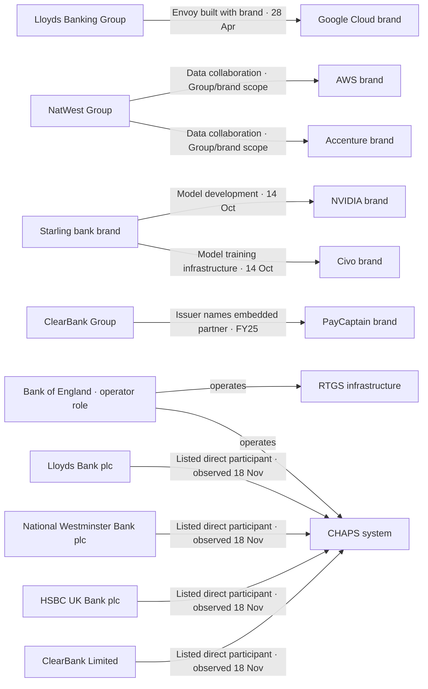

# Banking ecosystem — role and relationship map

Solid connections below are source-reported **research candidates**, not accepted contracts, dependency criticality or canonical graph edges. Exact predicates, parties, dates and limitations are in [Typed-Relationships.json](Typed-Relationships.json). No diagram adjacency creates an additional relationship.

The commercial value-system reference is **customer choice and servicing → funding and credit → payments and settlement → enabling technology/control**. This ordering is conceptual: a provider can support several stages, and a regulator is not a production supplier. Actual enterprise capabilities are distinct from the ordered stages. Banks, mutuals, operator/provider firms and institutions use different economic measures.

Pay.UK Limited remains separate from Bacs/FPS/ICS systems and CASS switching service. Guarantor governance, direct clearing participation, indirect access, settlement accounts, technology infrastructure and legal service contracts are distinct roles. Its financial/list/tariff evidence remains withheld under the documented acquisition/use exception; there is no inferred participant graph here.

The July CTP legal-person designations and 17 November additional cohort are national oversight context. They do not turn the Google Cloud brand edge into a Lloyds Bank plc–Google Cloud EMEA Limited contract, make a bank workload critical or establish purchasing intent. PRA is part of the Bank; FCA conduct and PSR access functions retain separate powers/status. A proposed transfer is not an already completed merger.

The airline/holidays reporting elimination and provider economic exemplars demonstrate cross-sector reuse of the same exact-scope method. They add no unverified Banking supplier/client edges. All 31 older candidate edges remain preserved separately, including their unresolved legal parties and source-use requirements.
