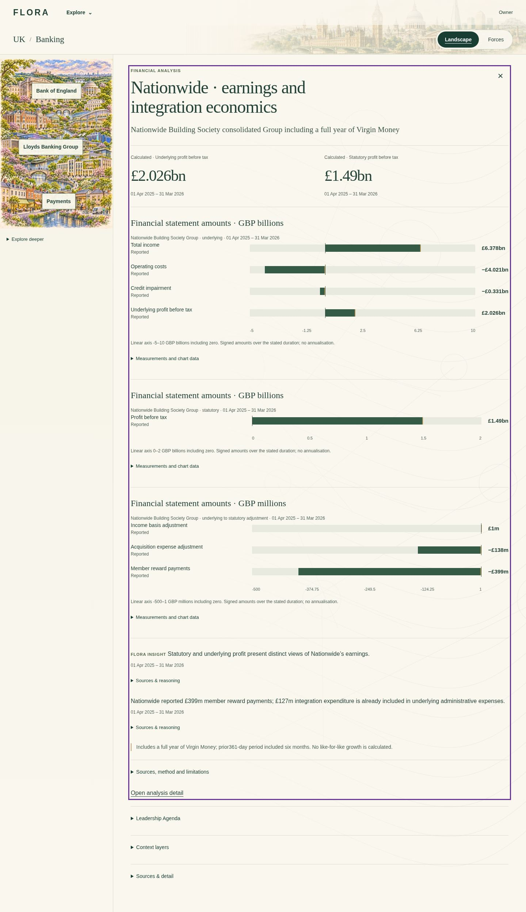

# Before / after — accepted VP-2 runtime

Baseline is the validated F3 main commit. After views use the same Top/Left/Main shell and original Banking portrait. Real financial facts; isolated synthetic authority. These are application screenshots, not redesigned mockups.

| Device | Before | After |
|---|---|---|
| Desktop1440×900 | [Before](previews/before-desktop.jpg) | [After](previews/after-desktop.jpg) |
| iPad landscape1194×834 | [Before](previews/before-ipad-landscape.jpg) | [After](previews/after-ipad-landscape.jpg) |
| iPad portrait834×1194 | [Before](previews/before-ipad-portrait.jpg) | [After](previews/after-ipad-portrait.jpg) |
| Mobile390×844 | [Before](previews/before-mobile.jpg) | [After](previews/after-mobile.jpg) |
| Mobile320×740 | [Before](previews/before-mobile-320.jpg) | [After](previews/after-mobile-320.jpg) |

Source/method and exact chart tables open progressively. Both profit bases have distinct business-language labels. No new illustration, research-administration panel or opportunity prompt was introduced. Same-period reconciliations show their period once. Keyboard focus outline is retained deliberately.

Browser evidence additionally covers six contextual service profiles, stream/history selection, deep links/detail, actual protected refresh POST, foreign-workspace denial, no-JavaScript sources, forced colours and200% text. Viewport/touch emulation does not replace physical Safari or screen-reader certification.
