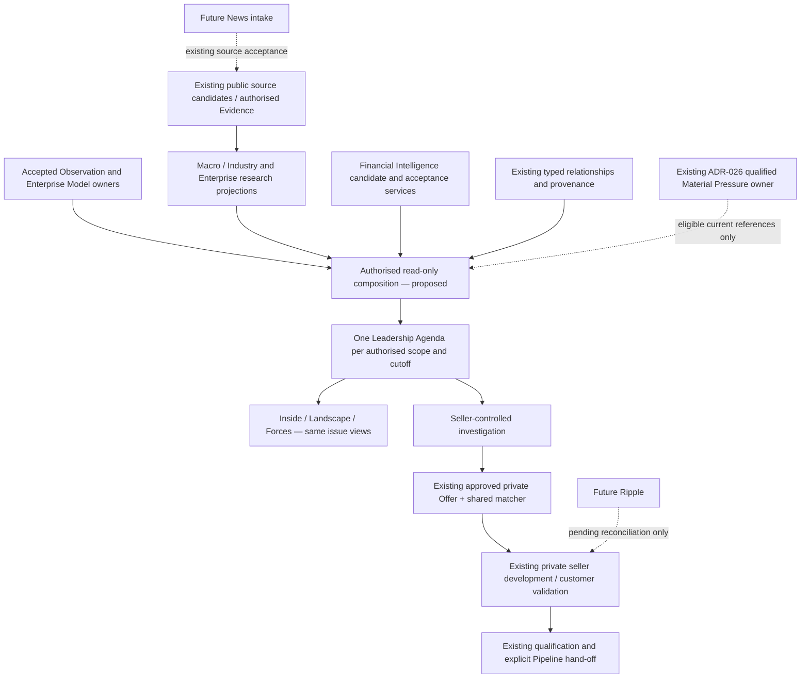

# Ownership and proposed view contracts

**Review proposal. No durable entity, route, API or schema is installed.** Machine-readable schemas constrain the authored pilot, not the full domain or future accepted statuses. In particular their null commercial values and `no_pain_claim` deliberately prevent unsupported proof output. The complete contract below also describes how an eligible demonstrated pain or falsifiable hypothesis could later be presented by its existing owner.

Solid arrows denote intended dependencies, not implemented SI-1 services. The public prototype uses only public candidate inputs. No private query, automatic pressure qualification, opportunity write or future News/Ripple worker is introduced.

| Contract | Required meaning and validation | Existing owner / failure behaviour |
|---|---|---|
| Scope envelope | Country, market/industry boundary, public or verified private subject reference, legal perimeter, audience/workspace and authorised source set | Existing registry/IAM/Canvas controls. Public ID never becomes private access. Reject unresolved identity; filter before counts, synthesis, cache or export. |
| Dependency release | Existing source/claim/Observation reference, owner path/version or immutable digest, original status and rights, policy version and cutoff | Evidence/memory/research owners remain singular. No copied research database. Pilot JSON is a disposable authored fixture. |
| Temporal evidence | Event/effective/reporting period, publication, retrieval/review and view-as-of separately, Unknown permitted | Source contract; a later review is not a later event. Reported future targets/conditional plans remain future. |
| Strategic Issue view | Concern + decision + horizon, scoped consequence, materiality argument, assertion classes, relevant analyses and explicit assumptions | Derived read-only Presentation Model proposal. View reference is not a durable canonical Issue ID. Reproducible concern keys need reviewed semantics, not keyword similarity or raw source IDs. |
| Leadership | Corporate-stated priority vs derived issue; actual speaker/role-at-time only when supported; role hypotheses separately | Corporate sources and future #593 Executive Voice; no invented buyer or private belief. |
| Analytical link | From/to scopes, type, support references, effective/reporting time, inference rationale, counter-case and applicability test | Existing eligible relationship/Observation or explicitly labelled interpretation. Unknown and contradicted links cannot support a stronger downstream fact. Source-backed endpoints do not prove the edge. |
| SWOT synthesis | Relevant internal S/W, external O/T and relationships/tensions; intent and context separate | Interpretation only. Research gaps are not W; a target is not a capability; empty quadrants valid. Strategic Opportunity is not a Pipeline Opportunity. |
| Pain | Direct adverse outcome + exact entity/date and suitable source, **or** falsifiable hypothesis with test/falsifier, **or** no claim | Existing Evidence/Material Pressure semantics. None of the pilot issues demonstrates pain, so all use no claim. No new pressure gate. |
| Decision/influence | Known commitments, exact remaining decision, alternatives, accountable role, timing and access known/unknown | Existing seller investigation; #604 governs future influence model. Announcement importance cannot imply open architecture, procurement or external scope. |
| Challenges | Source-backed counter-evidence with references separately from alternatives, methodological cautions, unknowns and contradictions | Inspectable author reasoning; no source-count or confidence score used as a truth substitute. |
| Agenda | Same scope, cutoff, dependencies and editorial policy → same ordered issue views across all streams | Normally 3–5 only with evidence; 0–2 permitted. Admission/order rationale recorded. Role-specific private play is a separate authorised projection. |
| Commercial action | Specific next learning question, source/customer test, alternative/falsifier, private approved Offer fit only through existing services | Never demand, budget, TCV, buying authority or qualified Pipeline status from the public agenda. Existing ten criteria and human hand-off stay authoritative. |

## Dedupe, updates and read access

One concern can appear through several analyses without becoming several issues. Group only when subject, consequence, decision and horizon are genuinely shared; retain distinct source statements and contradictions. Core renewal, operating-efficiency choice and realised AI benefit are separate Lloyds concerns; overlapping potential benefits are not additive deals.

A future view recomputation must first verify source rights, audience and scope, then resolve eligible owner versions, preserve stale/superseded facts and explain changes under an explicit policy version. A contradiction may demote a conclusion to a question or exclude it; it cannot silently overwrite history. Same-source syndication is not independent corroboration. No SI-1 background recomputation exists.

Caches, if later approved, require verified tenant/workspace/audience and authorised dependency fingerprints. Public cross-stream reuse does not authorise private seller attestations. Exports recheck rights/access and show scope/cutoff. Existing services own denied reads, audit and retention; SI-1 introduces neither a bypass nor a second ACL.

Ripple may later propose reconciliation for affected private records; it must preserve seller edits, customer statements, review decisions and Pipeline authority. News feeds the same eligible evidence path, not a second issue/pain engine. Enterprise Builder scenarios remain #611 with separately reviewed assumptions.

## Option A versus B

| Consideration | A — derived read-only view | B — new durable Strategic Issue |
|---|---|---|
| Shared synthesis and inspection | Sufficient; references existing owners and policy | Also possible, but adds lifecycle and reconciliation |
| New truth ownership / migration | None | Must specify identity, dedupe, acceptance, lineage and migrations |
| Private collaboration | Reuse existing seller records for seller work | Only justified if irreducible issue-specific collaboration/history cannot fit existing owners |
| Risk | Recompute drift; control with dependency snapshots and inspectable changes | Duplicate pressures/observations, stale copies, cross-tenant joins and orphaned issue history |
| Recommendation | **Preferred for v1 design acceptance** | Defer; no evidence here establishes necessity |

Before B could be implemented, a separate decision proposal must demonstrate A's insufficiency and define ownership, temporal and contradiction lifecycle, rights/ACL, collaboration, retention, compatibility and migration/rollback. Chief Architect review is required. Neither option authorises implementation through this design PR.
