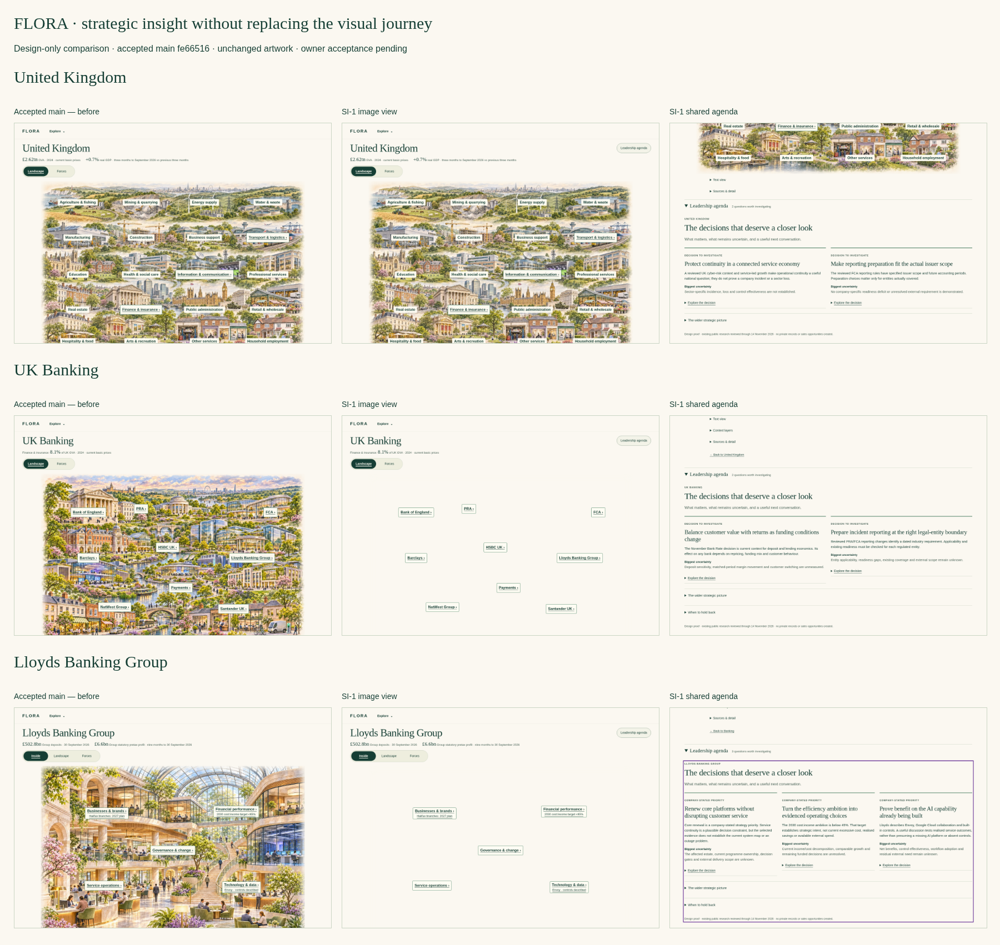

# FLORA SI-1 — strategic intelligence design review

**Design-only proposal for Issue #615. Stop for owner architectural and visual acceptance.** Recommend **Option A**, a derived read-only synthesis using existing owners; no durable Strategic Issue or second pressure/matching engine.

This pack designs the complete analytical method while preserving incomplete research. Seven agenda questions are authored examples: **two UK, two Banking, three Lloyds**, plus Santander, source-applicability and quiet/rejected counter-cases. None establishes demonstrated pain, buyer need, an open supplier opportunity, budget or deal value.

## Open the experience

Download [FLORA-SI1-Walkthrough.html](prototype/FLORA-SI1-Walkthrough.html) using GitHub **Raw / Download**, then open the downloaded file in a browser. It contains all seven accepted image derivatives and works without a server or external requests. GitHub displays HTML source rather than running the prototype. Desktop and both iPad orientations are the primary review targets; mobile reflows the existing image halves and agenda.

For a no-script fallback, clone the repository and open [UK Landscape](prototype/uk-landscape.html); its adjacent seven pages use native links and disclosures with repository-relative artwork. Native fallback does not emulate the script-controlled context-layer emphasis. Existing product tools/banks outside the three-scope pilot open the current application in a new tab and require its normal access controls. This pack does not emulate private records or production authentication.

1. Select the green-outlined Banking region in UK Landscape, then select Lloyds directly in Banking.
2. Switch Landscape / Forces and Inside / Landscape / Forces. The subject remains the same; the Leadership Agenda for that scope is identical.
3. Open **Leadership agenda** beside the title. Compare the decision, stakes and biggest uncertainty.
4. Open **Explore the decision** for a concrete first conversation, next test, role hypothesis, alternatives and commitments.
5. Inspect **Analysis behind this question** or **Sources and dates** only when wanted. Follow the original source link if independently reviewing it; publication, reporting and review periods are distinct.
6. Open **When to hold back**. Santander importance does not establish early prime influence; a France source does not establish a Lloyds duty; existing AI capability defeats a generic missing-platform pitch.

## Deliverables

| Required output | Review artifact |
|---|---|
| 1. Strategic Intelligence Analysis Model v1.0 | [SI-001 proposal](../../architecture/flora/SI-001-Strategic-Intelligence-Analysis-Model-v1.0.md) |
| 2. Capability and research coverage | [Coverage matrix](Coverage-and-Ownership.md), [actual code/test discovery](Discovery-Index.json) |
| 3. Architecture / ownership diagram | [Ownership and contracts](Ownership-and-Contracts.md) |
| 4. Integrated analytical design | [PESTLE, five forces, economics, value chain, operating model, SWOT](Analytical-Design.md) |
| 5. Proposed presentation contracts | [Contract semantics/options](Ownership-and-Contracts.md), [Issue pilot schema](IssueView.schema.json), [Agenda pilot schema](AgendaView.schema.json) |
| 6. Evidence-backed examples | [Three agendas](AgendaViews.json), [proof cases](Proof-Cases.json), [26 source bindings](Evidence-References.json) |
| 7. Inspectable traces | [Direct admission and conditional transmission paths](Proof-Cases.json), optional prototype analysis |
| 8. Desktop/iPad experience | [Single-file prototype](prototype/FLORA-SI1-Walkthrough.html), [comparison board](previews/Comparison.png), [all previews](previews/) |
| 9. Commercial assessment | [Language and usefulness review](Commercial-Review.md) |
| 10. Gaps and contradictions | [Research ledger](Research-Limits.md) |
| 11. Alternatives / recommendation | [A/B comparison and future B approval threshold](Ownership-and-Contracts.md) |
| 12. Independent critique and tests | [Independent review/disposition](Independent-Critique.md), [validation](Validation.md), [browser results](Browser-Validation.json) |
| 13. Commit and draft PR | Exact final SHA and draft review link in the PR description/completion report; no merge or deployment |

## Visual review

[Desktop Lloyds agenda](previews/lloyds-inside-agenda-desktop.png) · [iPad landscape](previews/lloyds-inside-agenda-ipad_landscape.png) · [iPad portrait](previews/lloyds-inside-agenda-ipad_portrait.png) · [Mobile](previews/lloyds-inside-agenda-mobile.png).

The original seven images, source owners and application routes are unchanged. The prototype reuses main's accepted VEX-1 derivatives of design commit `c6bf2280594922db6951c5c36205984c85ca4aea`; no artwork was generated, replaced or recomposed. Before views reproduce main's image experience without the proposed agenda action; after views add the optional agenda. No News placeholder or framework tabs were added.

## Owner acceptance checklist

- [ ] Accept the complete complementary analysis model, not PESTLE/SWOT alone.
- [ ] Accept Option A and continued existing Evidence/Twin/Material Pressure/Offer/Pipeline ownership.
- [ ] Confirm that the bounded UK/Banking/Lloyds examples do **not** certify comprehensive research, demonstrated pain or commercial demand.
- [ ] Review the three distinct Lloyds conversations and Santander/applicability/quiet negatives.
- [ ] Accept shared agendas across streams, qualitative admission/order and no padded issue count or numerical score.
- [ ] Review desktop and both iPad orientations; check real-device zoom/touch and preferred agenda placement.
- [ ] Confirm source/identity/rights and nine visual gaps plus retained overlay gap/hypothesis sets remain explicit.
- [ ] Chief Architect resolves authority metadata inconsistencies separately if needed; no ADR is silently amended here.
- [ ] Decide whether research enrichment is needed before any implementation brief.
- [ ] Provide explicit architectural and visual approval before implementation or NEWS-1 work.

No application functionality, canonical research, accepted ADR, permission, private seller/Offer record, Pipeline control, production configuration or Render deployment is changed. Separate PRs #603/#609/#610 remain untouched. Future News, Executive Voice, early influence, Ripple and Builder work remain separate.
