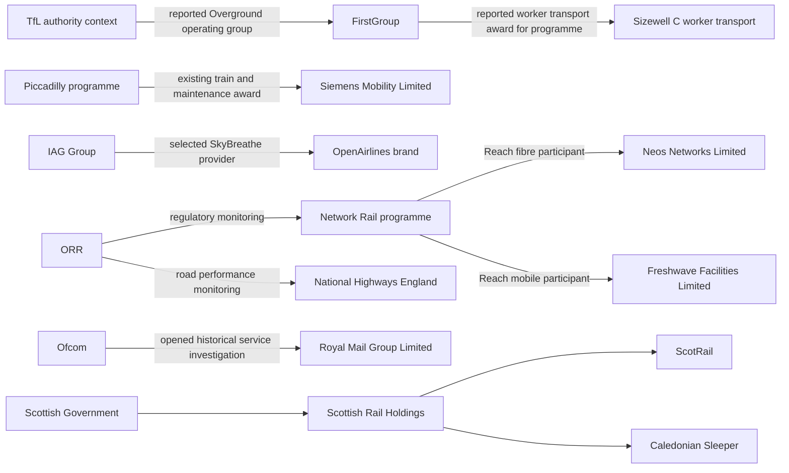

# Directed relationships and unresolved joins

Use [Relationships.json](Relationships.json) for individual source, endpoints, direction and date. All supported edges are **research candidates**, not accepted relationships. Registry numbers establish entities, not contracts. No edge has a fabricated value, expiry or exact signature authority.

Telecoms: Reach is specific project evidence, not general outsourcing. Manufacturing/aerospace: Siemens train manufacturing/support is evidenced; no aircraft engine/customer contract added. Technology: IAG platform selection is evidenced but legal signatory, date and commercial terms are open. Government: ownership/sponsorship/monitoring are distinct from buyer-supplier contracts. Energy: FirstGroup’s Sizewell worker-transport programme association does not identify the legal customer or establish an energy supply contract. Banking/finance: no named financing edge verified; do not link a lender from an industry provider list. All six requested cross-sector categories are assessed, with unsupported joins explicitly withheld.

Physical airport links and intermodal terminals are service/dependency context, not proof of a commercial supply agreement. ABP/DP World co-location is not ownership. Global DHL divisional figures do not attach to the UK company. Relationship uncertainty must survive any later diagram or package handoff.
