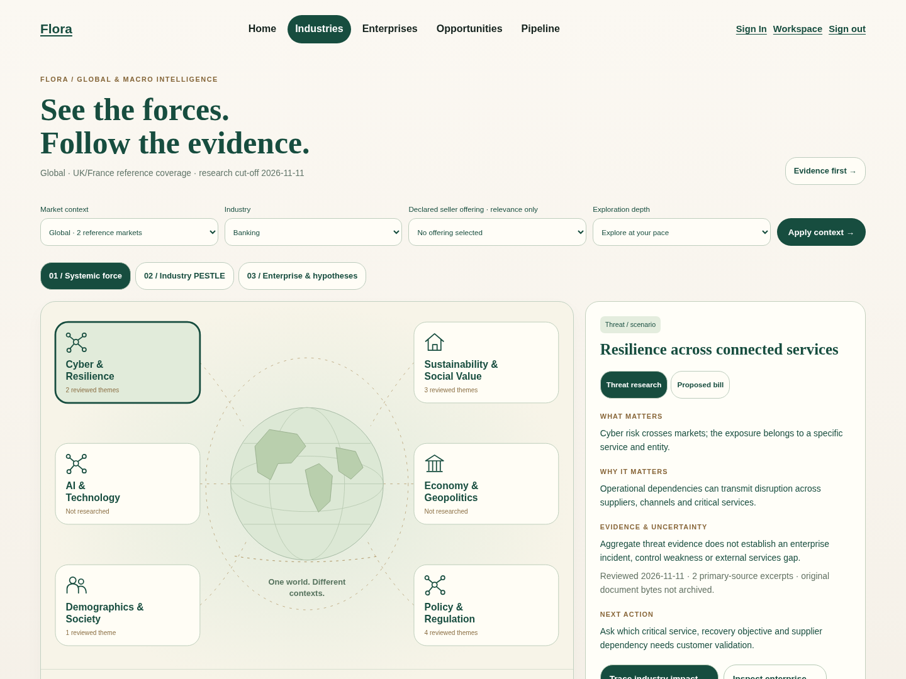
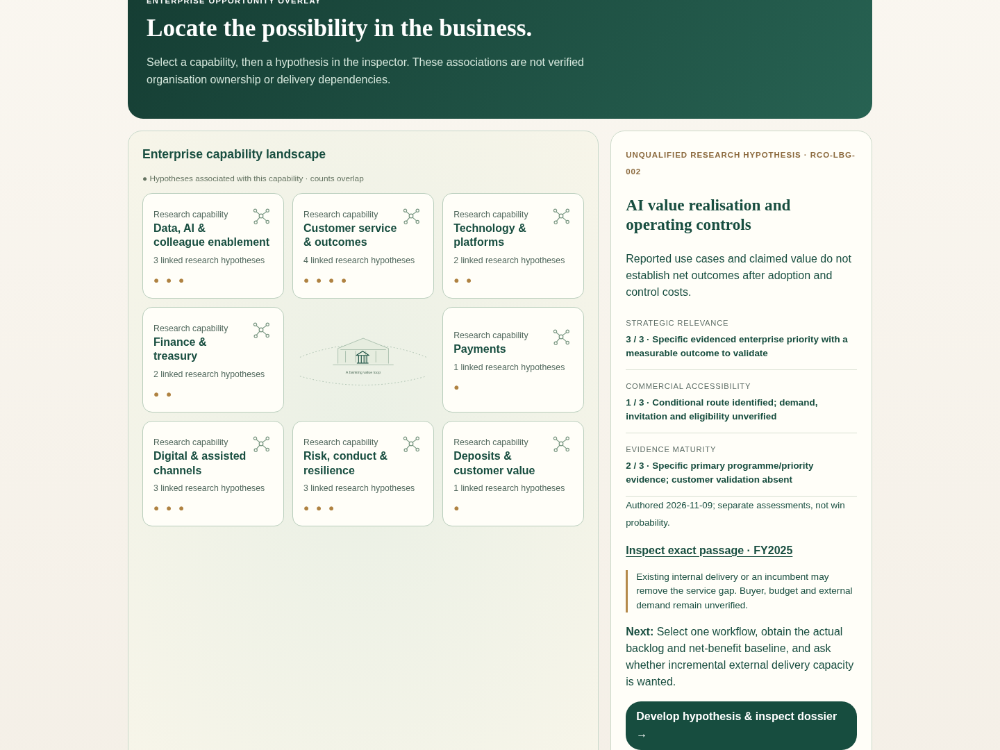
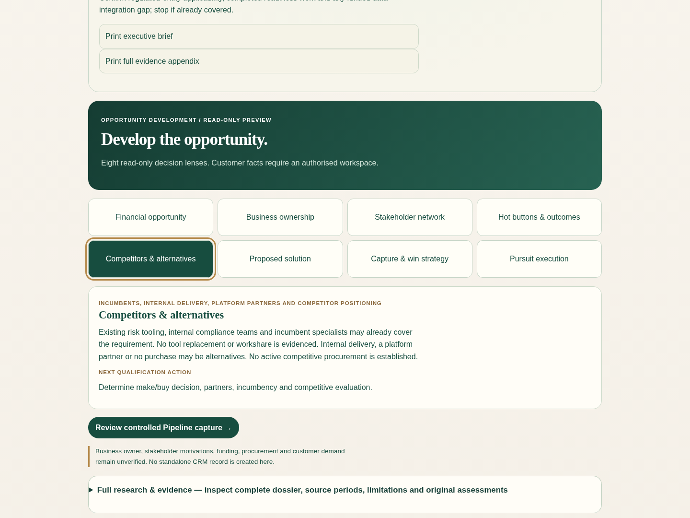

# Integrated owner acceptance gallery

Actual Chromium captures from the running integrated application. Desktop **1440×1080**, tablet **1024×768**, phone **390×844**; tablet/phone use touch emulation and reduced motion. First images start at page top; selected images scroll to the contextual inspection. No mock-up, composite screen, production credential or customer record is used.

Pipeline screens contain an explicitly **synthetic local test identity/workspace** and one deliberately captured original research hypothesis. They do not demonstrate customer-qualified demand or production provisioning.

## Global forces to enterprise intelligence

The original atlas, illustrated Industry/Enterprise assets and finite public navigation remain. Country coverage, jurisdiction, precise entity identity, formal applicability, business consequence and buying evidence remain separate.

| Screen | Desktop first / selected | Tablet first / selected | Phone first / selected |
| --- | --- | --- | --- |
| Global / six-force atlas | [First](previews/global-desktop-first.png) · [Inspect](previews/global-desktop-selected.png) | [First](previews/global-tablet-first.png) · [Inspect](previews/global-tablet-selected.png) | [First](previews/global-mobile-first.png) · [Inspect](previews/global-mobile-selected.png) |
| UK scoped Macro / entity inspection | [First](previews/macro-desktop-first.png) · [Inspect](previews/macro-desktop-selected.png) | [First](previews/macro-tablet-first.png) · [Inspect](previews/macro-tablet-selected.png) | [First](previews/macro-mobile-first.png) · [Inspect](previews/macro-mobile-selected.png) |
| Banking Industry Twin | [First](previews/banking-desktop-first.png) · [Inspect](previews/banking-desktop-selected.png) | [First](previews/banking-tablet-first.png) · [Inspect](previews/banking-tablet-selected.png) | [First](previews/banking-mobile-first.png) · [Inspect](previews/banking-mobile-selected.png) |
| Lloyds Enterprise Twin | [First](previews/enterprise-desktop-first.png) · [Inspect](previews/enterprise-desktop-selected.png) | [First](previews/enterprise-tablet-first.png) · [Inspect](previews/enterprise-tablet-selected.png) | [First](previews/enterprise-mobile-first.png) · [Inspect](previews/enterprise-mobile-selected.png) |
| Lloyds opportunity overlay | [First](previews/overlay-desktop-first.png) · [Inspect](previews/overlay-desktop-selected.png) | [First](previews/overlay-tablet-first.png) · [Inspect](previews/overlay-tablet-selected.png) | [First](previews/overlay-mobile-first.png) · [Inspect](previews/overlay-mobile-selected.png) |
| AI hypothesis | [First](previews/ai-desktop-first.png) · [Inspect](previews/ai-desktop-selected.png) | [First](previews/ai-tablet-first.png) · [Inspect](previews/ai-tablet-selected.png) | [First](previews/ai-mobile-first.png) · [Inspect](previews/ai-mobile-selected.png) |
| Cyber/resilience hypothesis | [First](previews/cyber-desktop-first.png) · [Inspect](previews/cyber-desktop-selected.png) | [First](previews/cyber-tablet-first.png) · [Inspect](previews/cyber-tablet-selected.png) | [First](previews/cyber-mobile-first.png) · [Inspect](previews/cyber-mobile-selected.png) |
| Eight-module development cockpit | [First](previews/cockpit-desktop-first.png) · [Inspect](previews/cockpit-desktop-selected.png) | [First](previews/cockpit-tablet-first.png) · [Inspect](previews/cockpit-tablet-selected.png) | [First](previews/cockpit-mobile-first.png) · [Inspect](previews/cockpit-mobile-selected.png) |

Phone Banking uses the existing equivalent-text control when the large illustration is hidden. Native controls, meaningful status labels and the selected intelligence panel remain available. This is not a claim of equal desktop/phone visual richness or physical iPad/Safari acceptance.

## Opportunity and controlled development

The cyber hypothesis now reuses the same visual story, eight modules and explicit dossier as the approved priority views. Business owner, stakeholder motivations, financials, customer need, supplier mandate and buying route stay unverified unless evidenced. No new opportunity ID or automatic Pipeline record.

## Authorised Pipeline — synthetic test workspace only

| Viewport | Record first viewport | Qualification inputs | Pipeline list |
| --- | --- | --- | --- |
| Desktop | [Record](previews/pipeline-desktop-first.png) | [Inspect](previews/pipeline-desktop-selected.png) | [List](previews/pipeline-desktop-list.png) |
| Tablet | [Record](previews/pipeline-tablet-first.png) | [Inspect](previews/pipeline-tablet-selected.png) | [List](previews/pipeline-tablet-list.png) |
| Mobile | [Record](previews/pipeline-mobile-first.png) | [Inspect](previews/pipeline-mobile-selected.png) | [List](previews/pipeline-mobile-list.png) |

The actual server-rendered capture form includes CSRF and uses an existing verified test session. Deliberate capture starts **Discovered**; all ten qualification inputs are present. An incomplete Qualified submission is rejected with the existing **422 validation response**, and the saved record remains Discovered. Duplicate capture returns the original record and immutable provenance. Before/after storage hashes are recorded in browser results; no synthetic demo seeding tool was run.

## Matched pre-integration comparison

Before is draft #566 at `111600a56ca0edba0d47d1a8a0c92068060d83a8`: Macro v2 plus integrated-main application, before the #557/#561 combination. It is not an assertion that those features were absent from their separate draft builds.

| Screen | Desktop before | Tablet before | Phone before |
| --- | --- | --- | --- |
| Scoped Macro | [Before](previews/before-macro-desktop-first.png) | [Before](previews/before-macro-tablet-first.png) | [Before](previews/before-macro-mobile-first.png) |
| Enterprise | [Before](previews/before-enterprise-desktop-first.png) | [Before](previews/before-enterprise-tablet-first.png) | [Before](previews/before-enterprise-mobile-first.png) |
| AI hypothesis | [Before](previews/before-ai-desktop-first.png) | [Before](previews/before-ai-tablet-first.png) | [Before](previews/before-ai-mobile-first.png) |

[Actual structural measurements](UX-Measurements.json): desktop standalone overlay height **3,565 → 1,440 px**; default Enterprise **4,236 → 5,667 px**; AI **3,128 → 3,486 px**; cyber **3,690 → 3,559 px**. Each tested default has one visible h1, no open full dossier and no horizontal overflow. The longer Enterprise page retains both approved views; no claim of uniformly reduced scrolling, faster human comprehension or increased sales conversion.

## Actual executive and full-evidence exports

| Context | Executive | Full evidence |
| --- | --- | --- |
| UK Macro / Lloyds entity trace | [2 pages](previews/macro-executive.pdf) | [15 pages](previews/macro-appendix.pdf) |
| France reporting / unresolved entity | [2 pages](previews/france-executive.pdf) | [11 pages](previews/france-appendix.pdf) |
| Banking | [1 page](previews/banking-executive.pdf) | [24 pages](previews/banking-appendix.pdf) |
| Lloyds Enterprise | [1 page](previews/enterprise-executive.pdf) | [40 pages](previews/enterprise-appendix.pdf) |
| AI hypothesis | [1 page](previews/ai-executive.pdf) | [22 pages](previews/ai-appendix.pdf) |
| Cyber/resilience hypothesis | [1 page](previews/cyber-executive.pdf) | [20 pages](previews/cyber-appendix.pdf) |

These are real print outputs, checked for uncertainty, selected citations and restoration of disclosure state. Full appendices retain specialist detail and inefficient pagination; this is an explicit remaining UX debt.

[Browser journeys, PDF hashes and rejected-write receipts](previews/browser-results.json) · [Rendered-source manifest](previews/source-manifest.json) · [Exact history probes](History-Integrity-Probes.json)

## Three browser-tested personas

- **A / New industry seller:** UK cyber offering → Macro → Legal PESTLE → entity scope → existing Enterprise Twin → risk capability → RCO-LBG-005 → eight modules. Browser Back restores selected Macro context and declared offering. Relevance is not customer demand.
- **B / Industry expert:** direct Lloyds entry → capability → AI hypothesis → exact canonical source passage → full dossier. No mandatory Macro orientation.
- **C / Intermediate seller:** same French reporting force compared in UK/France → contextual PESTLE → unresolved exact entity → national source → Back, retaining force and offering. Outside coverage is not a legal exemption.

All three are exercised at all three viewport sizes. Banking/Aviation, Five Forces/value-chain, keyboard Enter, native touch, reduced motion, no-JavaScript research/development and direct evidence routes are also checked. These are automated journeys, not human commercial evaluation.

## Owner acceptance checklist — human evaluation outstanding

- [ ] Follow Global → Macro → Industry → Enterprise → existing hypothesis → development → authorised capture naturally.
- [ ] Explain what is sourced, interpreted, Unknown and still customer-validated.
- [ ] Assess visual hierarchy and the single contextual inspection across desktop/tablet/phone.
- [ ] Decide whether default Enterprise page length and phone text fallback need a later bounded UX increment.
- [ ] Assess all eight modules, next actions and supplier/internal-delivery alternatives for commercial usefulness.
- [ ] Inspect exact evidence and judge the executive/full exports useful.
- [ ] In an authorised evaluation workspace, confirm capture remains separate from customer qualification.
- [ ] Evaluate physical iPad/Safari, screen-reader operation and human comprehension.

No physical-device, screen-reader, timed-human-comprehension or owner-acceptance pass is claimed. This gallery supports draft evaluation, not deployment approval.
