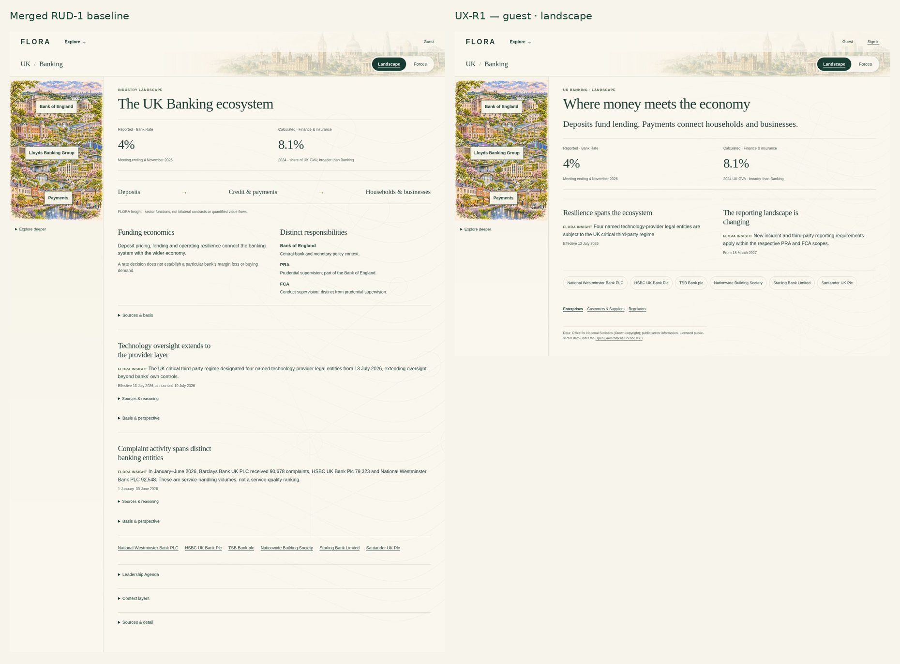
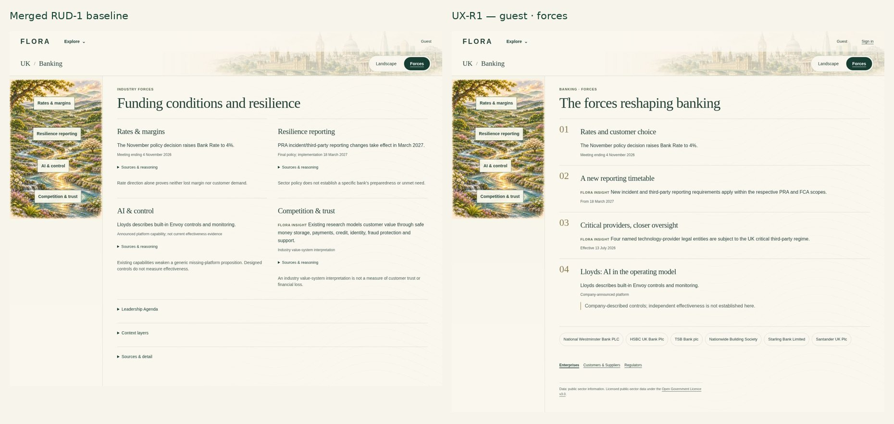
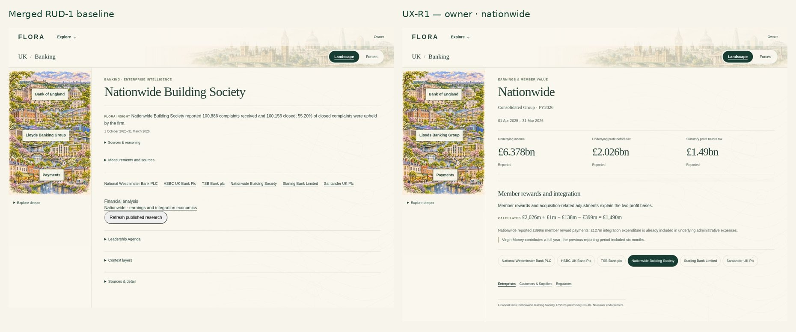

# Actual before/after application previews

Baseline: merged RUD-1 `93e83d34ee2661ebe17cbc06b047350f6c32e3c3`. After: this PR’s frozen implementation worktree. Final exact-SHA hosted artifacts reproduce these journeys. Isolated test accounts exercise the real session/ACL/Financial services; the monetary facts are genuine retained source-backed values. No production account, cookie, database, password or source archive is published.

## Desktop comparison

### Guest · Landscape

### Guest · Forces

### Owner · Nationwide

## Equivalent responsive views

Each cell links to full-page **before → after** screenshots. Mobile and portrait iPad retain a collapsible Left scene, with Main reading first.

| Role / screen | 1440 desktop | 1280 laptop | iPad landscape | iPad portrait | Mobile 390 | Mobile 320 |
|---|---|---|---|---|---|---|
| guest / landscape | [before](previews/before-guest-desktop-landscape.jpg) → [after](previews/after-guest-desktop-landscape.jpg) | [before](previews/before-guest-laptop-landscape.jpg) → [after](previews/after-guest-laptop-landscape.jpg) | [before](previews/before-guest-ipad-landscape-landscape.jpg) → [after](previews/after-guest-ipad-landscape-landscape.jpg) | [before](previews/before-guest-ipad-portrait-landscape.jpg) → [after](previews/after-guest-ipad-portrait-landscape.jpg) | [before](previews/before-guest-mobile-landscape.jpg) → [after](previews/after-guest-mobile-landscape.jpg) | [before](previews/before-guest-mobile-320-landscape.jpg) → [after](previews/after-guest-mobile-320-landscape.jpg) |
| guest / forces | [before](previews/before-guest-desktop-forces.jpg) → [after](previews/after-guest-desktop-forces.jpg) | [before](previews/before-guest-laptop-forces.jpg) → [after](previews/after-guest-laptop-forces.jpg) | [before](previews/before-guest-ipad-landscape-forces.jpg) → [after](previews/after-guest-ipad-landscape-forces.jpg) | [before](previews/before-guest-ipad-portrait-forces.jpg) → [after](previews/after-guest-ipad-portrait-forces.jpg) | [before](previews/before-guest-mobile-forces.jpg) → [after](previews/after-guest-mobile-forces.jpg) | [before](previews/before-guest-mobile-320-forces.jpg) → [after](previews/after-guest-mobile-320-forces.jpg) |
| guest / nationwide | [before](previews/before-guest-desktop-nationwide.jpg) → [after](previews/after-guest-desktop-nationwide.jpg) | [before](previews/before-guest-laptop-nationwide.jpg) → [after](previews/after-guest-laptop-nationwide.jpg) | [before](previews/before-guest-ipad-landscape-nationwide.jpg) → [after](previews/after-guest-ipad-landscape-nationwide.jpg) | [before](previews/before-guest-ipad-portrait-nationwide.jpg) → [after](previews/after-guest-ipad-portrait-nationwide.jpg) | [before](previews/before-guest-mobile-nationwide.jpg) → [after](previews/after-guest-mobile-nationwide.jpg) | [before](previews/before-guest-mobile-320-nationwide.jpg) → [after](previews/after-guest-mobile-320-nationwide.jpg) |
| owner / landscape | [before](previews/before-owner-desktop-landscape.jpg) → [after](previews/after-owner-desktop-landscape.jpg) | [before](previews/before-owner-laptop-landscape.jpg) → [after](previews/after-owner-laptop-landscape.jpg) | [before](previews/before-owner-ipad-landscape-landscape.jpg) → [after](previews/after-owner-ipad-landscape-landscape.jpg) | [before](previews/before-owner-ipad-portrait-landscape.jpg) → [after](previews/after-owner-ipad-portrait-landscape.jpg) | [before](previews/before-owner-mobile-landscape.jpg) → [after](previews/after-owner-mobile-landscape.jpg) | [before](previews/before-owner-mobile-320-landscape.jpg) → [after](previews/after-owner-mobile-320-landscape.jpg) |
| owner / forces | [before](previews/before-owner-desktop-forces.jpg) → [after](previews/after-owner-desktop-forces.jpg) | [before](previews/before-owner-laptop-forces.jpg) → [after](previews/after-owner-laptop-forces.jpg) | [before](previews/before-owner-ipad-landscape-forces.jpg) → [after](previews/after-owner-ipad-landscape-forces.jpg) | [before](previews/before-owner-ipad-portrait-forces.jpg) → [after](previews/after-owner-ipad-portrait-forces.jpg) | [before](previews/before-owner-mobile-forces.jpg) → [after](previews/after-owner-mobile-forces.jpg) | [before](previews/before-owner-mobile-320-forces.jpg) → [after](previews/after-owner-mobile-320-forces.jpg) |
| owner / nationwide | [before](previews/before-owner-desktop-nationwide.jpg) → [after](previews/after-owner-desktop-nationwide.jpg) | [before](previews/before-owner-laptop-nationwide.jpg) → [after](previews/after-owner-laptop-nationwide.jpg) | [before](previews/before-owner-ipad-landscape-nationwide.jpg) → [after](previews/after-owner-ipad-landscape-nationwide.jpg) | [before](previews/before-owner-ipad-portrait-nationwide.jpg) → [after](previews/after-owner-ipad-portrait-nationwide.jpg) | [before](previews/before-owner-mobile-nationwide.jpg) → [after](previews/after-owner-mobile-nationwide.jpg) | [before](previews/before-owner-mobile-320-nationwide.jpg) → [after](previews/after-owner-mobile-320-nationwide.jpg) |
| owner / financial | [before](previews/before-owner-desktop-financial.jpg) → [after](previews/after-owner-desktop-financial.jpg) | [before](previews/before-owner-laptop-financial.jpg) → [after](previews/after-owner-laptop-financial.jpg) | [before](previews/before-owner-ipad-landscape-financial.jpg) → [after](previews/after-owner-ipad-landscape-financial.jpg) | [before](previews/before-owner-ipad-portrait-financial.jpg) → [after](previews/after-owner-ipad-portrait-financial.jpg) | [before](previews/before-owner-mobile-financial.jpg) → [after](previews/after-owner-mobile-financial.jpg) | [before](previews/before-owner-mobile-320-financial.jpg) → [after](previews/after-owner-mobile-320-financial.jpg) |

## Owner before a run exists

One natural, contextual prepare action, with existing Owner/upload/Banking ACL and CSRF protections. Inspect-only has no prepare action. GET does not create a run.

[desktop](previews/after-owner-before-prepare-desktop.jpg) · [laptop](previews/after-owner-before-prepare-laptop.jpg) · [ipad-landscape](previews/after-owner-before-prepare-ipad-landscape.jpg) · [ipad-portrait](previews/after-owner-before-prepare-ipad-portrait.jpg) · [mobile](previews/after-owner-before-prepare-mobile.jpg) · [mobile-320](previews/after-owner-before-prepare-mobile-320.jpg)

## Print and text enlargement

[Nationwide Owner: before PDF](previews/before-owner-print-financial.pdf) → [after PDF](previews/after-owner-print-financial.pdf). [Guest Forces: before PDF](previews/before-guest-print-forces.pdf) → [after PDF](previews/after-guest-print-forces.pdf). [200% mobile text](previews/after-owner-mobile-200pct.jpg).

The PDFs are actual Chromium output, not mocked layouts. This environment did not open native details on printing; the owner’s browser/PDF cause remains unverified. [Print results](Print-Checks.json) and [disclosure metrics](Disclosure-Metrics.json) separate rendered words, retained markup, visible controls and source anchors.
