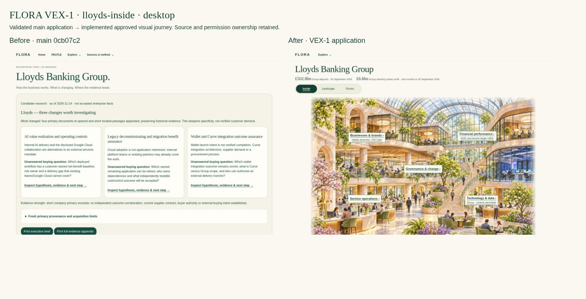
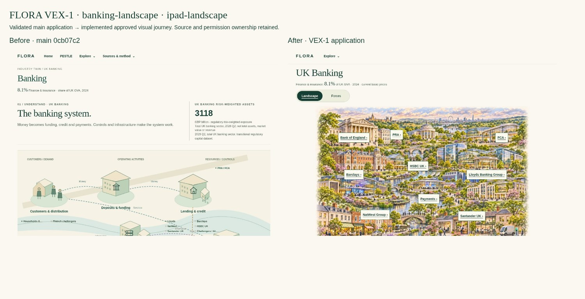
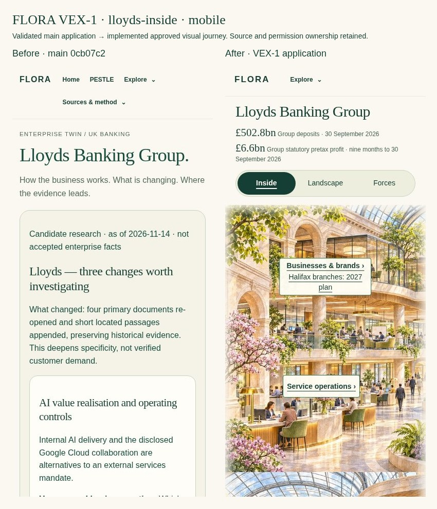
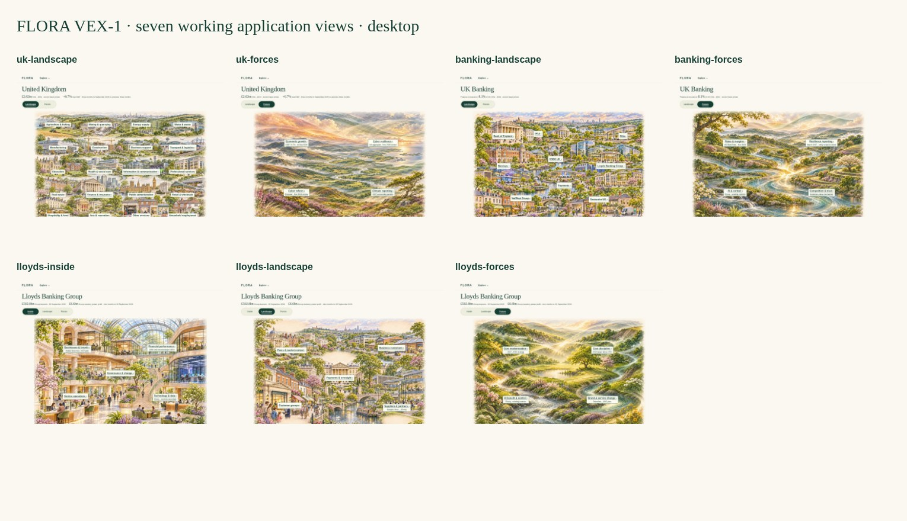

# FLORA VEX-1 — Visual journey implementation

Application implementation for [Issue #612](https://github.com/rdidale-jpg/CIOS/issues/612), using the accepted seven illustrations and navigation from design commit `c6bf2280594922db6951c5c36205984c85ca4aea`. **Draft for owner review; no merge or Render deployment.** Branch `codex/flora-vex1-612` starts from validated main `0cb07c2e78ccb16240c799b31cd62736e2135529`.

The primary application now follows **UK → Banking → Lloyds** in two selections. UK and Banking offer **Landscape | Forces**; Lloyds offers **Inside | Landscape | Forces**. A prominent contextual switcher sits above the artwork, separate from one compact global Explore menu. Current source-owner statements, metrics, dates, interpretations and unknowns remain distinct. This is a working, server-rendered application pilot, not the static HTML prototype and not a claim of a complete independently verified Commercial Digital Twin.

[Architecture, source-to-view mapping and changed-file overview](Architecture-and-Provenance.md) · [Main preflight evidence](Preflight.json) · [Source/control and artwork integrity](Boundary-Checks.json) · [Seven original image hashes](Accepted-Artwork.json).

## Before / after

Before images are the validated main application; after images are VEX-1 application renders, using isolated temporary data. Nothing is a Render/production screenshot.







[iPad portrait Banking](previews/ipad-portrait-banking-landscape-before-after.jpg) · [320px Lloyds](previews/mobile-320-lloyds-inside-before-after.jpg) · [UK desktop comparison](previews/desktop-uk-landscape-before-after.jpg).

## Seven live views



| View | Desktop 1440×1000 | iPad landscape 1194×834 | iPad portrait 834×1194 | Mobile 390×844 | Mobile 320×780 |
|---|---|---|---|---|---|
| Uk Landscape | [View](previews/desktop-uk-landscape.jpg) | [View](previews/ipad-landscape-uk-landscape.jpg) | [View](previews/ipad-portrait-uk-landscape.jpg) | [View](previews/mobile-uk-landscape.jpg) | [View](previews/mobile-320-uk-landscape.jpg) |
| Uk Forces | [View](previews/desktop-uk-forces.jpg) | [View](previews/ipad-landscape-uk-forces.jpg) | [View](previews/ipad-portrait-uk-forces.jpg) | [View](previews/mobile-uk-forces.jpg) | [View](previews/mobile-320-uk-forces.jpg) |
| Banking Landscape | [View](previews/desktop-banking-landscape.jpg) | [View](previews/ipad-landscape-banking-landscape.jpg) | [View](previews/ipad-portrait-banking-landscape.jpg) | [View](previews/mobile-banking-landscape.jpg) | [View](previews/mobile-320-banking-landscape.jpg) |
| Banking Forces | [View](previews/desktop-banking-forces.jpg) | [View](previews/ipad-landscape-banking-forces.jpg) | [View](previews/ipad-portrait-banking-forces.jpg) | [View](previews/mobile-banking-forces.jpg) | [View](previews/mobile-320-banking-forces.jpg) |
| Lloyds Inside | [View](previews/desktop-lloyds-inside.jpg) | [View](previews/ipad-landscape-lloyds-inside.jpg) | [View](previews/ipad-portrait-lloyds-inside.jpg) | [View](previews/mobile-lloyds-inside.jpg) | [View](previews/mobile-320-lloyds-inside.jpg) |
| Lloyds Landscape | [View](previews/desktop-lloyds-landscape.jpg) | [View](previews/ipad-landscape-lloyds-landscape.jpg) | [View](previews/ipad-portrait-lloyds-landscape.jpg) | [View](previews/mobile-lloyds-landscape.jpg) | [View](previews/mobile-320-lloyds-landscape.jpg) |
| Lloyds Forces | [View](previews/desktop-lloyds-forces.jpg) | [View](previews/ipad-landscape-lloyds-forces.jpg) | [View](previews/ipad-portrait-lloyds-forces.jpg) | [View](previews/mobile-lloyds-forces.jpg) | [View](previews/mobile-320-lloyds-forces.jpg) |

Full-page images include default closed disclosures. `-viewport.jpg` captures the initial fold. Equivalent before/after boards exist at all five sizes; seven zoom-width renders and an [Inside accessibility tree](previews/Inside-Accessibility.yml) are included.

## Performance findings

The original source art is unchanged in the reviewed design commit. Only deterministic proportional WebP variants are shipped for the new scene routes; the runtime has no image-generation or Pillow dependency. Only the current scene loads; the two halves share one responsive resource. Other streams are not prefetched.

Measured variant payloads (decimal KB):

| Scene | Accepted original KB | 768px KB | 1152px KB | 1536px KB |
|---|---:|---:|---:|---:|
| uk-landscape | 723.0 | 189.8 | 410.4 | 707.0 |
| uk-forces | 3841.3 | 165.9 | 351.2 | 613.4 |
| banking-landscape | 3935.3 | 206.7 | 422.3 | 675.0 |
| banking-forces | 4218.4 | 195.0 | 413.4 | 703.7 |
| lloyds-inside | 4081.2 | 191.6 | 410.6 | 688.2 |
| lloyds-landscape | 4243.0 | 195.8 | 417.4 | 714.6 |
| lloyds-forces | 4094.6 | 178.5 | 383.0 | 651.0 |

The 21 variants total **8.88 MB** on disk. At DPR 1, the 320px view selected 768px art, the 390px view selected 1152px art, and the 1440×1000 desktop selected 1536px art. Each chosen image stays between 166–715 KB in this variant set; the largest six PNG replacements are about 83% smaller at full source width. Original UK WebP already had compression; its largest variant saves little, while smaller screens benefit from responsive selection. The original 1536px resolution caps sharpness on large Retina displays; no artificial upscaling is claimed.

Pure content-addressed images have immutable cache/ETag responses; the warm Lloyds reload transferred **zero image bytes**. HTML, sources, account controls and code remain `no-store`. HTTP tests verify anonymous and authenticated image bytes match and contain no account data, and conditional requests return 304.

Cold emulated mobile connection: **1.6 Mbps, 150 ms RTT, DPR 1**, single loopback measurements:

| Entry | Before FCP ms | After FCP ms | Before image KB | After image KB | After art request ms |
|---|---:|---:|---:|---:|---:|
| uk-landscape | 540 | 608 | 723.0 | 410.4 | 2377 |
| banking-landscape | 816 | 596 | 0.0 | 422.3 | 2422 |
| lloyds-inside | 1960 | 588 | 0.0 | 410.6 | 2414 |

[Complete measurements](previews/Performance.json). Baseline Banking/Lloyds used inline graphics, so their image-transfer columns are zero; that is not a zero-cost page. The baseline harness uses HTTP and the candidate uses local TLS. FCP includes text/header paint, not completion of the illustration or LCP. These are single-run observations with local CPU/cache variability, not a statistically controlled production comparison, an SLA or proof of universal FCP improvement. No unapproved numerical performance target is invented. Real Safari/Retina, production network, LCP and image-quality acceptance remain manual.

## Validation and retained test contracts

[Browser evidence](previews/Browser-Checks.json): **2,580 assertions**, seven primary views at all five sizes, 35 responsive captures, exact native stream destinations with retained layers/selection, two-selection journey, Back/Forward, fresh deep links, no-JS detail, force-to-Inside pathway, sources/unknowns, keyboard/Tab/Enter/focus, touch, missing-image/text fallback, immutable-image reuse, global-menu Escape retaining the selected insight, seven effective 200% zoom-width views and forced-colour active state. No horizontal overflow, label collisions, stream/art overlap or application script errors were observed. Labels stay at least 14px; stream and interactive label targets have at least 44px height.

**53 new VEX-1 unit/HTTP cases** cover scope identity, exact sources/assets, active state, selectors/duplicates, private/foreign identity rejection, current-owner source injection escaping, unknowns, source staleness, withdrawn relationship suppression, no private Canvas/matching/network or Offers/Pipeline writes, verified account revocation, no-store HTML, pure public asset cache and unlisted/symlink asset denial. A broader focused run passed **132 tests** including visual-system, existing two-screen study, retained specialist and source-navigation contracts.

Full local and hosted security/regression CI must be read against the **exact final SHA in the draft PR and its Actions artifacts**. This document is committed before the final run so it does not pretend to contain its own Git hash. The unchanged gate requires **388 strict security passes**, the approved **36 inherited failures / 10 skips**, and **zero new failures or changed inherited signatures**. No comparator, baseline, strict security module or approved skip is changed. Final pass/fail, counts, SHA and hosted run URL are recorded in the PR completion report.

Five formerly passing presentation contracts are deliberately updated for the accepted defaults; their original intelligence remains tested:

| Existing test | Corrected expectation / retained protection |
|---|---|
| Unified industry/enterprise template selection | The prior operating-model template is tested through its explicit `lens=operating-model` deep link; the new default Inside is independently tested. |
| Unified current/historical/inferred evidence | All original evidence/status assertions remain on that retained specialist view. Current source facts and unknowns are separately tested in the new view. |
| Primary workspace Home route | Replaces the old decorative description with exact UK scope, Landscape default and all 20 sector labels. All other route checks remain. |
| Multi-industry enterprise return | Compares the canonical URL path while allowing the required retained-selection query. New tests assert the exact query. |
| Existing visual-family navigation | Existing SVG families continue to be tested at explicit `overview` / `operating-model` specialist deep links; new seven-view tests own the default image-stream contract. |

The Account Understanding link is preserved in optional source/detail inspection along with the research review and supporting models; the corresponding existing test remains unchanged. This restores navigation, rather than hiding a regression by removing its assertion. All approved inherited failure fingerprints remain the comparator's responsibility.

These checks are Chromium emulation and application tests, not physical iPad/VoiceOver/NVDA certification. The preflight full main security/regression run is [43522807793](https://github.com/rdidale-jpg/CIOS/actions/runs/43522807793); the final implementation run is linked from the new PR.

## Run locally and inspect

Use the existing approved FLORA development startup and isolated data configuration. Do not point preview tooling at production data. Native entry links in that local application are:

- `/` → UK Landscape; `/?stream=forces` → UK Forces.
- `/industries/banking` → Banking Landscape; `?stream=forces` → Banking Forces.
- `/enterprises/lloyds` → Inside; `?stream=landscape` / `?stream=forces` → parallel views.

Reproduce browser previews against validated-main worktree with existing project dependencies, Node Playwright and Chromium:

```sh
PYTHONPATH=. python tools/ci/flora_visual_streams_preview.py --output /tmp/vex1-review --baseline-root /path/to/validated-main
node tools/ci/flora_visual_streams_boards.cjs /tmp/vex1-review
python tools/ci/flora_visual_streams_boundaries.py
python -m pytest tests/test_flora_visual_streams_612.py -q
python tools/ci/flora_ci.py --output /tmp/vex1-exact-head-ci
```

The preview harness creates temporary test identity/storage and local-only TLS, cleans it afterwards and asserts no Offers/Pipeline writes. No production credentials/configuration or real customer data are needed or committed. Asset preparation is optional offline work: with Pillow 12.3.0 and the pinned design commit fetched, run `python tools/ci/flora_visual_stream_assets.py`. It reads source Git objects, never merges or edits PR #610.

## Design assessment and limits

Retained: exact source illustrations, architectural richness/palette, original UK labels and image-relative geometry, one scope identity, clear selected stream, current financial context and optional source inspection. The same shared presentation serves all seven views. Banking's ecosystem and banks remain one screen, and Enterprise Builder is not an extra journey step.

Improved: the design is now real guarded application navigation with current-owner data, reliable exact destinations, retained server-side URL context, responsive compression/cache, error fallback, private-owner negatives and existing product/account navigation. No browser-tab sales examples or prototype-only external live-site links are imported.

Limits: source depth is bounded. Inside is not a verified current legal hierarchy, leadership tree, complete operating/system inventory or quantified revenue/cost model. External customer roles are not named clients, and one announced supplier collaboration is not complete supplier coverage. Forces and entry questions do not establish buyer need, open procurement, external scope, budget, urgency or an early influence window. The nine research deficiencies remain unresolved. Optional source/model inspection can be lengthy; default screens remain image-led. Mobile folds the original image and needs scrolling. New default content is public source intelligence, not private imported Canvas content. No parallel private read model is introduced.

## Owner acceptance walkthrough

- [ ] Open UK: all 20 original labels remain; only the three available industry journeys have green interactive outlines. Switch Landscape/Forces and back in one action.
- [ ] Select Banking, then Lloyds directly. Confirm Inside opens in two selections from the default UK scene; no Groups or mandatory question page.
- [ ] Inspect Banking's five banks, BoE/PRA/FCA and payments context. Other banks open their existing profiles without invented extra streams.
- [ ] Switch Lloyds Inside → Landscape → Forces → Inside; the same enterprise and appropriate layer/selection persist. Back restores Banking's selected Lloyds.
- [ ] Open/copy a force/detail/layer URL; use browser Back/Forward. Test without JavaScript.
- [ ] Compare current deposits/profit with their periods; inspect the 2030 target and unknown current income/cost/growth. Confirm sources and all nine gaps remain available.
- [ ] Select a force and inspect its uncertainty/counterpoint and possible affected Inside area. No qualified sales claim or Pipeline action should appear.
- [ ] Review desktop, both iPad orientations, 390/320px, touch, keyboard, zoom and original-art sharpness. Complete real-device/assistive-technology and production-network review.
- [ ] Confirm global Offers, sales development, Pipeline, account switching and sign-out still reach their existing authorised owners.
- [ ] Accept this implementation visually and functionally before any merge or deployment decision.

## Rollback

Revert the implementation PR commit(s) through a reviewed GitHub change and run the same full CI. No migration or data rollback is needed: this sprint adds presentation assets/projection and changes no domain records. The prior main defaults, public catalogue and header are restored by the revert. Newly copied stream-query bookmarks may need their base URL reopened after rollback; existing specialist deep links remain available. Cached immutable images contain public artwork only and are not referenced by reverted HTML. Do not delete historical branches, evidence, source data, Offers or Pipeline records, and do not run destructive cleanup.

**No merge, Render deployment/restart/configuration change or production-data action is authorised or performed. PR #603/#609/#610 are untouched.**
