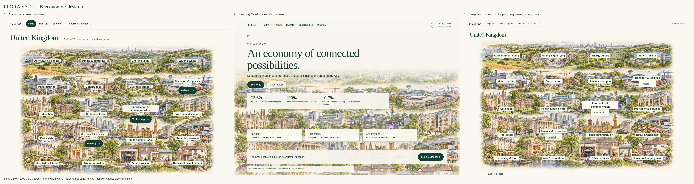
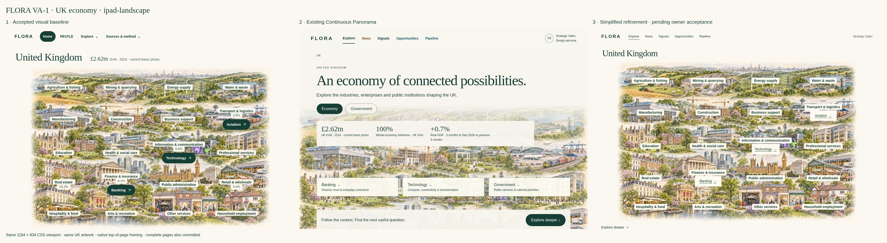
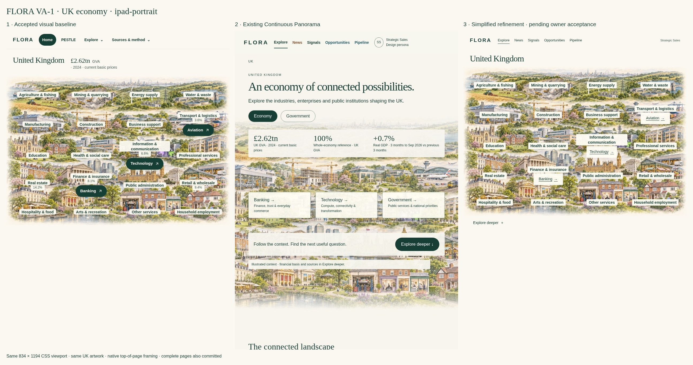
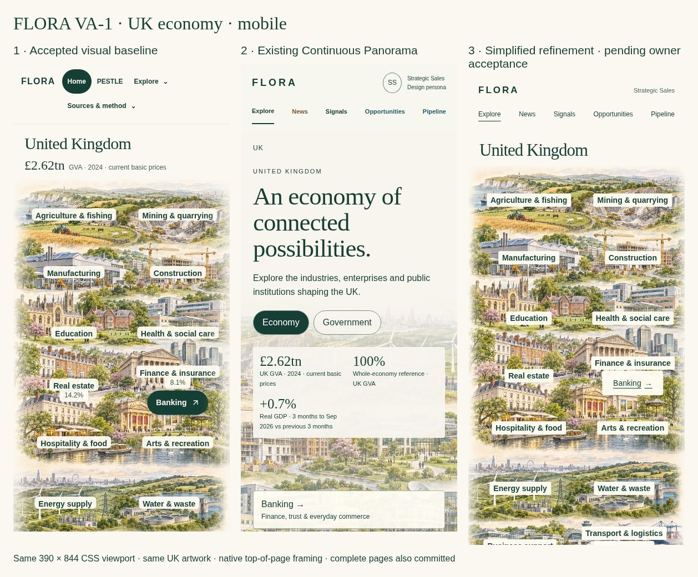

# VA-1 visual simplicity correction — owner review

Responds to [the owner's rejection of VA-1](https://github.com/rdidale-jpg/CIOS/pull/609#issuecomment-6878491819). **A / Continuous Panorama is a starting hypothesis, not an accepted finished design.** B/C are retained as historical design evidence; no new concept family or implementation sprint is introduced. The restrained revision below still requires visual owner acceptance.

## Three states, one comparison protocol

1. **Accepted visual baseline:** actual public anonymous `visual_v2.render` output from unchanged `origin/main` `0cb07c2e78ccb16240c799b31cd62736e2135529`. Only asset URLs are localised for reproducible static capture. Original CSS, labels, source disclosures and geometry are preserved. This is the accepted visual implementation, not a claim that every historical metric is newly verified.
2. **Existing A / Continuous Panorama:** untouched `a-uk.html` at `034e87735873db441ad2a247f013b8457058262e`. Its missing sector labels and extra wording remain visible in the comparison; they are not retroactively repaired in the middle column.
3. **One simplified A-minus refinement:** same UK image bytes and original sector positions; warm page/sky blending; one title, five quiet tools, role identity, sector labels and one contextual disclosure. No metric panel, sales tagline, card grid or visible technical explanation.

Same scope (UK economy), same artwork, same viewport, same browser, no JavaScript, no interaction before capture, top-of-page native framing. Nothing is individually zoomed or cropped to flatter a version. First-viewport boards preserve the exact captured dimensions; complete-page images are also committed. Existing A deliberately retains its original cover crop, content and page depth; the difference from the baseline's full-map framing is a visible design issue, not something concealed by altering the original. The refinement restores the baseline's whole-scene framing and left/right phone fold so all original sectors remain available. Native header/heading heights differ as part of the designs.

## Canonical comparison images

### Desktop — 1440 × 1000



[Full accepted baseline](previews/desktop-baseline.jpg) · [Full existing A](previews/desktop-panorama.jpg) · [Full refinement](previews/desktop-refined.jpg)

### iPad landscape — 1194 × 834



[Full baseline](previews/ipad-landscape-baseline.jpg) · [Full existing A](previews/ipad-landscape-panorama.jpg) · [Full refinement](previews/ipad-landscape-refined.jpg)

### iPad portrait — 834 × 1194



[Full baseline](previews/ipad-portrait-baseline.jpg) · [Full existing A](previews/ipad-portrait-panorama.jpg) · [Full refinement](previews/ipad-portrait-refined.jpg)

### Mobile — 390 × 844



[Full baseline](previews/mobile-baseline.jpg) · [Full existing A](previews/mobile-panorama.jpg) · [Full refinement](previews/mobile-refined.jpg)

The phone viewport naturally shows only part of the complete landscape; scroll through the unchanged two-half fold to reach Technology/Aviation and the remaining sectors. No tiny compressed all-sector overview is substituted. Full phone images above show that every label remains.

## Exactly what changed

| Retained | Restored | Removed from the default view |
|---|---|---|
| Original expansive UK artwork and London skyline | All **20 original industry names**, verbatim | Marketing headline, introductory slogan and descriptive sublabels |
| Continuous warm/light image-to-page treatment | Original image-relative sector coordinates and meaningful geography | Duplicate UK breadcrumb, uppercase level label, repeated headings |
| Explore / News / Signals / Opportunities / Pipeline | Full-scene framing; original left/right phone fold | Three metric boxes, 100% reference and GDP-growth slot |
| Strategic Sales experience identity, without permission effects | Three researched industry entry points: Banking, Technology, Aviation | Industry card grid and repeated navigation to the same places |
| Native keyboard links, focus, skip and progressive detail | Accessible text labels directly attached to the image | Default skyline-building diagram, actor lists and relationship explanations |
| Optional financial/source context and original research boundaries | One contextual **Explore deeper** action | Large dark controls, contrasting colour islands, default technical copy and design-persona caption |

The GVA figure is moved to optional financial detail, not deleted from the research or replaced. Actor concepts, Government, Forces of Change, tool destination notes and supporting evidence remain progressively available. Existing A industry/enterprise pages remain reference studies, not accepted follow-on designs. The three researched links remain distinct from inert context-only sectors; no unresearched sector becomes clickable. Navigation styling is quieter, while research links keep underlines, 44px targets and visible focus.

## Text-density and pixel review

Counts are reproducible in [Browser-Review.json](previews/Browser-Review.json). A word is a whitespace-separated token containing a letter/number; punctuation-only tokens are excluded. Screen-reader-only content, hidden disclosures and the unfocused skip link are excluded. **Default-visible** means the entire closed-disclosure page, including content below the fold; first-viewport counts are reported separately. This is not a claim that a minor count reduction alone proves beauty.

| Size | Baseline default words | Existing A | Refined | Baseline / A / refined first-viewport words |
|---|---:|---:|---:|---|
| Desktop | 60 | 150 | 53 | 60 / 88 / 53 |
| iPad landscape | 60 | 150 | 53 | 60 / 79 / 53 |
| iPad portrait | 60 | 150 | 53 | 60 / 91 / 53 |
| Mobile | 60 | 133 | 53 | 39 / 60 / 37 |

The refinement has **7 fewer default-visible words than the baseline** (~12%), and 97 fewer than desktop A (~65%), despite restoring all 20 sector labels. This is a modest reduction versus the already concise baseline; the major correction is removal of A's clutter and restoration of recognisable sectors. Actor explanations and finance remain optional rather than erased to reduce the count.

Rendered desktop and phone pixels were inspected: original sector names are legible on pale local text backings; Banking sits with the Bank of England/financial district, Aviation with transport, and Technology with information/communications. The illustration remains concept geography, not actual corporate locations or a relationship claim. Labels are at least 14px; automated checks also verify bounds, no district overlap, three 44px research targets and no horizontal overflow. iPad comparisons and equivalent 720px zoom-width capture are committed for owner inspection. Chromium does not certify Safari, physical iPad or VoiceOver/NVDA.

## Preservation and acceptance boundary

Only static design artifacts and a standalone review script change. No application, auth, source, canonical intelligence, matcher, employer/Offer, seller-development, Pipeline, historical assessment or deployment file is modified. Original A/B/C files and screenshots remain intact. The main-branch label IDs/positions, image bytes and frozen evidence are retained; there is no new metric, relationship, classification, approval or research promotion. The known rounded-weight source discrepancy remains for #607. #604 and #606–608 remain separate.

**Owner visual acceptance is required before implementation.** Review the actual comparison images and full pages on desktop/iPad/phone; judge immediate industry recognition, visual calm, image integration and next-action clarity. This revision does not claim owner acceptance or authorise implementation, merge or deployment.

Reproduce from repository root:

```sh
PYTHONPATH=. python docs/flora-runtime/visual-atlas-va1/simplicity/build.py
python -m http.server 8776 --bind 127.0.0.1 --directory docs/flora-runtime/visual-atlas-va1
# In a second terminal, with Playwright/Chromium installed:
node tools/ci/flora_visual_atlas_simplicity_preview.cjs
```

The static baseline export uses an isolated temporary data-directory setting and anonymous public rendering. No authenticated app, private record, live external source or Render service is contacted. [Comparison provenance](Comparison-Provenance.json) pins the image hash, original labels and source commits. For rollback, remove/revert this design correction; no application or data rollback exists because none changed.
