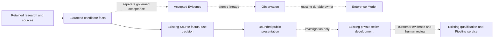

# From enterprise understanding to a real sales investigation

These are **owner research examples**, not new core-screen content, qualified Material Pressures, buying triggers, or Pipeline opportunities. Existing record IDs are referenced through Audit.json. No buyer name, budget, contract value, customer demand or supplier work package is inferred.

## What is actually connected

Solid arrows above describe the bounded read path or a retained candidate relationship, not an automatic production update. Dashed edges require their existing owners and applicable authority. The audit has not verified production canonical or private records. Navigation does not implement those data dependencies. Canonical promotion is not a prerequisite for ordinary lawfully permitted analytical facts, and public facts do not authorise private/consequential actions.

## Seven examinations of the commercial chain

| Example / existing evidence | Ambition, consequence and response | Capability, technology and suppliers | Decision and next investigation | Counter-evidence / disconfirming test | Current qualification |
| --- | --- | --- | --- | --- | --- |
| **Core renewal / application retirement:** `LBG-AR25-MIGRATION`, `LBG-A2030-PLATFORMS`; programme `PROG-LBG-LEGACY`; W3/Tier | Reported retirement/cloud direction and existing simplification. Service continuity is an analytical concern, not a proven Lloyds failure or missed milestone | Platform/change/service capabilities are conceptual associations. No verified application inventory, retirement tranche, critical dependency, assigned owner or incumbent contract | Role hypotheses: business service owner and technology/operations/change leadership. Ask which specific retirement tranche has an unresolved, measurable customer/service consequence beyond existing delivery | The programme already exists and may be succeeding. A disclosed planned retirement is neither pain nor an open work package. Reject an external intervention if the existing team/supplier already covers it | Research/investigation only; no materiality/consequence proof or customer-confirmed need |
| **Cloud migration:** current retirement commitment and `LBG-ENVOY-GOOGLE`; R2 supplier reality | A migration ambition and a Google collaboration are separately supported. Neither proves that a particular core workload is on that cloud or causes concentration risk | Only `REV-ENVOY-GOOGLE` is verified in the current graph, at reported collaboration scope. Google Cloud brand, designated provider legal entity and contracted service must not be collapsed | Ask for an evidenced workload/service boundary, accountable owner and remaining decision before proposing migration or assurance work | Existing cloud/platform capability and controls are positive evidence. Government provider designation is not Lloyds workload exposure. No displacement or greenfield platform sale follows | No qualified Pressure or opportunity; contract/workload applicability missing |
| **AI industrialisation:** current reported FY2025 contribution, 2026 expectation, Envoy controls; Tier F11/F22 and R2 adoption notes | There is an installed capability story to investigate, not an absence of AI. Reported contribution/expected value is not a net economic return | Distinguish M365 licences, GitHub engineer footprint, Envoy and specific business use cases. Existing controls do not establish effectiveness, model risk failure, adoption or net productivity | Role hypotheses: business process owner, finance and AI/technology assurance. Ask which use case has an agreed outcome baseline, full run/change/control costs and an evidenced residual gap | The Group reports benefits and has an existing platform. Reject a proposition that merely duplicates those capabilities or treats the 2026 expectation as delivered value or external spend | Public thesis only. Real customer evidence and additionality remain unestablished |
| **Payments and Curve:** `LBG-Q326-CURVE`, wallet priority, Tier transaction-banking remit | Acquisition completion is already a decision taken. A future wallet objective may change customer interaction, but integration outcome and open scope are not proven | Payments/customer interaction is a reasonable conceptual lens. No actual integration architecture, payment-service dependency or supplier workshare is established | Determine whether a named post-acquisition business outcome remains open, then identify the accountable role and actual decision. Do not sell “influence over the acquisition” after completion | Completion is not delivery failure, procurement or evidence of integration success. Existing teams/partners may already own all remaining work | No open procurement or qualified opportunity established |
| **Branch transformation:** `LBG-BRAND26-TIMING`, `LBG-BRAND26-NO-ROLES`; existing legal-bank complaints | Planned shared-access change is dated. The announcement's role-impact qualification is not a permanent workforce measure. Customer outcome has not been attributed to the branch change | Conceptual servicing/channel capabilities; no measured branch-to-process/system owner chain. FCA complaints are Lloyds Bank PLC, not Group/Retail or a branch cohort | Ask which customer journey and legal entity has a measured access/resolution objective and whether an unresolved delivery need remains | A branch announcement or complaint volume does not establish avoidable cost, customer harm, backlog clearance or buying intent. A process may already meet the intended outcome | Investigation only; no customer-confirmed gap |
| **Regulatory reporting / resilience:** PRA/FCA March 2027 context; Tier climate/AI guidance; CTP provider context | Dated external obligations can frame a decision only after regulated-entity applicability. No current Lloyds reporting failure, outage or noncompliance is established | Reporting/data/service/control capabilities are conceptual. No proven regulatory data lineage, critical third-party workload or remediation work package | First verify exact rule/entity/management response; then ask whether a measurable residual control or reporting problem exists and who can validate it | Regulatory change alone is not a qualified Pressure. Provider designation and relationship proximity cannot supply enterprise applicability or consequence | ADR-026 qualification remains separate and unexecuted; no automatic Opportunity |
| **Efficiency / cost reduction:** 2030 ratio/savings ambitions, LEI bridges, R2 Retail lease and pricing notes | Ambition is not actual cost or spend available to suppliers. Existing research records improved Group income/profit and disclosed mitigation, complicating a generic “bank under pressure” story | Potential asset-lifecycle, servicing and platform mechanisms need matched economic and role evidence. No capability-level financial allocation is supported | Recover the matched driver analysis; ask what explains the specific residual return or productivity variance after existing responses. CFO/business-owner role is a hypothesis, not buying authority | Lease mix/residual values, accounting basis and prior-period effects can explain movements without an unserved supplier need. Do not infer a £100m deal, distress or released budget | Financial candidates and commercial hypothesis only; qualification inputs incomplete |

## Edge-by-edge readiness

| Required connection | Current repository evidence | What remains missing |
| --- | --- | --- |
| Management ambition → enterprise issue | Current sourced ambitions and dated changes; LEI/R2 economic analyses | A supported enterprise-specific consequence on matched scope, not generic negative language |
| Issue → transformation priority | Five programme records and seven objective horizons | Decision/implementation/result chronology, work-package owner and evidence of remaining choice |
| Priority → affected capability | Ten conceptual capabilities and nine journeys | Verified company-specific role/process/capability binding |
| Capability → applications/infrastructure | Envoy/Copilot disclosures; a reported Google collaboration | Installed topology and workload criticality; whole-estate completeness is not available |
| Technology → supplier/contract | One verified reported relationship, four supplier catalogue names | Exact legal counterparty, contracted service, value, duration, renewal and remaining scope |
| Decision-maker → commercial investigation | Public professional roles in research; dated government CEO fact | Current accountable remit, access and delegated buying authority; role title alone is insufficient |
| Investigation → qualified opportunity | Existing Offer matching, seller development, customer attestation and reviewed Pipeline service | Authorised seller-specific records and dated customer evidence; independent need/accuracy are not proven by form completeness |

The existing nine public candidates and eight SWOT themes are not nine or eight sales opportunities. The actual number/status of private Lloyds opportunities is **unverified**, not asserted to be zero. This audit makes no private record lookup and writes no development or Pipeline state.

## Existing owners to reuse

Source eligibility and lifecycle remain in the existing Source/research adapters. Typed measures and calculation recipes remain in Financial Intelligence. Accepted Evidence → Observation → Enterprise Model ownership remains governed by ADR-002/010/011 and existing contracts. ADR-026 retains its six Material Pressure gates; an objective, a large figure, a programme or a negative adjective does not pass by itself. Existing Offers and `seller_development.qualification` retain employer/Offer approval, staleness, real customer distinctions, explicit review, ACL and authorised Pipeline hand-off. This report proposes neither a matcher nor a parallel qualification/ripple engine.

Source-policy scope, epistemic quality and canonical acceptance must stay separate in any later implementation. Keep source dates, actuals/targets, alternative explanations and falsifiers internally traceable while presenting only meaningful eligible intelligence on the executive canvas. Investigation questions here belong in authorised research/seller context, not automatically in the default executive view.
