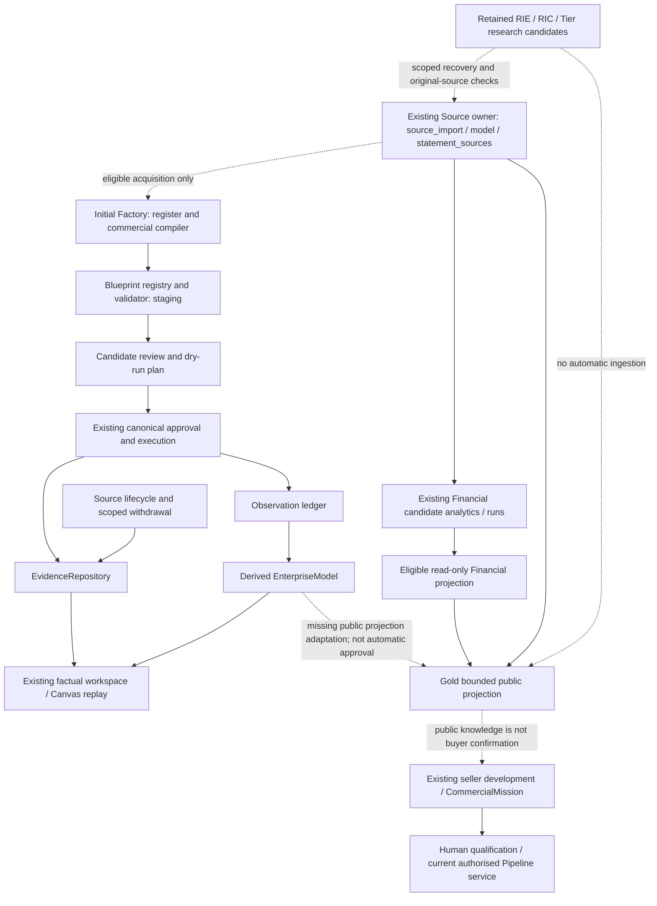

# Research-to-intelligence traceability

Solid arrows describe implemented mechanisms; dashed arrows describe proposed integration or a boundary requiring a decision. A navigation link is not a model dependency.

## Implemented ownership and boundaries

| Route | Existing implementation | Persistent owner / authority | Finding |
| --- | --- | --- | --- |
| Commission → extracted register / disclosure records | `research_intelligence/initial_factory.py`, `commercial_factory.py`; `tools/research/initial_factory.py` | Blueprint proposal records, not accepted intelligence | Implemented, including explicit replay lane and held financial source |
| Package → candidate staging → reviewed plan | `blueprint_import` registry, validator, CandidateReviewService, DryRunPlanningService | Existing staging and audit artifacts | Implemented; validation is not execution authority |
| Approved plan → Evidence / Observation / model | `blueprint_import/promotion.py`, `memory/repository.py`, `memory/service.py` | Evidence JSONL, authoritative Observation ledger and derived model snapshots | Implemented; proof uses the same CanonicalPromotionService **only inside temporary directories** with existing test identity fixture |
| Model → factual workspace / Canvas | `memory/views.py`, `enterprise_canvas/service.py` | Read projections over existing repositories | Implemented, with separate access and source qualifications |
| Model → optional route proof | `memory/commercial_views.py` | Read-only replay; development flag plus membership plus resource ACL | Implemented test lane; not public Gold or a production publication permission |
| Original source revision → withdrawn projection | `research_intelligence/source_lifecycle.py`, EvidenceRepository | Owner-maintained document revisions; unavailable/changed versions fail closed | Implemented for revision-bound `commercial_change` evidence; **legacy commercial replay lacks these bindings** |
| Source → typed Financial analysis | `financial_intelligence/candidate_analytics.py` | Existing permitted selection/input binding and Financial-run access | Implemented; calculation/persistence permission is separate from reading an isolated number. No new run in this sprint |
| Public source/claim → Gold | `intelligence_presentation.py`, `visual_streams.py`, `lloyds_gold.py`, `leadership_agenda.py` | Existing bounded eligible public projection | Implemented, not a live traversal of every EnterpriseModel or historical research pack |
| Public intelligence → seller development → Pipeline | `seller_development.py`, `commercial_mission.py`, `sales_pipeline.py` | Private versioned development, customer attestation, qualification and existing Pipeline authority | Implemented controlled lifecycle, not activated by reading research; no changes here |

Paths in the table are relative to `cios/applications/flora/` unless explicitly under `tools/`. Accepted ADR-026 gates and existing Source/Financial/IAM ownership remain unchanged. ADR-027 remains Proposed.

## Why research appears disconnected

1. **Intentional boundary:** a research package, migrated JSON filename, test approval or valid checksum does not grant canonical ownership, publisher-use authority or public/private access.
2. **Missing integration:** current Gold selects a bounded set of public claims; there is no implemented generic connection from all retained RIE/Tier research or model attributes into Gold. Commercial and IP&I direct fact lists remain thin even though research exists.
3. **Incomplete source binding:** a legacy replay checksum identifies a reviewed claim bundle, not publisher bytes. Automatic revision withdrawal cannot be claimed for that lane. Existing Evidence withdrawal works, and the separate revision-bound factory tests cover Source withdrawal.
4. **Unverified operational state:** production model/workspace bindings and actual import receipts are unavailable. We cannot diagnose a failed production import from repository records alone.
5. **Presentation defect, separately diagnosed:** the `.canvas-technology` selector collision constrains a title to 65px. It does not explain the missing Source/model/Gold data connections. No CSS fix is included.

## Smallest intended next route

Resolve original-source applicability and exact entity/workspace binding for **one non-financial divisional or operating slice** under existing owners. Bind real source revisions, then project eligible existing model/Source output through the existing public presentation policy into the current Gold component. Re-evaluate withdrawal on every representation. Preserve the existing six semantic types and independently record canonical status. Do not import candidate interpretations merely because the renderer can display them.

The adapter would be a bounded read projection, not another research engine, financial engine, source registry, opportunity lifecycle or universal requirement for canonical promotion. A source owner can authorise ordinary lawful factual analysis through an existing reusable use category; stronger canonical admission remains a distinct optional process.
